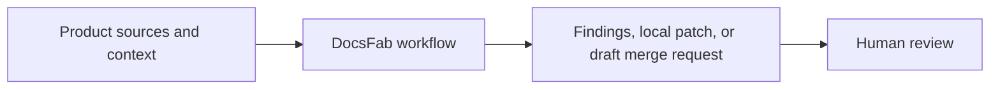

> **Early-access alpha.** This curated export is not accepting contributions. Public issues are welcome; pull requests are not merged. Refer to [CONTRIBUTING.md](CONTRIBUTING.md) for details and [SECURITY.md](SECURITY.md) to report vulnerabilities privately, never in a public issue. Source code is licensed under [Apache-2.0](LICENSE); skill instructions and documentation are licensed under [CC-BY-4.0](LICENSE-CC-BY-4.0). See [NOTICE](NOTICE) for license scope and third-party notices.

The [reusable skill license](packages/skills/LICENSE) and
[knowledge skill license](packages/knowledge/skills/LICENSE) keep the license
terms with skills used independently of this repository: instructions and
documentation use CC-BY-4.0, and scripts and other source code use Apache-2.0.
The [canonical template-set license](packages/quality/formats/template-set-v1/LICENSE)
and its [generated runtime copy](packages/runtime/quality/formats/template-set-v1/LICENSE)
likewise cover template documentation/assets under CC-BY-4.0 and source code
under Apache-2.0. Both template copies retain those terms when the templates
are distributed on their own or staged into the runtime package.

# DocsFab

**Turn product knowledge into documentation people can trust.**

DocsFab is an NVIDIA Developer Blueprint in early access. It helps teams use product evidence to create, update, and review documentation. Each job keeps its claims connected to the sources and checks that support them.

## Start Locally

You need Node.js 24.21.0 or later, npm, and Git on macOS or Linux. Native Windows is unsupported; Windows users can use Ubuntu on WSL2 with Linux tools. Some required checks need Linux with `/usr/bin/bwrap` and working unprivileged user namespaces. macOS has no required-check backend in this alpha. Refer to the [Support Matrix](docs/reference/support-matrix.md) for details.

Install DocsFab from this repository's source checkout. Use the clone URL shown on the repository page:

```bash
git clone <repository-clone-url> docsfab
cd docsfab
npm --prefix packages/runtime ci
npm install --global ./packages/runtime
```

You can explore workflows without configuring a model:

```bash
docsfab --help
docsfab list
```

For a model-backed session, configure a provider, model, and API key. Then open the repository you want to document and start an inspection-only conversation:

```bash
docsfab setup
cd /path/to/your-repository
docsfab live-agent --read-only
```

Without a terminal, or with `--json`, bare `docsfab setup` on a host without a model selection stops with `setup-model-choice-required`. Choose a provider and model with `--provider` and `--model`, or select a profile with `--profile`.

The live agent allows documentation edits by default. `--read-only` disables edits and host commands. Model-backed work requires credentials for OpenAI, Anthropic, or a compatible endpoint. Refer to [Install DocsFab](docs/get-started/installation.md) for platform requirements and setup details.

## How a DocsFab Job Works

DocsFab gathers evidence, runs a bounded documentation workflow, and leaves a result for a person to review.



## Where You Can Work

DocsFab can inspect a local checkout hosted on GitHub or GitLab. Local review and `--patch-only` delivery work without a GitLab remote. In this alpha, write workflows can open GitLab draft merge requests; GitHub pull request delivery is not available.

## Choose Your Next Step

| To… | Start here |
| --- | --- |
| Install DocsFab and configure a model | [Installation](docs/get-started/installation.md) |
| Inspect before making changes | [Live Agent Quickstart](docs/get-started/live-agent-quickstart.md) |
| Run a named workflow and keep a local patch | [Runner Quickstart](docs/get-started/runner-quickstart.md) |
| Explore workflows and their steps | [Workflow Discovery](docs/get-started/discover-workflows.md) |
| Understand the product and its boundaries | [Docs index](docs/README.md), [architecture](docs/about/architecture.md), and [support matrix](docs/reference/support-matrix.md) |

Package guides: [runtime](packages/runtime/README.md), [knowledge](packages/knowledge/README.md), [quality](packages/quality/README.md), and [skills](packages/skills/README.md).

## License

DocsFab source code is licensed under [Apache-2.0](LICENSE). Skill instructions and documentation use [CC-BY-4.0](LICENSE-CC-BY-4.0) where marked. Refer to [NOTICE](NOTICE) for license scope and third-party notices.
