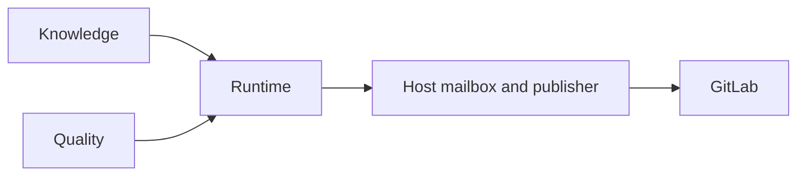

DocsFab combines product knowledge, documentation workflows, and quality
checks to produce a reviewable result. Knowledge and quality supply inputs
to the runtime; a separate host channel delivers results to GitLab. For
product orientation, refer to [NVIDIA DocsFab Documentation](index.md).

The following diagram shows knowledge and quality inputs entering the runtime,
then a finished result reaching GitLab through host delivery.

The package relationship is `knowledge → runtime ← quality`. Runtime consumes
knowledge and quality inputs without owning either store. Delivery has its own
authorization boundary.

## Components

The following table summarizes each component's role.

| Component | Role |
| --- | --- |
| Knowledge | Registers attributed sources, reconciles conflicts, and versions the product reference model. |
| Runtime | Binds a named job to pinned inputs and allowed tools, executes its workflow, and retains the result. |
| Quality | Supplies locked writing, review, evaluation, and deterministic-check inputs to the job. |
| Host | Posts review notes or opens draft merge requests through separately authorized GitLab delivery. |

Documentation skills supply reusable procedures, and page templates guide
content organization. A host router can select these for its agent; DocsFab
binds its own workflow, skill catalog, and quality inputs. Refer to
[Execution Boundaries](../reference/architecture.md#host-skills-and-templates).

## Data Flow

A named workflow follows this sequence.

1. Bind the requested outcome, repository revision, documentation targets,
   workflow, and allowed operations.
2. Prepare a disposable workspace from tracked files at that revision.
3. Execute the workflow steps with their pinned inputs and allowed tools.
4. Retain a run record, findings, and any documentation patch.
5. Deliver the result only when the separate delivery prerequisites pass.

The model proposes responses and tool calls; runtime controls their execution.
For the detailed boundaries, refer to
[Request Binding](../reference/architecture.md#bind-the-request-first) and
[Result Delivery](../reference/architecture.md#from-result-to-delivery).

## Deployment Topologies

The current product runs locally. Hosted proposals remain an intended
integration, as the following table distinguishes.

| Interface | Purpose | State and Guide |
| --- | --- | --- |
| Local CLI | Submit a named workflow or a natural-language request. | Current product; follow the [Workflow Quickstart](../get-started/runner-quickstart.md). |
| Local live agent | Work in a persistent conversation over a local repository. | Current product; follow the [Live Agent Quickstart](../get-started/live-agent-quickstart.md). |
| Hosted CI proposals | Intended: start revision-bound documentation work from a repository event. | Integration pending; refer to [Automatic CI Proposals](../workflows/automatic-ci-proposals.md). |

## External Integration Points

Each integration supplies a distinct capability around the job.

### GitLab

GitLab receives review notes on existing merge requests or a draft merge
request containing a documentation patch. These delivery paths retain separate
authorization checks. Refer to
[GitLab Integration](../reference/architecture.md#gitlab).

### Model API

An explicit composition selects the model route, transport, and session
adapter. The model receives the tools and context allowed for its step.
Refer to [Model API Boundaries](../reference/architecture.md#model-api).

### Fern Site

Fern renders the documentation site. Preview, publication, and product
release remain separate from delivering a documentation patch. Refer to
[Fern Site Delivery](../reference/architecture.md#fern-site).

### Credential Boundary

Host-owned adapters retain credentials outside model prompts and durable
evidence. Refer to
[Credential Boundaries](../reference/architecture.md#credential-boundary) and
[Security and Trust](security.md).

## What Failure Looks Like

A job records why it cannot finish and what can unblock it. Missing product
input, a failed check, and a capability boundary require different actions.
Refer to [When a Job Stops](core-concepts/job-stops.md). Detailed operator error
contracts belong in the
[Architecture Reference](../reference/architecture.md#what-failure-looks-like).

Operator output can direct `migration-required` here when an artifact needs
the current schema version. Refer to the
[Migration Contract](../reference/architecture.md#what-failure-looks-like)
before retrying.

## Related Topics

Continue with the following pages for more detail.

- [DocsFab Architecture](../reference/architecture.md): admission, workspace,
  delivery, and integration contracts.
- [Documentation Jobs](core-concepts/documentation-jobs.md): job identity,
  results, and authority.
- [Workflow Contracts](../reference/workflow-contracts/index.md): ordered steps
  for each catalog job.
- [DocsFab Implementation Status](../reference/status-and-configuration/implementation-status.md): capability evidence and release boundaries.
