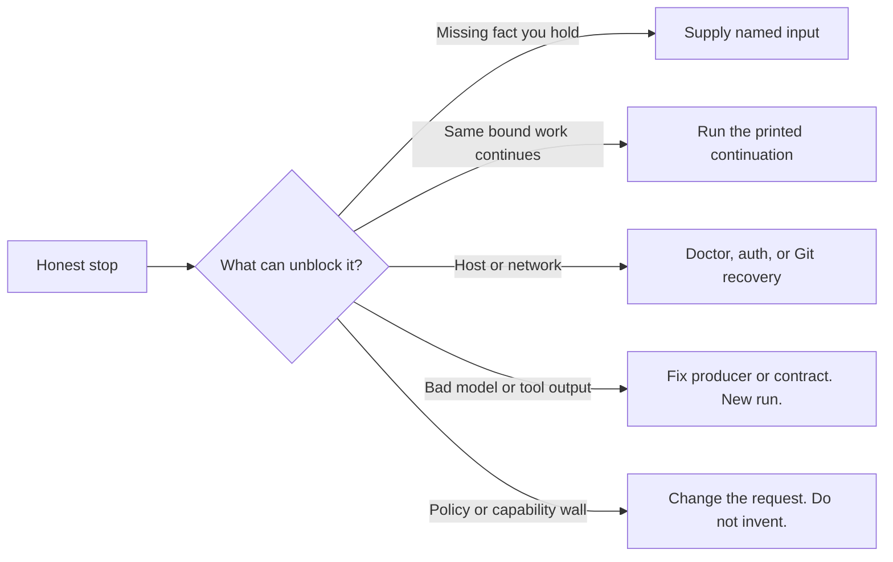

A job stop records why work cannot finish and what can unblock it in
[DocsFab](../index.md). Read the stop before retrying so you can distinguish
missing input from a failed check or a capability boundary.

A stop preserves the gap instead of inventing intent or hiding a skipped
check. Your documentation task remains incomplete. An unsupported limit or a
broken continuation can still be a product defect; recording it does not make
the requested journey successful. For related concepts, refer to
[Core Concepts](../index.md#core-concepts).

## A Stop Is Not a Crash

A stop is honest, incomplete work. It is not a crash, and it is not a
successful documentation change. A job can stop before it starts, when
DocsFab cannot bind your request to one catalog job. It can also stop after it
starts, when a step finds that the pinned evidence cannot support the bound
target.

When load-bearing product intent is missing, the job stops with
`needs-input`. DocsFab keeps the original task, so you can supply the missing
input and resume the same bound work. Resuming does not grant write, publish,
or merge authority.

## Three Separate Results

Do not infer readiness from the process exit code alone. A run reports the
following three separate results:

- **Execution status**: Did the workflow run to completion, fail, or pause for
  input or a decision?
- **Product disposition**: Is the documentation outcome ready, or is it
  `not-ready`, `needs-input`, `inconclusive`, or `blocked`?
- **Publication status**: When the job delivers a patch, did delivery
  succeed?

A run can succeed in execution while the product is not ready. Read each
result separately.

## What Can Unblock a Stop

Every stop belongs to one of five handling kinds, based on what can unblock
it.

Use the matching kind. Do not retry a supply stop as if it were a transient
failure. Do not resume a producer defect with the same inference. Do not ask
for input when the wall is a missing capability.

## Walls and Supply Stops

Some stops cannot be answered with more input from you. A wall is a missing
capability or a policy boundary, such as a provider that rejects the request
or evidence the job cannot obtain. When a wall stops a run, narrow or retarget
the request, wait for the capability, or accept the incomplete outcome. Do not
retry the unchanged request.

A supply stop is different: it names input that you hold, such as a work
product or a product decision. When a run has both a wall and a missing input,
the supply stop owns the next action.

## Classify a Specific Stop

The command output names the stop. If the output has a run ID, inspect the
saved run with `docsfab runs show <run-id>`. To match the output to a stop
class and its next action, refer to
[Stop Classes in DocsFab](../../reference/status-and-configuration/stop-classes.md).

## Related Documentation

For more information, refer to the following pages:

- [Answer and Resume a Stopped Job in DocsFab](../../workflows/answer-and-resume.md)
- [Documentation Jobs in DocsFab](documentation-jobs.md)
- [Troubleshooting DocsFab](../../troubleshooting.md)
