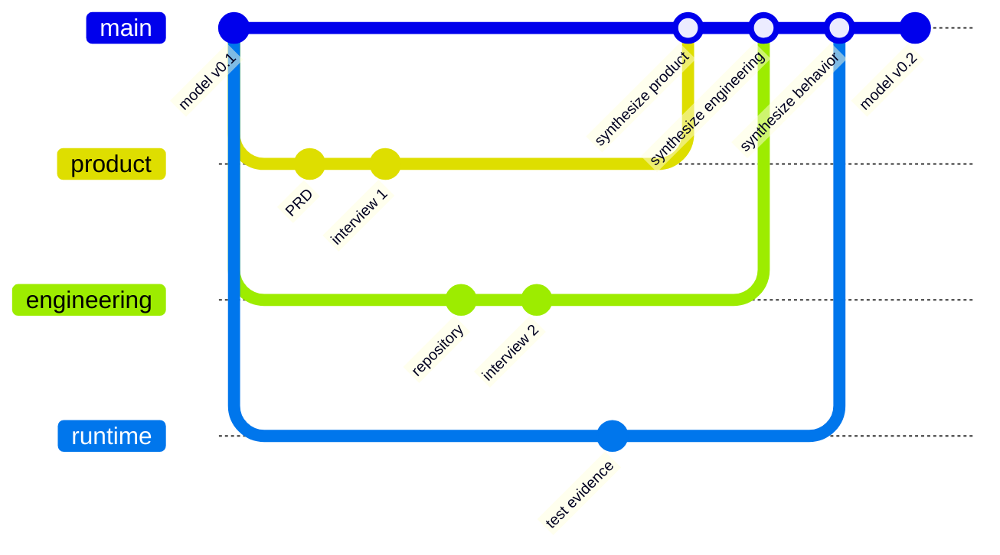

Product knowledge connects claims about a product to their sources, scope,
and unresolved questions in [DocsFab](../index.md). A product reference model
organizes that knowledge as the canonical, versioned representation of shared
product understanding.

Use the model to inspect what supports a claim before you document it.
Claims, relationships, terminology, diagrams, conflicts, and decisions remain
traceable to evidence. Each immutable version preserves the evidence and
decisions used to create it; generated documentation is a reader view of that
model. For related concepts, refer to [Core Concepts](../index.md#core-concepts).

## Source Threads

A source thread is the stable lineage for one identifiable evidence origin.
The origin can be a person, repository, runtime, organization, artifact, or
observation set. A thread can contain many documents, interviews, diagrams,
tests, corrections, and derived representations over time. An existing
requirements document can be registered as a source thread.

Product knowledge is fragmented and scoped. A product manager can explain
audience and purpose, an engineer can describe one component, code can show
current behavior, and a test can verify a narrow invariant. None of those
sources is automatically the complete truth, so DocsFab keeps each origin as
an independently inspectable thread. The design resembles version control:
source threads behave like evidence branches, synthesis compares their heads
to create a candidate shared model, and inconsistencies behave like merge
conflicts that require explicit resolution.

The following diagram shows three source threads that synthesis combines into
a new model version without flattening their origins.

## Evidence, Model, and Projections

DocsFab keeps the following three layers distinct.

| Layer | Primary question | Examples |
| --- | --- | --- |
| Source evidence | What did this origin provide, and under what scope? | Interviews, requirements, diagrams, repositories, tests, and observations |
| Product reference model | What shared claims and relationships does the selected evidence support? | Purpose, concepts, components, workflows, constraints, decisions, conflicts, and open questions |
| Projections | How should a reader inspect or apply the model? | Documentation, diagrams, glossaries, summaries, and readiness views |

Projections remain traceable to a model and evidence boundary. A diagram or
page that conflicts with current evidence creates a finding; it does not
silently redefine the model.

## Synthesis and Conflicts

Synthesis compares atomic claims within a declared product region, version,
audience, and documentation target. Compatible claims can enter the candidate
model together. Meaningful differences become inconsistencies, classified by
behavior, intent, terminology, scope, version, representation, or
documentation quality.

An adjudication can do one of the following:

- Accept one variant.
- Supersede an outdated variant.
- Rescope variants so both remain valid.
- Preserve product or deployment variants.
- Defer a decision and block only dependent outputs.

Behavior conflicts require version-bound behavior evidence. Intent conflicts
require an accountable intent authority. Representation disputes return to
the represented source or participant. Adjudication is not a vote.

Every synthesis produces three reviewable outputs: a candidate model version
with normalized claims, an inconsistency report (including an explicit
no-conflict result), and a merge receipt that names the exact source items,
versions, decisions, and inferences it used. For the step-by-step procedure,
refer to
[Reconcile Source Threads in DocsFab](../../workflows/reconcile-source-threads.md).
For the file formats, refer to
[Reference-Model Package in DocsFab](../../reference/knowledge-and-delivery/knowledge/reference-model-package.md).

## Claims and Versions

A consequential claim includes enough context for another person or agent to
evaluate it safely. The following table lists that context.

| Context | What it establishes |
| --- | --- |
| Statement | The normalized product assertion. |
| Source claims and evidence | The exact statements, observations, or inferences that support it. |
| Scope | Applicable product version, deployment, audience, region, or release. |
| Conflict and decision state | Whether alternatives exist and how they were resolved or deferred. |
| Verification state | Whether representation, behavior, intent, or another dimension has been checked. |
| Model state and version | Whether the claim is candidate, unresolved, approved, or superseded, and where it appears. |

Representation, behavior, and intent remain separate. A participant can
confirm that an interview reflection represents their view without proving
the implementation. A test can verify behavior without approving product
purpose.

The model is shared because it gives one inspectable reference point for a
defined scope. Shared does not mean unanimous: agreement by several people
does not make a claim correct, and contributors do not need identical mental
models.

Each synthesis creates a new immutable model version that names its
predecessor. Synthesis appends a version; it does not rewrite the earlier one,
and rejected variants stay in history. A candidate model can support clearly
labeled design documentation, but it does not become an approved product
specification or proof of implemented behavior because documentation was
generated from it.

## Approval Boundaries

Passing one approval boundary does not certify another. The following table
lists the boundaries.

| Boundary | Required question |
| --- | --- |
| Representation | Does the record faithfully represent its source? |
| Behavior | Does version-bound evidence support the behavior claim? |
| Intent | Has an accountable product authority approved the intended meaning? |
| Editorial | Have blocking documentation findings been resolved or explicitly dismissed? |
| Release | Is the page accepted for the named documentation release? |
| Publication | Is delivery to the target surface authorized? |

Knowledge gathering does not have a universal definition of done. DocsFab
uses a target-specific threshold: enough evidence to create a high-quality
output for a named audience, page, and release. A later iteration can reopen
the target when its assumptions or evidence change. This approach permits
progress without claiming that the shared product model is complete or
permanently correct.

## How Documentation Uses the Model

Documentation generation selects the claims required for one reader outcome
and combines them with verified behavior evidence. Different page types need
different evidence. For the evidence each page type needs before drafting,
refer to
[Evidence Before Drafting](documentation-quality.md#evidence-before-drafting).

Review and use findings map back to affected pages, model claims, and source
evidence. This connection lets DocsFab improve the product understanding and
the documentation together.

## Related Documentation

For more information, refer to the following pages:

- [Gather Product Knowledge](../../workflows/index.md#gather-product-knowledge)
- [Reference-Model Package in DocsFab](../../reference/knowledge-and-delivery/knowledge/reference-model-package.md)
- [Source-Thread Registry in DocsFab](../../reference/knowledge-and-delivery/knowledge/source-thread-registry.md)
