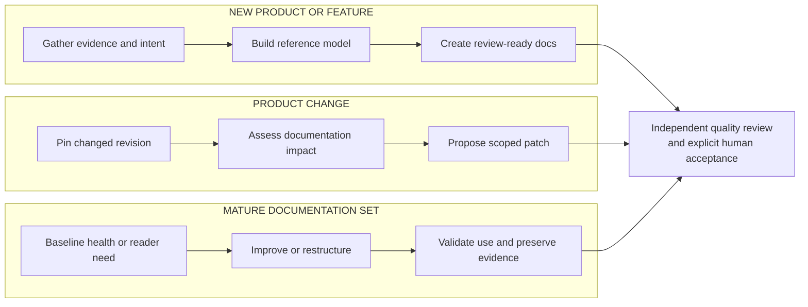

Use DocsFab to stand up documentation, keep it current with a product change,
or assess and improve an existing set. Each goal leads to a reader journey
and one or more catalog jobs. For product orientation, refer to
[Overview of DocsFab](index.md).

A journey starts with the person who needs an outcome. Engineers, reviewers,
product managers, and subject-matter experts can contribute evidence or
acceptance at different points along that journey.

<Warning title="In-development scope">
This page describes intended product goals. Which jobs are publicly
runnable today is recorded in
[DocsFab Implementation Status](../reference/status-and-configuration/implementation-status.md)
and
[Documentation Jobs in DocsFab](core-concepts/documentation-jobs.md).
</Warning>

## Three Use Cases

Choose the outcome you need from the following table.

| Use Case | Starting Goal | Result to Inspect |
| --- | --- | --- |
| Stand up documentation | Create the first documentation for a new product or feature. | A grounded page or short set, with source and quality evidence for review. |
| Keep documentation current | Assess documentation impact or update pages beside a product change. | Revision-bound findings, a scoped patch, or evidence that no update is needed. |
| Trust and improve the set | Establish a health baseline, improve a page, restructure, or validate reader use. | Separate findings and quality results, with missing evidence kept visible. |

The following diagram shows the evidence and review shared by the three paths.

## Journeys

Each use case contains more specific journeys with an accountable starting role.

### Stand Up Documentation

The following journeys create grounded documentation for a new product or
feature.

| As a role, I want to… | So that |
| --- | --- |
| As a docs contributor, I want to produce first documentation for a new product | the team can ship a grounded set from requirements, code, diagrams, and interviews |
| As an engineer, I want to document a new feature on a product that already exists | readers get a page or short set for the approved feature, not a wholesale rewrite |

A product manager or subject-matter expert joins when intent is missing.
Refer to
[Source Threads](core-concepts/product-knowledge.md#source-threads).

### Keep Documentation Current

The following journeys keep documentation aligned with bounded product and
evidence changes.

| As a role, I want to… | So that |
| --- | --- |
| As a reviewer, I want to see documentation impact on my merge request before it merges | missing or stale docs are visible as read-only, source-linked findings on that MR |
| As an engineer, I want to propose a grounded documentation update beside my code change | only the affected pages are patched, and a human still accepts the draft MR |
| As a product manager, I want to answer a missing-intent question so a blocked documentation job can resume | the original job continues on a new attributed model version instead of inventing product truth |
| As a documentation owner, I want to correct documentation from review, support, or usage signals (later-track) | drift becomes a bounded follow-up job rather than an unattended rewrite |

The last journey is later-track. Repository owners retain merge and
publication authority. Refer to
[Delivering Results](core-concepts/documentation-jobs.md#delivering-results)
and
[A Result Grants No Authority](core-concepts/documentation-jobs.md#a-result-grants-no-authority).

### Trust and Improve the Set

The following journeys assess or improve an existing documentation set.

| As a role, I want to… | So that |
| --- | --- |
| As a documentation leader, I want to get a health and readiness baseline before I invest or release | gaps are versioned and lens-separated, not collapsed into one readiness score |
| As a docs contributor, I want to improve one existing page | a clarity or style fix ships as a small patch when product truth is not in question |
| As a docs lead, I want to restructure a mature documentation set | readers can find their way without a content-destroying rewrite |
| As a documentation owner, I want to validate that the intended audience can use the documentation | a new, changed, or high-risk experience has direct evidence, or an explicit insufficient-evidence result |

Audience validation is a gate on other journeys as often as it is a
standalone request. Refer to
[Approval Boundaries](core-concepts/product-knowledge.md#approval-boundaries)
and
[Evidence Before Drafting](core-concepts/documentation-quality.md#evidence-before-drafting).

## Catalog Jobs

Journeys use these catalog jobs. Identifiers stay stable even when a public
workflow is still missing. Workflows implement jobs. Disk presence of a skill
is not a job. The following table lists the catalog jobs.

| ID | As a role, I want to… |
| --- | --- |
| UC1 | As a product manager, engineer, or docs contributor, I want to establish a shared understanding of the product from fragmented evidence |
| UC2 | As a docs lead, I want to plan a documentation release or information architecture before anyone writes |
| UC3 | As an engineer or docs contributor, I want to create documentation for a new product or feature |
| UC4 | As an engineer or docs contributor, I want to update documentation for a product change |
| UC5 | As an engineer, reviewer, or maintainer, I want to review documentation impact before a change merges |
| UC6 | As a docs contributor, I want to improve one existing page |
| UC7 | As a docs lead, I want to restructure a mature documentation set |
| UC8 | As a documentation leader, I want to establish a health and readiness baseline for a documentation set |
| UC9 | As a documentation owner, I want to validate that the intended audience can find, understand, and use the docs |
| UC10 | As a documentation owner, I want to keep documentation current from review, support, and usage signals |
| UC11 | As an accountable product participant, I want to resolve missing or conflicting product intent |

The catalog links product goals to runtime work. Public workflow names and
execution boundaries are described in
[Documentation Jobs](core-concepts/documentation-jobs.md#catalog-jobs).
For the installed set, run `docsfab list`. Cosmetic polish belongs in an update
job; it is not a separate public catalog identifier.

## Choose an Entry Point

Use the local CLI for a named or natural-language workflow request, or the
local live agent for a persistent conversation. Automatic GitLab CI proposals
remain intended, with integration pending. Slack is a pilot adapter, and MCP
is planned. An interface does not create a new use case or grant authority.

For interface capabilities and evidence states, refer to
[Reach DocsFab](key-features.md#reach-docsfab). For hands-on procedures, refer
to [About DocsFab Workflows](../workflows/index.md).

## What Is Not a Use Case

The following requests describe a surface, platform operation, or adoption
journey instead.

| As a role, I want to… | What that actually is |
| --- | --- |
| As an operator, I want to run DocsFab from the CLI or live agent | An entry surface. Refer to [Choose an Entry Point](#choose-an-entry-point) |
| As an operator, I want to run DocsFab from Slack or MCP | A pilot or planned adapter |
| As a maintainer, I want to activate a repository | A platform operation |
| As an operator, I want to deploy DocsFab safely | A platform operation |
| As an evaluator, I want to compare a workflow or model revision | A platform operation |
| As a first-time user, I want to run one governed job | An adoption journey. Refer to [Install DocsFab](../get-started/installation.md) |

## Next Steps

Use these pages to connect the intended journeys to product and
implementation details.

<CardGroup cols={2}>
  <Card title="DocsFab Overview" href="/about">
    Return to the [Overview of DocsFab](index.md).
  </Card>
  <Card title="Key Features" href="/about/key-features">
    Look up capabilities by outcome in [Key Features](key-features.md).
  </Card>
  <Card
    title="Documentation Jobs"
    href="/about/core-concepts/documentation-jobs"
  >
    Learn how a journey becomes a bounded run in
    [Documentation Jobs in DocsFab](core-concepts/documentation-jobs.md).
  </Card>
  <Card
    title="DocsFab Implementation Status"
    href="/reference/status-and-configuration/implementation-status"
  >
    Check
    [DocsFab Implementation Status](../reference/status-and-configuration/implementation-status.md)
    before treating a preview as the product.
  </Card>
</CardGroup>
