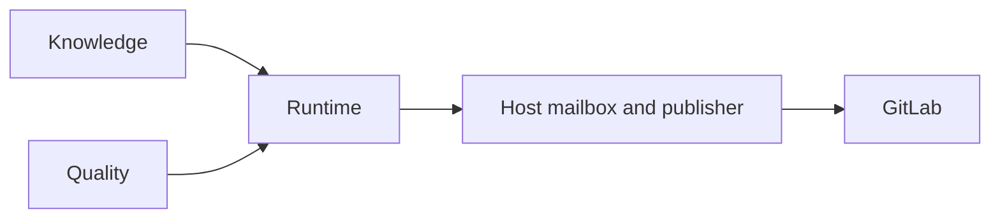

Use this reference for the detailed contracts between DocsFab components.
For the component roles and the overall data flow, start with
[Architecture Overview for DocsFab](../about/architecture.md).

DocsFab combines product knowledge, documentation workflows, and quality
checks to produce a reviewable result. The runtime executes the job; a separate
host channel delivers findings or a patch to GitLab. For product orientation,
refer to [Overview of DocsFab](../about/index.md).

The package relationship is `knowledge → runtime ← quality`. Use this page to
understand the components, data flow, and delivery boundaries before choosing
an interface or integrating a job.

<Note title="Implementation boundary">
The local command-line interface (CLI) and local live-agent are the
current repository-tested product surfaces. Hosted continuous-integration
proposals are intended, with integration pending. For the exact evidence
boundary, refer to
[DocsFab Implementation Status](status-and-configuration/implementation-status.md).
</Note>

## High-Level Architecture Diagram

The following diagram shows the product topology. Knowledge and quality are
inputs. Runtime is the executor. Host is the GitLab delivery channel.

Knowledge supplies attributed evidence and a versioned product model.
Quality supplies locked writing, review, and evaluation inputs. The runtime
binds one catalogued job to those inputs and returns a reviewable result.
Host then posts a note or opens a draft merge request. It does not rewrite
product meaning.

## Functional Layers

Each layer has a distinct responsibility. The runtime consumes knowledge and
quality inputs without owning either store.

| Layer | Responsibility | Learn More |
| --- | --- | --- |
| Knowledge | Registers attributed evidence, reconciles conflicts, and versions the product reference model. | [Product Knowledge](../about/core-concepts/product-knowledge.md) |
| Runtime | Binds a catalogued job to pinned inputs and allowed tools, then retains a run record and optional patch. | [Documentation Jobs](../about/core-concepts/documentation-jobs.md) |
| Quality | Supplies locked writing, review, evaluation, and deterministic-check inputs to the job. | [Documentation Quality](../about/core-concepts/documentation-quality.md) |
| Host | Posts review notes or opens draft merge requests through separately authorized GitLab delivery. | [Documentation Delivery](knowledge-and-delivery/delivery/documentation-delivery.md) |

A host executes routed documentation skills with its own tools, model, and
execution evidence. A DocsFab job uses its catalog-bound tools, pinned inputs,
and run record. Installing a skill or template collection does not activate
a DocsFab job. Host-owned adapters retain repository credentials outside the
model session.

## Data Flow

A named job moves from a bound request to retained evidence. Delivery follows
under its own authorization.

1. Bind the requested outcome, repository revision, documentation targets,
   workflow, and allowed operations.
2. Prepare a disposable workspace from tracked files at that revision.
3. Run the workflow steps with their pinned knowledge, quality inputs, and
   allowed tools.
4. Retain a run record, findings, and any documentation patch.
5. Deliver the result only when the separate delivery prerequisites pass.

For ordered workflow steps, refer to
[Workflow Contracts](workflow-contracts/index.md).

### Bind the Request First

Admission names the catalog job, the repository revision, and the authority
boundary. Write jobs also bind the instruction and the documentation
targets. The runtime then pins the workflow, the locked skill catalog, and
the locked quality pack. Those pins are the job. Files that happen to sit
on disk beside the checkout are not.

The worker receives a disposable, tracked-only workspace at that revision.
It does not receive a generic shell, a network grant, or a GitLab token.
Each workflow step receives only the tools that step is allowed to use. A
model response cannot add a tool, broaden the path set, or mint a delivery
grant. Plan admission checks every planned write against the run's write
roots. For the path rules, refer to
[The Write Scope](status-and-configuration/request-interpretation.md#the-write-scope).

If the request is not complete enough to bind, DocsFab does not start the
writer. For how DocsFab reports that stop, refer to
[When a Job Stops in DocsFab](../about/core-concepts/job-stops.md).

### From Result to Delivery

A finished job leaves a run record, findings, and, for authorized write work,
a Git patch. Host delivery turns that patch into a draft merge request only as
a separate step. Host rechecks the exact plan and patch immediately before it
changes GitLab, so a stale patch, a moved head, or a missing grant stops
delivery. For why a result grants no write, merge, or publication authority,
refer to
[A Result Grants No Authority](../about/core-concepts/documentation-jobs.md#a-result-grants-no-authority).

## Deployment Topologies

The current local interfaces share the runtime's workflow and authority
contracts. Hosted proposals remain an intended integration.

| Pattern | How You Work | Execution and Delivery Boundary | Start Here |
| --- | --- | --- | --- |
| Local CLI | Submit a named workflow or classify a natural-language request. | Workflow model steps use a disposable workspace. A write result can remain a local patch or proceed to separately checked draft-MR delivery. | [Runner Quickstart](../get-started/runner-quickstart.md) |
| Local live agent | Continue a conversation over a local repository. | Direct documentation edits are enabled by default. `--read-only` removes edit, write, and host-command tools. Invoked workflows retain their own boundaries. | [Live Agent Quickstart](../get-started/live-agent-quickstart.md) |
| Hosted CI proposals | Intended: start revision-bound work from a repository event. | Integration is pending. A proposal does not approve, merge, or publish its own output. | [Automatic CI Proposals](../workflows/automatic-ci-proposals.md) |

The live agent's approved host commands use the invoking user's existing Git
authentication. Those credentials stay outside model prompts. A conversation
can supply evidence, but it does not grant broader workflow or delivery
permission. Refer to [Security and Trust](security-and-trust.md).

## External Integration Points

DocsFab integrates with GitLab, a model API, and the Fern documentation
site. Each integration has a narrow job. None of them receives authority
that the DocsFab host did not already grant.

### GitLab

GitLab is the current forge. DocsFab uses it in two different delivery
shapes. Mixing those shapes hides the authority boundary.

The mailbox talks on an **existing** merge request. It can post a terminal
or needs-decision note, accept a mention that submits a catalogued job, and
project a review summary onto a frozen head. Mention text cannot mint write
authority. Chat text and merge-request text never grant publish or merge
authority.

The publisher creates or reuses a **draft** merge request. That path
delivers a successful write-job patch as a GitLab change. It is a later
host action, not a mailbox phase and not a workflow step.

Inbound GitLab events can start work only after the host maps the event to
a project and a principal. An event does not become a write grant.

### Model API

The runtime reaches a model through an explicit composition. The
composition binds the serving route, authentication route, transport,
session adapter, limits, and workflow. A model name does not select
credentials, and a throttled request does not silently fail over across
cost, privacy, or data boundaries.

The model receives the bounded workspace, the step tools, and the pinned
context for that step. It does not receive GitLab tokens, host leases, or
generic source-control credentials. It does not receive an unrestricted
shell or network. Tool results return through the runtime, and the runtime
records them. The model cannot retain a credential by echoing it into
prose, because the credential never entered the prompt.

Provider choice is deployment policy. NVIDIA, direct OpenAI, and direct
Anthropic routes are different compositions in the local runtime. A listed
composition is not a released model profile.

### Fern Site

Fern renders the DocsFab documentation site from `docs/` and `fern/`
navigation. Local preview, merge-request Review Apps, default-branch
builds, and tagged publication are separate Fern states. None of those
states is the GitLab draft-merge-request path.

A DocsFab documentation proposal does not activate Fern preview,
publication, or release approval. A Fern Review App does not merge the
proposal. Tagged Fern publication is not a DocsFab product-release record.
Keep those gates distinct when you evaluate the architecture.

### Credential Boundary

Repository credentials stay in host-owned adapters. The host issues
task-scoped, expiring handles to a fixed-purpose publisher. Workers receive
a decision, not a token. Run records, patches, prompts, and repository
files must not contain those credentials.

The model API key is a different secret. It authenticates the composition.
It still does not authorize GitLab mutation. A successful model completion
cannot spend a GitLab grant that was not already present on the job.

For the runtime trust boundary, refer to [Security and Trust](security-and-trust.md).

## What Failure Looks Like

DocsFab fails closed. When it cannot complete a documentation outcome
honestly, it stops with evidence. It does not silently publish, merge, or
fill gaps with fluent prose. For how stops work and how to read one, refer to
[When a Job Stops in DocsFab](../about/core-concepts/job-stops.md).

Failure of a tool, a provider, or a check is also evidence. The runtime
does not swap in a different model, a different skill, or a broader path
set to keep the job green. Silent fallback would hide the boundaries that
this architecture exists to preserve.

Operator envelope code `migration-required` means the artifact must move
to the current schema version before retry. Missing-profile throws can
share that stem and send `Docs:` to
[Install DocsFab](../get-started/installation.md) instead of this page. For
the envelope schema, refer to
[DocsFab Operator Error Envelope](status-and-configuration/operator-error-envelope.md).

For why agent-authored content needs an independent reviewer, refer to
[Documentation Quality in DocsFab](../about/core-concepts/documentation-quality.md#what-each-check-can-show).

## Related Documentation

Use the following pages when you need the next level of detail.

<CardGroup cols={2}>
  <Card
    title="DocsFab Implementation Status"
    href="/reference/status-and-configuration/implementation-status"
  >
    [DocsFab Implementation Status](status-and-configuration/implementation-status.md)
    records the evidence boundary for each capability.
  </Card>
  <Card
    title="Documentation Jobs"
    href="/about/core-concepts/documentation-jobs"
  >
    [Documentation Jobs in DocsFab](../about/core-concepts/documentation-jobs.md)
    explains the `Task → Workflow → Step` contract and the catalog jobs.
  </Card>
  <Card
    title="Workflow Contracts in DocsFab"
    href="/reference/workflow-contracts"
  >
    [Workflow Contracts in DocsFab](workflow-contracts/index.md)
    lists the ordered step compositions for each catalog job.
  </Card>
  <Card
    title="DocsFab Operator Error Envelope"
    href="/reference/status-and-configuration/operator-error-envelope"
  >
    [DocsFab Operator Error Envelope](status-and-configuration/operator-error-envelope.md)
    documents schema version 1 `docsfab-operator-error`.
  </Card>
  <Card title="Key Features" href="/about/key-features">
    [Key Features](../about/key-features.md) catalogs the operator-visible
    capabilities this architecture supports.
  </Card>
</CardGroup>
