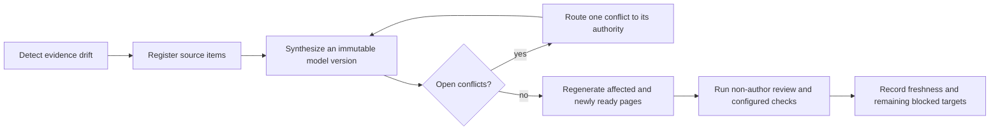

DocsFab treats documentation generation as a repeatable convergence cycle,
not a one-time export. A cycle begins when new product evidence or repository
behavior appears and ends with an evidence-bound freshness result. For more
information, refer to [Delivery Contracts in DocsFab](index.md).

## Convergence Cycle

The cycle preserves three forms of currency:

- **Evidence currency:** Every selected registered source item has an explicit
  disposition in model history.
- **Model currency:** The current immutable model accounts for new evidence,
  conflicts, decisions, and behavior versions.
- **Projection currency:** Generated pages identify the model and behavior
  boundary they represent and pass their required checks and review.

## Deterministic and Agentic Responsibilities

| Responsibility | Deterministic automation | Agent or accountable human |
| --- | --- | --- |
| Find registered items absent from model history | Yes | Reviews whether the selected boundary is correct. |
| Record a pinned repository revision and compare configured repository bytes and source-thread heads | Yes | Classifies the meaning and affected targets; revision ancestry is not inferred. |
| Validate schemas, paths, links, and retained receipts | Yes | Addresses semantic or prose findings. |
| Reconcile compatible version and scope variants | Produces evidence | Confirms the synthesis and records rationale. |
| Resolve semantic or intent conflicts | No | The named authority adjudicates each conflict. |
| Generate or revise documentation | Orchestrates inputs and checks | A qualified writer or agent produces the content. |
| Satisfy the minimum adversarial gate | Verifies a receipt | A non-author human or clean agent performs the review. |
| Merge, publish, deploy, or approve a release | No implicit authority | An explicitly authorized actor performs the action. |

## Automation Policy

The convergence checker reports one of the following results:

| Result | Meaning |
| --- | --- |
| `fresh` | The configured deterministic boundary and required evidence agree. |
| `stale` | Watched source, model, documentation, job, or review evidence drifted. |
| `blocked` | A declared evidence or readiness gap prevents convergence. |

Malformed evidence and unexpected checker conditions are errors, not a fourth
freshness result.

### Validated Boundary

The checker validates and hashes:

- Canonical source-thread records, retained artifacts, and current-model
  decision records.
- Every historical model namespace, its version-appropriate package shape,
  immutable history, and retained assessment evidence.
- The current-model pointer, structured source-item dispositions,
  source-thread heads, configured repository paths, Fern navigation metadata
  and page content, required checks, and independent-review evidence.
- The watched digest against an existing Git commit and tree.
- The package-owned freshness job, including its triggers, dependency
  bootstrap, checker invocation, strict or advisory selection, and artifact
  path.

The checker safely parses complete YAML evidence blocks, rejects symbolic
input paths, constrains output writes to checker-owned namespaces, and emits
JSON errors. Only the active receipt can be excluded from a repository-wide
digest.

### Review and Lineage Authority

A passed review is a retained, hashed report. It must name the exact reviewed
commit and tree in the first direct paragraphs of two distinct top-level bullet
items. Fenced, indented, HTML, blockquoted, nested, continuation, and
illustrative structures do not establish that authority. Only that report can
change between the reviewed commit and snapshot commit.

When the repository mandates squash merges, finalize freshness in two separate
merge requests. First, review the canonical content commit on the default
branch and merge only its retained assessment. Then generate the receipt from
that reachable assessment commit and merge only the receipt. A receipt must
not rely on an intermediate source-branch commit or a hidden merge-request
reference: those objects may disappear after squash. Do not merge the
assessment and receipt together or relax an unresolvable revision to content
digests alone; without a surviving commit anchor, a forged assessment and
excluded receipt could circularly authenticate each other.

A structured model input must meet all of the following conditions:

- It was registered by its merge timestamp through an event graph in which
  every child occurs at or after each declared parent.
- It cites the exact event-graph head at that timestamp.
- It binds one item-level representation or collection member to the matching
  integrity value.
- Its frontier retains a still-active sibling head even when that sibling's
  event sequence predates the selected item's registration.

The default mode is advisory, so the team can validate triggers without making
every repository change a hard CI failure. A configured strict mode can fail
when deterministic staleness is present.

For the operator procedure, follow [Check Documentation Freshness](../../../manage/check-documentation-freshness.md).

Automation must fail on malformed evidence or an unexpected condition. It
must not silently skip a broken source thread, invent a semantic resolution,
or call an unreviewed projection current.

## Default Watch Boundary

The packaged DocsFab boundary watches product behavior and planning under
`packages/`, `planning/`, `governance/`, and `deploy/`; root control files
`.gitlab-ci.yml` and `GOVERNANCE.md`; retained assessments; and
the package-owned freshness definition at `.gitlab/ci/knowledge.yml`.
Documentation bytes come from `README.md` and every Markdown page in Fern
navigation. Source threads and model history are validated and hashed
separately.

Watching the package-owned job is required: changing its triggers, dependency
bootstrap, checker invocation, strict/advisory selection, or artifact path
must produce repository drift even when all other watched files are unchanged.

## Freshness Receipt

A useful receipt binds at least:

- the reference-model ID and version;
- source-thread head event IDs;
- hashes of canonical source-thread records, retained artifacts, and immutable
  model history;
- the repository commit or tree used as behavior evidence;
- the Fern navigation file and documentation paths covered by regeneration;
- the checks and independent review evidence applied; and
- blocked targets or known evidence gaps.

The receipt proves what was compared and checked. It does not prove that the
model is universally complete, that readers succeed, or that a release was
authorized.

## Related Topics

- [Product Knowledge in DocsFab](../../../about/core-concepts/product-knowledge.md)
- [DocsFab Implementation Status](../../status-and-configuration/implementation-status.md)

## Authoritative Sources

- [Freshness checker](../../../../packages/knowledge/skills/converge-documentation/scripts/check_freshness.py)
- [Convergence contract](../../../../packages/knowledge/skills/converge-documentation/references/convergence-contract.md)
- [Freshness regression tests](../../../../packages/knowledge/skills/converge-documentation/tests/test_check_freshness.py)
