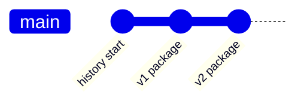

In DocsFab, a product reference-model package preserves one model's
append-only history and immutable candidate versions. DocsFab stores its
own package under `.docsfab/reference-model/shared/`. For more information,
refer to [Knowledge Contracts in DocsFab](index.md).

Model-package versions are independent of the DocsFab release version.

## Directory Layout

```text
shared/<model-id>/
├── history.md
└── <model-version>/
    ├── inconsistency-report.md
    ├── model.md
    └── merge-receipt.md
```

Never overwrite an earlier model version, inconsistency report, or receipt.

## Choose a Record

| Record | Use it to answer |
| --- | --- |
| `history.md` | Which immutable versions exist, and how does each version follow the prior one? |
| `model.md` | Which claims, scopes, sources, decisions, and documentation targets define this version? |
| `inconsistency-report.md` | Which conflicts were found, who owns resolution, and which targets remain blocked? |
| `merge-receipt.md` | Which exact inputs, transformations, reviewers, approvals, and deltas produced the version? |

Each synthesis adds a directory. `history.md` records the chain. Prior
`model.md` files stay on disk.



A correction after `v1` creates `v2`. It does not replace `v1/model.md`,
`v1/inconsistency-report.md`, or `v1/merge-receipt.md`.

## Model Record

`model.md` identifies the merge, model, new and prior versions, creation time,
bounded model region, target release, audience, documentation targets, exact
source items, reviewers, and approval state. It contains atomic claim-decision
records.

Each claim decision records:

- Stable claim and source-claim identifiers.
- Relationship and action.
- Normalized statement and scope.
- Exact evidence and agent inferences.
- Behavior, representation, intent, and model states.
- Decision basis and resolution owner.
- Blocked and unblocked documentation targets.

## Inconsistency Report

Every synthesis creates `inconsistency-report.md`. A report with no conflicts
states that result and names the comparison boundary. A conflict record
contains its stable identifier, status, classification, exact source variants,
consequence, resolution owner, adjudication, and resulting claims.

Open conflicts can remain in a candidate model, but dependent documentation
cannot present them as settled truth.

The target product contract treats a zero-open-conflict model issue as the
start of documentation convergence. The current agent-executed synthesis skill
continues by regenerating affected documentation and rescanning all configured
information-architecture families; no autonomous runtime reconciler is yet
established. Newly ready targets enter generation, while blocked targets
remain explicit in the readiness record.

## Merge Receipt

`merge-receipt.md` records how the synthesis result was produced. It includes:

- Exact thread heads, item versions, representations, integrity values, and
  claim versions.
- Included, added, superseded, excluded, rescoped, and variant claims.
- Unresolved conflicts and routing owners.
- Behavior evidence and accountable intent decisions.
- Agent inferences and documentation-readiness effects.
- Reviewer independence and approval states.
- Exact delta from the prior model.
- Failures, manual interventions, and remaining acquisition work.

## Approval States

The merge boundary uses these increasing states:

1. `candidate`
2. `representation-reviewed`
3. `behavior-supported`
4. `intent-approved`
5. `release-approved`

These states describe different evidence and authority boundaries. A later
state must not be inferred from the existence of an earlier one.

## Related Topics

- [Product Knowledge in DocsFab](../../../about/core-concepts/product-knowledge.md)
- [Evidence Before Drafting](../../../about/core-concepts/documentation-quality.md#evidence-before-drafting)
- [Reconcile Source Threads in DocsFab](../../../workflows/reconcile-source-threads.md)

## Authoritative Sources

- [Synthesis skill](../../../../packages/knowledge/skills/synthesize-source-threads/SKILL.md)
- [Synthesis contract](../../../../packages/knowledge/skills/synthesize-source-threads/references/synthesis-contract.md)
