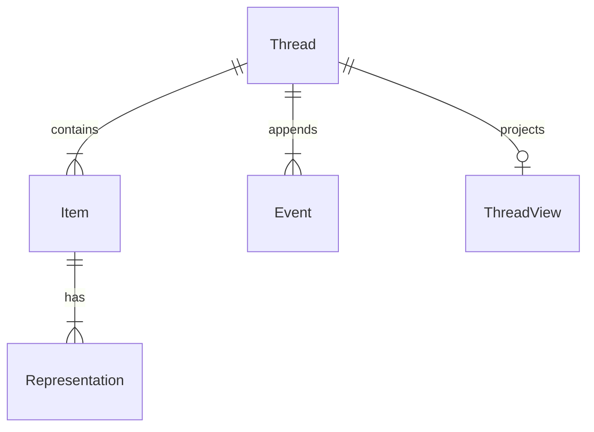

The DocsFab source-thread registry preserves independently inspectable
evidence lineages before claim extraction or synthesis. The current
format is `docsfab.knowledge.source-thread/v1`. For more information,
refer to [Knowledge Contracts in DocsFab](index.md).

## Directory Layout

Each stable origin has one directory.

```text
source-threads/<source-thread-id>/
├── thread.json
├── events.jsonl
├── items/
│   └── <item-id>.json
├── artifacts/
│   └── sha256/<first-two-digest-characters>/<full-digest>
└── views/
    └── thread.md
```

`thread.json`, `items/*.json`, and `events.jsonl` are canonical.
`views/thread.md` is a deterministic projection. Retain artifact bytes only
when governance permits; otherwise use an immutable Git locator or governed
external version.

## Choose a Record

| Path | Authority | Use it to |
| --- | --- | --- |
| `thread.json` | Canonical | Identify the origin, access class, item index, relationships, event log, and current heads. |
| `items/*.json` | Canonical | Preserve one attributed evidence item and its representations or collection members. |
| `events.jsonl` | Canonical and append-only | Reconstruct changes, corrections, transformations, and current event heads. |
| `views/thread.md` | Generated projection | Review the canonical records in a human-readable shape. Do not edit it to change history. |
| `artifacts/sha256/…` | Retained evidence when governance permits | Preserve byte-addressed original or derived representations. |

One origin is one thread. Items and events hang off that thread.
`views/thread.md` is generated from those records; it is not a source.



`ThreadView` is `views/thread.md`. Do not edit the view to change history.
Append an event and re-render.

## Canonical Records

| Record | Schema | Purpose |
| --- | --- | --- |
| Thread | `docsfab.knowledge.source-thread/v1` | Identifies the origin, access class, item index, relationships, event log, and current event heads. |
| Item | `docsfab.knowledge.source-item/v1` | Records one attributed artifact, collection, interview, observation, correction, or decision with scope and lineage. |
| Event | `docsfab.knowledge.source-event/v1` | Appends a timestamped, attributed change to thread history. |

The JSON schemas beside the source-thread contract in
`packages/knowledge/skills/register-source-thread/references/` are
authoritative.

## Item Representations

Every item contains at least one representation or collection member. A
representation records:

- Role and media type.
- Original filename and byte size.
- Retained-artifact, Git, or external-version locator.
- Integrity algorithm and value.
- Parent representations and transformation details.
- Optional access override.

Keep a PDF, presentation, image, audio file, video, or diagram as an original
representation. Add extracted text, transcripts, renders, redactions, or
summaries as derivatives. Never replace the original with extracted content.

## Event Ledger

`events.jsonl` stores one immutable JSON object per line. Append corrections,
supersessions, transformations, migrations, and relationship changes as later
events. Do not edit an earlier event to make the history appear cleaner.

## Registry Invariants

The validator enforces the following invariants:

- Thread and item identifiers remain stable.
- The thread item index equals the item records.
- Event identifiers and sequence numbers are unique.
- Event parents exist and precede their children.
- Thread heads equal the event-ledger leaves.
- Each item contains at least one representation or collection member.
- Derived representations identify existing parents and a transform.
- Original evidence remains inspectable.

## Validation Commands

Run the following commands from the repository root:

```bash
python3 packages/knowledge/skills/register-source-thread/scripts/source_thread.py \
  validate <thread-directory>

python3 packages/knowledge/skills/register-source-thread/scripts/source_thread.py \
  render <thread-directory>

python3 packages/knowledge/skills/register-source-thread/scripts/source_thread.py \
  validate <thread-directory> --check-view
```

The commands fail on malformed records, broken lineage, integrity mismatches,
or a generated view that differs from canonical records.

## Related Topics

- [Source Threads](../../../about/core-concepts/product-knowledge.md#source-threads)
- [Reference-Model Package in DocsFab](reference-model-package.md)

## Authoritative Sources

- [Source-thread contract](../../../../packages/knowledge/skills/register-source-thread/references/source-thread-contract.md)
- [Thread schema](../../../../packages/knowledge/skills/register-source-thread/references/source-thread-v1.schema.json)
- [Item schema](../../../../packages/knowledge/skills/register-source-thread/references/source-item-v1.schema.json)
- [Event schema](../../../../packages/knowledge/skills/register-source-thread/references/source-event-v1.schema.json)
- [Validator and renderer](../../../../packages/knowledge/skills/register-source-thread/scripts/source_thread.py)
