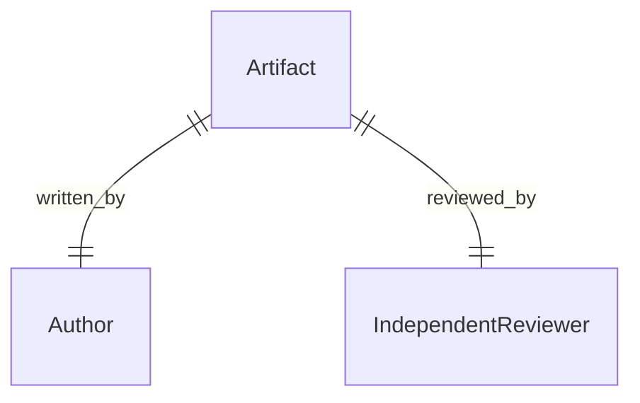

DocsFab separates the required outcome, the provider, the reusable skill, and
the evidence. One role is not necessarily one persona, and one capability is
not necessarily one skill. For more information, refer to [DocsFab Quality
Reference](index.md).

## Separate the Layers

The following table lists the question that each layer answers.

| Layer | Question |
| --- | --- |
| Required outcome | What quality result must the documentation establish? |
| Provider | Which qualified human, clean agent, deterministic tool, or runtime operation can produce that evidence? |
| Skill | Which reusable behavior contract governs the work? |
| Evidence | Which revision-bound artifact proves what happened and with what limitations? |

## Quality Functions

The following table lists each quality function, its required outcome, and its skill.

| Function | Required outcome | Skill |
| --- | --- | --- |
| Technical writing | Grounded content for the approved audience and plan | `write-documentation` |
| Source-obligation analysis | Bounded ledger of reader-relevant source consequences | `verify-technical-accuracy` |
| Technical verification | Evidence-backed findings about claims, examples, procedures, and versions | `verify-technical-accuracy` |
| Editorial review | Findings about clarity, structure, terminology, style, and usability | `review-documentation` |
| Quality evaluation | Layered evidence and hard-gate decision | `evaluate-document-quality` |
| Audience evaluation | Controlled comprehension and task evidence | `test-audience-understanding` |

## Reader Context

Context-dependent reader-impact work uses the shared `ReaderContextV1`
component and the quality-owned reader-impact baseline. The context reuses the
documentation brief's audience, scope, source-priority, required-content,
excluded-content, question, and limitation meanings. Existing briefs remain
valid without reader context, and DocsFab does not infer context for historical
records.

A focused read-only Markdown assessment can return an update candidate, a
no-change candidate, or insufficient evidence. A no-change candidate requires
an evidence-backed adequacy rationale and one of two evidence bases: an exact
comparison with the current public contract, changed source, and
documentation, or, unless a base and head commit comparison declares the
change, a plan that keeps every planned page unchanged with each kept page
admitted as current documentation. It does not establish a quality pass. A
missing material source, or an unknown comparison that the kept-page basis
does not cover, produces insufficient evidence.

The governed HTML artifact requirements apply only when the selected workflow
requests HTML output. Focused Markdown assessment, audit, and polish work do
not require an SRD, an HTML format, `document.html`, `base.css`, or writer
metadata. An update preserves necessary setup, examples, anchors, validation
steps, and observable consequences. It does not restructure a page unless the
selected operation grants that scope.

`create-documentation` and `restructure-documentation` are runtime workflows,
not skill ids. Their mutation steps bind `write-documentation` in create or
restructure mode. The eight canonical entries are skills.
`plan-documentation` resolves scope and sources.
`verify-technical-accuracy` inventories source facts and later compares them
to the candidate.
`lint-documentation` supplies deterministic evidence, and
`audit-documentation` handles focused-document and documentation-set audit
scopes.
Runtime remains responsible for scheduling and activation.

## Review Independence

Every DocsFab-authored artifact requires a non-author review when policy names
an independence gate.

The following table lists the minimum independent reviewer for each author.

| Author | Minimum independent reviewer |
| --- | --- |
| Agent session | A clean agent context that did not participate in authorship |
| Human | Another human or a clean agent that did not participate in authorship |

The reviewer receives the frozen artifact and approved evidence, not private
authoring rationale or expected answers. Same-context review is supplemental
self-review or proxy evidence.

Independence is cardinality. One artifact has an author. The independence
gate requires a different reviewer. Same-context review does not fill that
slot.

An agent author needs a clean subagent. A human author needs another human
or a clean agent. The reviewer does not receive expected answers.

## MVP Capability Slots

The MVP requires evidenced coverage of context assembly, documentation audit,
technical accuracy, drafting and revision, editorial polish, style application,
code and example validation, documentation health, adversarial and audience
review, and SCM handoff.

Coverage is many-to-many. Skills, humans, deterministic checks, profiles,
knowledge procedures, runtime operations, and SCM adapters can each cover part
of one or several slots. The skill catalog supplies documentation behavior;
it does not grant SCM authority or replace runtime orchestration.

## Current Implementation

The canonical catalog contains eight skill contracts. The DocsFab runtime
stages exact hash-locked copies and starts creation through
`docsfab run create-documentation`. `guided-demo` remains only a benchmark
identity.

Integrated behavior claims require the governed runtime crate and a validated
execution record.

## Related Topics

See the following related topics:

- [Skill Behavior Contracts in DocsFab](skills/index.md)
- [Documentation Quality in DocsFab](../../about/core-concepts/documentation-quality.md)
- [Evidence Before Drafting](../../about/core-concepts/documentation-quality.md#evidence-before-drafting)
- [DocsFab Implementation Status](../status-and-configuration/implementation-status.md)

## Authoritative Sources

This page draws on the following authoritative sources:

- [Canonical skill catalog](../../../packages/skills/README.md)
- [Quality policy and evidence](../../../packages/quality/README.md)
- [Runtime workflow catalog](../../../packages/runtime/model-compositions/workflow-catalog.json)
