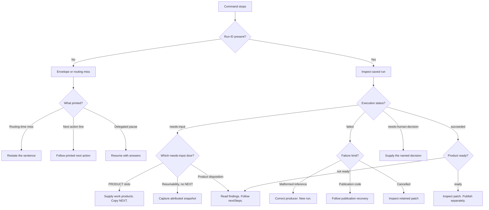

DocsFab names a class and a next action for every operator-visible stop. Use
this page to match what a command printed to its stop class, then follow the
linked recovery. For more information, refer to [DocsFab Status and
Configuration Reference](index.md).

For why DocsFab stops instead of guessing, and the five kinds of next action,
refer to
[When a Job Stops in DocsFab](../../about/core-concepts/job-stops.md). For
symptom-led steps, refer to
[Troubleshooting DocsFab](../../troubleshooting.md).

## Recognize the Stop

Start from what the command printed. Do not infer readiness from the
process exit code alone. Execution status, product disposition, and
publication status are separate planes.

The following diagram classifies the stop from the operator-visible
output, then routes you to the matching next action.



If the output has no run ID, you are still before a catalog job. If it
has a run ID, inspect that record:

```bash
docsfab runs show <run-id>
```

Read `execution.status`, `product.disposition`, publication status,
`Resumability:`, PRODUCT, and NEXT as separate facts. For machine
consumers, use `--json` and read `nextSteps`. Do not scrape the human
footer.

Each class in the following sections is a different door. Do not treat every
`needs-input` string as the same stop.

## Stops Before a Run Exists

The following classes stop before DocsFab creates a catalog run.

| Class | How you recognize it | What DocsFab does | What you do next |
| --- | --- | --- | --- |
| Routing-time miss | `Outcome route: needs-input`. No run ID. | Refuses to bind a catalog job. Lists named `run` commands. | Restate the sentence so `do` can bind one job. Refer to [A Run Stops With needs-input](../../troubleshooting.md#a-run-stops-with-needs-input). |
| Operator envelope | JSON `kind` is `docsfab-operator-error`, or human output prints `Next action:` or `Docs:`. | Fails closed with a situation code. Optional `nextAction` and `docsAnchor` come from the situation catalog. | Follow the printed next action. Refer to [DocsFab Operator Error Envelope](operator-error-envelope.md). |
| Doctor blocked | `docsfab doctor` reports blocked readiness. | Stays read-only. It does not call a model unless you pass `--live`. | Follow the printed diagnostic and one safe next command. Refer to [Doctor Reports Blocked Readiness](../../troubleshooting.md#doctor-reports-blocked-readiness). |
| Delegated pause | `docsfab do --delegate` exits 2. JSON includes `stopReason` and `nextAction.command`. | Persists the finite task. Does not invent answers. `--no-input` keeps `needs-input`. | Resume that exact task with `--resume` and `--answers`. |
| Pre-write freshness | `--draft-mr` refuses before a run exists, often with `stale-revision`. | Creates no run and writes nothing. | Run `docsfab doctor --repo <path>`, then retry or pin GitLab's new target-branch head. Refer to [A Draft Merge Request Is Not Created After a Successful Run](../../troubleshooting.md#a-draft-merge-request-is-not-created-after-a-successful-run). |
| Limit or authority refuse | Coded refusal names the limit or missing grant, the observed value, and the remediation. | Refuses at startup or admission. It does not clamp, skip, or continue silently. | Apply the named remediation. Do not widen repository, model, evidence, or publication authority as a workaround. |

## Stops After a Run Exists

The following classes stop after DocsFab has a run ID.

| Class | How you recognize it | What DocsFab does | What you do next |
| --- | --- | --- | --- |
| Editorial work products | PRODUCT lists named slots. NEXT prints one command. Exit 2. Live-agent prefixes the activity with `[Needs input]`. | Keeps the bound job. Does not invent work products. | Supply the named slots. Copy NEXT. Do not run `docsfab doctor` to continue editorial work. Refer to [A Run Stops With needs-input](../../troubleshooting.md#a-run-stops-with-needs-input). |
| Knowledge continuation | Create or update first-pass stop. `runs show` prints `Resumability:`. NEXT is absent until a snapshot is accepted. | Preserves the original task. Does not guess product intent. | Capture an attributed snapshot, then render the resume command. Refer to [Answer and Resume a Stopped Job in DocsFab](../../workflows/answer-and-resume.md). |
| Product not ready | Execution can succeed while product is `not-ready`, `needs-input`, `inconclusive`, or `blocked`. | Records findings, limitations, and open decisions. Successful execution is not a ready product. | Read those fields and follow `nextSteps`. Do not broaden authority. Refer to [A Run Stops With needs-input](../../troubleshooting.md#a-run-stops-with-needs-input). |
| Human decision | Run or step status is `needs-human-decision`. PRODUCT lists an open decision whose kind is `human-decision`. | `--json` keeps status `needs-human-decision`. The CLI verdict can say `needs-input`. A named decision is `resumable (needs-human-decision)`. An unnamed stop stays blocked. | Supply the named decision. NEXT names that id and is not `docsfab doctor`. Do not use `--resume-from`. |
| Technical failure | Run status `failed`. NEXT inspects JSON or names a typed recovery such as revision accounting. When every step succeeded but the final editorial decision was refused, FAILURE and NEXT name the refusal's closed code and location, such as `editorial-finalization-decision-independent-rejection`. | Retains the failed run. Retryable inference may already have been retried. Categories `provider-terminal` and `invalid-request` are not retryable. They stop at a capability wall. Category `no-progress` means the model kept re-reading content it already had; its code names the limit, `execution-read-loop-withheld-reads-bound` for one result or `execution-read-loop-unchanged-re-reads-bound` across results. It is retried once. That retry asks for the answer at its first withheld re-read and then denies every tool call; each denied call spends the same allowance, so a model that ignores the ask stops with a read-loop code, and the run fails. A step attempt that uses its whole tool-call ceiling without answering also ends as `no-progress`, with condition `tool-call-ceiling` and code `composition-execution-max-tool-calls-per-step-bound`. It gets the same single retry from the same budget, with the same ask at the retry's first withheld re-read; a retry that reaches the ceiling again fails the run. | If NEXT says do not retry unchanged, correct the producer or contract, then start a new run. For `provider-terminal` or `invalid-request`, follow [Capability and Policy Walls](#capability-and-policy-walls). Refer to [An Unexpected Failure Does Not Explain the Cause](../../troubleshooting.md#an-unexpected-failure-does-not-explain-the-cause). |
| Cancellation | Saved workflow runs use status `failed` and the diagnostic "Workflow cancelled by user." Host job packets also use `cancelled`. | Stops retries and later stages. Does not roll back completed work. | Inspect the retained patch and checkout. Do not treat cancellation as unchanged. Refer to [Live Agent Reference in DocsFab](live-agent.md). |
| Publication recovery | Publication status `failed` with a typed code such as `stale-revision`, `run-revision-unpushed`, or `tracked-source-dirty`. | Preserves a succeeded write when the code is post-write. | Follow the phase-specific NEXT. `docsfab ship` republishes a preserved write and does not re-run the workflow. Refer to [A Draft Merge Request Is Not Created After a Successful Run](../../troubleshooting.md#a-draft-merge-request-is-not-created-after-a-successful-run). |
| First-pass useful partial | A first pass stopped because sources disagree or the request names a source it could not read. Original request remains `incomplete`. Draft applicability is `useful-partial`, `scaffold-only`, or `no-useful-deliverable`. An evidence gap alone does not stop the run: it continues with a `first-pass-evidence-gaps` limitation. | Can retain a host-held labeled draft. That draft is not CREATE success and not a publishable page. | Treat the original request as still open. When a run exists, resume knowledge continuation. Refer to [Run a Documentation Workflow in DocsFab](../../workflows/run-a-documentation-workflow.md) and [Operational Limits in DocsFab](operational-limits.md). |

After a transient provider failure, such as HTTP 429, wait for the provider
condition to clear before copying the retry command in NEXT. The command uses
the saved target repository and retains the original CLI request options.
A review started without an instruction retries without `--instruction` or
`--patch-only`. A write workflow retains its selected delivery mode.
The command repeats `--composition` and each `--set` value, so the retry uses
the same model settings. NEXT never shows an endpoint set with
`--set baseUrl`, so for such a run it opens the JSON record instead.
Shell quoting preserves paths and instructions that contain spaces or quotes.
If a saved run lacks enough request context, NEXT opens its JSON record for
inspection instead of guessing a retry command.

## Capability and Policy Walls

Some stops cannot be answered with more operator input. Findings of kind
`evidence-limitation`, `blocked-dependency`, `roadmap-gap`, or
`product-gap` name a wall. A terminal inference attempt of category
`provider-terminal` or `invalid-request` also names a wall.

When a wall stops the run, NEXT is `docsfab runs show <run-id> --json`.
The reason names each wall kind and code, then tells you to change the
request. Narrow or retarget the request, wait for the capability, or
accept the incomplete outcome. Do not retry the unchanged request. A
retained local patch does not resolve the wall, so review it before any
publish.

`create-documentation`, `update-documentation`, and
`restructure-documentation` also record `evidence-limitation` findings that
the request did not cause. The evaluate and audience steps produce them on
every run. They do not name a wall, and they fall into the following groups:

- Standing limitations: `experimental-quality-profile`,
  `insufficient-evidence` (the audience rule that create and update always
  carry), and `quality-rubric-unavailable`.
- Advisory evaluation results: `quality-evaluation.<decision>` for the
  evaluator's decision, such as `quality-evaluation.fail`, and
  `quality-hard-gate.<gate>` for each hard gate it reported, such as
  `quality-hard-gate.material-omission`. A gate id that cannot become a code
  is reported as `quality-hard-gate-unrepresentable`.

The evaluator is a model, so its decision and hard gates are advisory
evidence, not a product verdict. They never make the outcome `ready`. When a
succeeded authoring run has no other wall finding, NEXT is still
`docsfab runs show <run-id> --json`. The reason tells you to review the
retained patch at its path before any publish. It names the standing
limitations and labels the evaluation results as advisory. Any other
`evidence-limitation` code on an authoring run, such as an editorial
`evidence-limitation.*` code, still names a wall. In that case, the wall
reason lists only those codes.

A verified no-change is the exception. When a succeeded `update-documentation`
run ends with the editorial outcome `verified-no-change`, it answered the
request, so NEXT is not a wall. NEXT starts with
`No documentation change needed; review the kept pages if you disagree`
followed by the kept pages. When the plan kept no page, it starts with
`No documentation change needed; review the saved evidence if you disagree`
instead. NEXT then names the basis and lists the run's other limitations,
such as one an assessment step recorded, as recorded. When the quality
evaluator answered `not-applicable`, because a no-change changes no page, that
list includes `quality-evaluation-not-applicable`. A `no-change-basis.*` code
discloses the basis of a no-change and never names a wall. Refer to
[Reach a Verified No-Change Result](../../workflows/verify-no-change.md#reach-a-verified-no-change-result).

A wall never produces InputAsk slots, a continue command, or a retry
command. A wall does not replace a supply door. When the outcome also has
a missing governed input, or a `needs-human-decision` run names an open
human decision, that door owns NEXT. A `review-documentation` run reports gap
findings about the reviewed pages as its result, so only
`evidence-limitation` and `blocked-dependency` findings redirect a
review.

## How DocsFab Selects NEXT

A live run footer whose status is `failed`, `needs-input`, or
`needs-human-decision` selects a NEXT command. When an open decision of kind
`human-decision` is present, NEXT names that decision id and does not fall
back to `docsfab doctor`. When a capability or policy wall stops the run,
NEXT inspects the saved run, names the wall code, and redirects the request.
A succeeded authoring run whose only limitations are standing or advisory
evaluation codes is not at a wall. Its NEXT tells you to review the retained
patch and names the patch path. A succeeded `update-documentation` run whose
editorial outcome is `verified-no-change` is not at a wall either. Its NEXT
says no documentation change is needed, names the kept pages, or the saved
evidence when the plan kept none, and names the basis. Refer to
[Capability and Policy Walls](#capability-and-policy-walls).
When structured recovery is otherwise unavailable
on that live path, the command falls back to `docsfab doctor`
against the original target checkout. Human saved-run replay (`docsfab runs
show` without `--json`) is stricter: it emits only a parser-validated
continuation or a recovery action tied to the exact saved run. It omits a
placeholder command whose checkout path is unresolved, so human replay can
intentionally show no NEXT until the required selection or path is available.
The sealed JSON `nextSteps` projection can still carry a legacy/template
placeholder from the summary; treat that field as descriptive evidence, not
a parser-validated executable command or authority. Knowledge continuation
eligible stops print `Resumability:` first and emit NEXT only after you supply
an attributed snapshot. Operator envelopes print `Next action:` when the
situation catalog has one. Routing-time `docsfab do` lists named `run`
commands before any run exists.

A stop with no next action is generally a defect. The current surfaces have
three bounded exceptions: an unanswered knowledge snapshot, an envelope
whose `code` is the situation identity while `nextAction` is omitted, and a
human saved-run replay whose only candidate is the unresolved placeholder
described above. Inspect-only NEXT commands are still guidance: they tell you
not to retry unchanged inference.

## Failure Classes

A stop class says what you can do next. A failure class says why the work
failed, so reports can count failures by cause. Every failure carries
exactly one failure class, the layer that produced it, and the catalogued
code DocsFab read the class from. This applies to CLI refusals, failed
runs, failed steps, failed model attempts, and hosted dispatcher attempts.

The following table lists the closed set of failure classes.

| Class | Meaning |
| --- | --- |
| `model-content` | The model reply was well formed, but its content broke a host rule, such as a fact link, a status, or a locator. |
| `contract-shape` | An artifact did not match its contract shape: unparseable JSON, missing or unexpected fields, or a DocsFab binding defect. |
| `planning-refusal` | DocsFab refused to plan or admit the request as given, for example a proposal-scope or first-pass stop. |
| `operator-input` | The request, options, checkout, or configuration you supplied is invalid for this command. |
| `bound` | A limit from `config/limits.yaml`, or a model output allowance, was reached. A reply cut off at its allowance is a bound, not a shape defect. |
| `auth` | A credential, login, approval, or authority grant is missing, expired, or insufficient. |
| `infrastructure` | A tool, process, network, provider, or file system DocsFab depends on was unavailable or failed. For example, a model request that left the host but broke or timed out with no HTTP status, a store write that failed, or a quality validator missing from its lock. |
| `flake` | A condition the provider marks as repeatable, such as throttling (HTTP 429), a provider server error (HTTP 5xx), or a provider timeout status (HTTP 408 or 504), that can clear on retry. |
| `cancelled` | You or the host stopped the work on purpose. |
| `unknown` | DocsFab has no evidence of one cause: the code is uncatalogued, or it covers several causes, such as `invalid-request` for an HTTP 400 or 404. The code shows what still needs a class. |

A failed model request takes its class from the closed provider error class
and HTTP status its attempt recorded. An HTTP 401, 403, or 407 is `auth`, with
code `provider-http-auth`. A provider connection that broke with no HTTP
status is `infrastructure`, with code `provider-network`.

The layer is one of `cli`, `workflow`, `inference`, `host`, or `harness`.
Surfaces show the class in the following places:

- The operator error envelope prints `failure class:` and writes `failure`
  in `--json`. Refer to
  [DocsFab Operator Error Envelope](operator-error-envelope.md#failure-class).
- A live-agent stop before a run record prints `Failure class:` above NEXT.
- A failed run prints `Failure class:` in its FAILURE footer and in
  `docsfab runs show`. The run record stores `failure` on the run and on
  each failed step. `--json` lists `failures` for the run, each failed
  step, and each failed model attempt.
- A hosted dispatcher failure line carries `failure`. A worker that ran
  and failed reports its run record's class.

A failure class does not choose the next action. Classify the stop with the
tables above to find what to do.

## Related Topics

For more information, refer to the following pages:

- [When a Job Stops in DocsFab](../../about/core-concepts/job-stops.md)
- [Answer and Resume a Stopped Job in DocsFab](../../workflows/answer-and-resume.md)
- [DocsFab Operator Error Envelope](operator-error-envelope.md)
- [Diagnose Failed Runs in DocsFab](diagnose-failed-runs.md)
- [Troubleshooting DocsFab](../../troubleshooting.md)
- [Live Agent Reference in DocsFab](live-agent.md)
