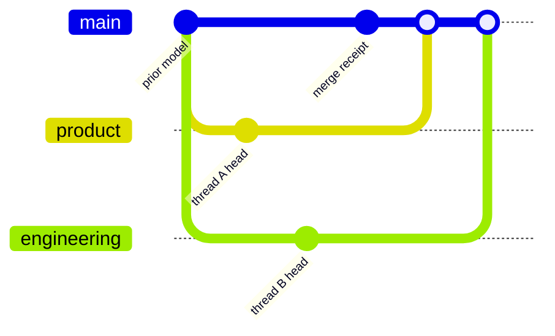

Use this DocsFab procedure after registering or updating source-thread
evidence that can change the product reference model or documentation
readiness. For more information, refer to
[About DocsFab Workflows](index.md).

The `synthesize-source-threads` skill remains the entry point for the complete
procedure. It guides comparison, adjudication, canonical model issuance,
documentation updates, and the family rescan. A hosted local runtime can run
a bounded merge-triggered comparison and owner-adjudication slice. It can
create a new immutable model candidate and publish a reviewable proposal for
affected Product Requirements Document (PRD), Software Requirements Document
(SRD), and Plan of Record (POR) candidate projections. It cannot approve
product intent, publish documentation, or complete the broader family rescan,
and it merges the proposal only when the project grants the maintain-prm
add-on, as the draft merge request section below describes.

The host requires an explicit `poll` or `webhook` source mode for each project.
Only an exact merged revision can change semantic truth. Open, updated, and
closed-without-merge events cannot. The knowledge job receives no source
credential. Refer to
[merge-request change-event intake](../reference/knowledge-and-delivery/delivery/gitlab-host-notification.md#merge-request-change-event-intake)
for activation requirements. Live deployment and conflict interaction evidence
remain pending.

The host packs the comparison into turns capped by
`semantic.mergeComparisonTurnBytes`, which defaults to 1 MiB. If a provider
rejects a turn for exhausted context or cuts its structured answer at the
output limit, the host admits the same evidence in smaller turns and records
`docsfab.reconciliation.semantic-narrowed`. The default allows two narrower
admissions through `semantic.mergeComparisonNarrowings`. The comparison does
not repeat an output-limited answer on identical input by default;
`semantic.mergeComparisonCutAnswerRetries` controls that route-specific retry.
An operator can raise these supported limits for a qualified model.
When one source fragment exceeds a turn, DocsFab splits it into consecutive
byte ranges and accounts for every range. If even one range cannot fit beside
its claim and metadata, the retained comparison names the unexamined bytes and
stays incomplete. The operator event `semantic-evidence-fragment-unadmitted`
names the byte budget and remedy; the comparison cannot offer a decision from
that incomplete source.

A merge comparison reads each changed file before and after the merge. The
before evidence of a file the merge keeps is the status quo the approved model
already describes, so it never leads a finding when the merge's own change
bears on the same claim; it is cited as context. Before evidence still raises
a finding when nothing else in the merge bears on that claim, for example when
the merge removes a section the claim relies on. A deleted file's before
evidence is the removed behavior. A conflict also requires the changed
behavior to fall within the approved claim's scope, such as the component and
mode it governs; evidence about another component is irrelevant to that
claim, even when it shares a term with the claim's statement.

The comparison explains each assessment in one or two plain sentences on how
the change bears on the claim's statement and scope. For a behavior, intent,
scope or representation conflict it rates `high` confidence, it also proposes
the claim rewritten so it holds after the merge, as a product requirement in
the claim's own voice. It reads the merge commit's own title and description,
and says whether they present the change as deliberate. For each conflict it
also suggests the reply it would give the owner, `keep`, `update` or `later`,
with a one-sentence rationale. The suggestion is advice: it records nothing, and
only the owner's reply records a decision. The merge result
carries one finding for each approved claim it conflicts with. When a behavior,
intent, scope or representation conflict with that claim carries a proposed
requirement that differs from the approved claim, the finding is an exact
offer: keep the approved claim, or replace its statement and scope with the
proposed ones. Otherwise, including a proposed requirement that restates the
approved claim unchanged, and a terminology, version or documentation-quality
conflict, which DocsFab does not ask about, the finding offers one claim, the
comparison's most confident account of the change, and stays advisory.
Either way, the finding cites every other evidence span that bears on the same
approved claim as its evidence, and its summary names how many spans it cites.

The comparison treats an empty optional owner-information list as no request.
If the model returns a reply the host cannot parse or bind to the comparison,
the default retry policy gives it one correction attempt. A second refused
reply fails the comparison with its existing `semantic-reply-*` code. The
failure keeps a bounded, redacted excerpt and reply shape for diagnosis. A
refused model reply does not become an owner question or a comparison finding.

Each question is one Slack thread. Its root message is the message your reply
binds to. It opens with a header that says who is asked, which merge, and how to
reply, followed by the first of the details for audit:

```text
<@owner> PRM decision · <project> · !<merge request> "<merge title>"
Reply in this thread with one word: keep · update · later   (free text = later + your note)

*Details* (for audit)
...
```

The header mentions the owner, or addresses the repository Maintainers, so the
owner is notified. It names the project and the merge, with the merge's own
title. When the title is too long for the header to fit one Slack message, the
header points to the details, where the title is shown in full.

The details follow the header, starting in the root message and continuing in
replies in the thread when they pass one Slack message. **Why this was flagged**
is the comparison's explanation. **Looks intended?** is the comparison's reading of the merge's own
title and description, which it quotes: `no` when they present the change as a
mistake or a temporary workaround, and a `yes` names the issue the merge's
message says it advances or closes. The **Suggested reply** comes next, ahead of
the long claim quotes, so it is in the root message: it is the comparison's own
suggestion. The details also hold the merge request and commit, and the approved
claim and the proposed claim in full with their scopes. When the comparison gave
none that can be shown, DocsFab suggests by a fixed rule and marks the
suggestion as its default. The rule never suggests `update` for a conflict that
proposed no replacement wording. A suggestion is advice: it records nothing.

What each reply word does, and the IDs, digests and evidence, close the details,
so they are usually in the last reply and not in the root message. The root message
is part 1 and has no label; replies are labelled from 2, so `[2/2]` is the second of
two messages. A question that fits one message has no replies.

A question that was already asked when this layout shipped keeps the layout it
was asked in: DocsFab posts any part it had not yet posted exactly as before.

Reply with one word alone on the first line, in any case, with an optional note
on the lines below it. `keep` keeps the approved claim. `update` accepts the
proposed claim; when no wording was proposed, it takes the claim's new wording
from the lines under it. A bare `update` there records nothing: the thread says
what to send, and the question stays open for `update` with the wording under it.
`later` defers the decision. `rescope: <scope>` records a narrower or wider scope when the
question takes one. A first line that holds more than the word, such as `Update:
checking tomorrow`, or two of the words, is recorded as `later` with your words
as the note, and DocsFab says in the thread what it understood. The older
`Decision:`, `Claim:`, `Scope:` and `Rationale:` template still works. A reply
never reaches further than its question and is checked against the same
authority as before.

An `update` reply proposes a new product reference model version whether or not
the conflict proposed wording. On a conflict that proposed none, the new version
keeps the claim's approved scope and records your decision, including the
wording you sent, as the claim's statement. Where the project's product-feedback
publication is configured, DocsFab opens one draft merge request that adds that
version under `.docsfab/reference-model/`. Its title is a conventional commit
subject, such as `Draft: docs(prm): record accepted decision in PRM v0.33`.
DocsFab assigns the draft to the person who decided and requests their review.
When it cannot find that person's GitLab account, it names the owner that the
repository's `CODEOWNERS` file gives for the changed paths instead, or nobody. A
person reviews and merges it, unless the project grants the maintain-prm add-on.
With the add-on, DocsFab readies its own draft and adds it to the merge train,
and GitLab merges it after the required pipeline passes. For this one exception,
refer to [A Result Grants No Authority](../about/core-concepts/documentation-jobs.md#a-result-grants-no-authority).

The hosted path's default severity policy remains `report-only`. An
optional active policy can ask a question of one accountable owner in an
approved project-channel thread, about at most one finding per merge. Which
open findings are worth asking about at all is the policy's question floor:
by default, a load-bearing finding clears it at any confidence, and an
advisory finding clears it only when rated `high` confidence; an
informational finding never clears it. A project's operator can change this
floor -- tightening it to load-bearing findings only, or widening it so
every open finding clears it regardless of impact or confidence -- without
a code change or a deploy. The setting is the `questionFloor` field of the
project's `reconciliation-severity-policy.json`: `load-bearing`,
`advisory-high` (the default when the field is absent), or `any-open`.
Clearing the floor is necessary, not sufficient: a
minimum-confidence policy floor, and a fixed set of classifications the
policy can ask about at all, still apply on top of it, and a finding that
does not clear all of them stays silent or batched into the record instead
of reaching a question. The bound owner answers with one word, or with
one allowed disposition, offered claim, optional rescope value, and rationale
in the older template. DocsFab registers that answer as an immutable
authority-decision source, then continues the same logical reconciliation.
The result is a candidate model and candidate projections. It cannot
approve or publish them.

Execution failure, a missing or corrupt result, quarantine, and retry are
operational states, not Product Reference Model conflicts. They do not produce
an adjudication request. A later merge does not supersede an earlier one: each
merge is reconciled, and asked about, on its own.

The hosted slice can ask at most two sequential blocking questions. Any
remaining blocking conflict returns to `needs-input`. The agent-executed
stages later in this guide still own complete queue convergence, canonical
model issuance, artifact updates, independent review, and documentation gates.

When an eligible result has no remaining load-bearing conflict, the hosted
path issues one immutable candidate model and derives only the affected PRD,
SRD, and POR projections. The only accepted adjudication affected-target
identifiers are `product-reference-model`, `product-requirements`,
`software-requirements`, and `plan-of-record`. Matching is exact and
case-sensitive. The exact `product-reference-model` target identifies a
change to the semantic source of truth and expands to all three governed
projections. An unknown-only set or a set that mixes known and unknown
targets fails closed.

The hosted runner validates the closed output and required gates before a
protected publisher creates one provider-neutral change proposal. Each
candidate change binds the exact merge-revision Markdown bytes and contains
the complete proposed replacement bytes. The proposal carries no merge
instruction or provider credential. The prior model and repository
projections remain authoritative until an authorized actor merges the
proposal.

## What You Will Produce

A completed reconciliation creates the following reviewable artifacts for one bounded
model region:

- An inconsistency report with stable conflict IDs, including an explicit
  no-conflict result when applicable.
- A new immutable candidate model version. The prior model remains unchanged.
- A merge receipt that pins exact inputs, decisions, inferences, reviewers,
  approvals, and the delta from the prior version.
- A reviewable, provider-neutral change proposal containing only affected PRD,
  SRD, and POR candidate projections derived from that candidate.
- Target-specific documentation readiness changes and a generation receipt for
  any additional documentation updated after convergence.

## In This Guide

Use the following links to follow the reconciliation sequence or return to a specific
stage:

- [Prerequisites](#prerequisites)
- [Compare the Selected Evidence](#compare-the-selected-evidence)
- [Adjudicate Open Inconsistencies](#adjudicate-open-inconsistencies)
- [Issue the Model Version](#issue-the-model-version)
- [Converge the Documentation Set](#converge-the-documentation-set)
- [Verify the Result](#verify-the-result)
- [Next Steps](#next-steps)

## Prerequisites

Before you begin, confirm that you have all of the following inputs:

- an authorized model region, product version, target release, audience, and
  documentation target;
- exact source-thread IDs, item versions, representation IDs, integrity
  values, and thread-head event IDs;
- validated canonical source records and deterministic thread views;
- the current immutable product reference-model version; and
- identified authorities for behavior, intent, representation, and
  documentation-quality decisions.

Do not use a moving branch, unversioned document, or current conversational
memory as a synthesis input.

Reconciliation compares pinned thread heads, records a conflict if they
disagree, and issues a new model version. Chat memory is not a head.



Only the named item versions and event IDs from the prerequisites enter
the comparison. A later adjudication is a new source-thread event, then
another model version.

## Compare the Selected Evidence

Compare the smallest independently supported claims from the pinned inputs:

<Steps>
  <Step title="Load the selected evidence">
    Load only the selected model region and exact source representations.
  </Step>
  <Step title="Decompose into atomic claims">
    Decompose the evidence into atomic claims with source claim IDs, scope,
    and exact locators.
  </Step>
  <Step title="Compare claims">
    Compare claims as compatible, more-specific, partial, unsupported,
    contradictory, superseded, or uncertain.
  </Step>
  <Step title="Classify inconsistencies">
    Classify each meaningful inconsistency by behavior, intent,
    representation, scope, terminology, version, or documentation quality.
  </Step>
  <Step title="Create the inconsistency report">
    Create the inconsistency report, including an explicit no-conflict result
    if none are found.
  </Step>
</Steps>

Automatically resolve only scope or version differences that have decisive
evidence. Never resolve a conflict by majority vote, source prestige, writing
confidence, or implementation precedence alone.

## Adjudicate Open Inconsistencies

If conflicts remain, offer to go through them one by one. For each conflict:

<Steps>
  <Step title="Show the exact variants">
    Show the exact variants, sources, classification, affected targets, and
    consequence of leaving the conflict open.
  </Step>
  <Step title="Identify the decision authority">
    Identify the appropriate decision authority.
  </Step>
  <Step title="Recommend a disposition">
    Recommend a disposition and explain which evidence supports it.
  </Step>
  <Step title="Ask for one bounded decision">
    Ask for one bounded decision.
  </Step>
  <Step title="Record the accepted decision">
    Record the accepted decision, authority, rationale, time, and resulting
    claim as a new source-thread item and event.
  </Step>
  <Step title="Re-run synthesis">
    Re-run synthesis against the recorded decision before moving to the next
    conflict.
  </Step>
</Steps>

An adjudication can accept, supersede, rescope, preserve as a variant, or
defer. A deferred conflict remains open and blocks only the targets that rely
on it.

<AccordionGroup>
  <Accordion title="For a hosted Slack question">
    A hosted Slack question is two messages in one thread. The first shows the
    project and the merge, what changed, the approved claim's relevant clause,
    the proposed change, whether the merge looks intentional, a suggested reply
    and the three reply words. The reply in the thread shows what merged, with
    links to the merge request and merge commit, the approved claim and its
    statement, the merge's own account of the change, and what each reply does
    to the next Product Reference Model candidate. Reply in the question's
    thread with one word alone on the first line, in any case, with an optional
    note on the lines below it:

    - `keep`: the merge does not contradict the approved claim. The approved
      claim stays. On a question about one claim, the decision is recorded as
      `not-a-conflict`, which is `supersede-variant` of the claim from the
      merge, and that claim is marked superseded.
    - `update`: accept the merge's change into the next candidate. On a
      question with a proposed replacement, the proposed claim replaces the
      approved one. On a question with none, write the claim's new wording on
      the next line; it becomes the decision text. A bare `update` there
      records nothing and leaves the question open, and the thread says how to
      add the wording.
    - `later`: decide later. The conflict is recorded as `defer`.
    - `rescope: <scope>`: record your decision with the scope you write after
      the colon, when the question takes one.

    A reply whose first line is not one of these words alone, such as `Update:
    checking tomorrow`, or names two of them, is recorded as `defer` with your
    words as the rationale, and
    DocsFab says in the thread what it understood. A question about several
    claims takes `later` and `rescope: <scope>`, but not `keep` or `update`,
    which would not name a claim; it shows the template for any other
    decision. The template works on every question:

    ```text
    Decision: <one of the question's allowed dispositions>
    Claim: <offered claim id, or none for rescope, retain-variants and defer>
    Scope: <required only for rescope>
    Rationale: <why>
    ```

    Only the owner bound to that question can supply the accepted answer.
    Other replies remain commentary. DocsFab retains the answer text only in
    protected project custody and registers digest-bound authority evidence
    in one immutable question source thread. It then continues the same
    logical reconciliation with a fresh attempt and a new bounded evidence
    set. It never reuses the stopped attempt's authority.
  </Accordion>
</AccordionGroup>

## Issue the Model Version

When the selected queue has no open conflicts, create a new immutable model
version. Include the following:

- the normalized claim decisions and exact evidence;
- the inconsistency report and all state transitions;
- the merge receipt with exact inputs, inferences, reviewers, approvals, and
  delta from the prior version; and
- documentation targets that became blocked, unblocked, or stale.

Do not edit the prior version. A later correction creates another version. The
hosted path stages the new version as a candidate inside a reviewable
change proposal. The prior repository model remains authoritative until the
proposal passes its required review and protected-forge gates and an authorized
actor merges it.

## Converge the Documentation Set

For the hosted path, first create candidate changes for only affected PRD,
SRD, and POR projections. Each typed `replace` change binds the exact
merge-revision Markdown digest and contains the complete proposed Markdown
bytes. An exact, case-sensitive `product-reference-model` affected target
expands to all three governed projections because it identifies a semantic
source-of-truth change. The host does not trim or match containing, path-like,
or lookalike target strings. Unknown-only and mixed known-and-unknown target
sets fail closed. The local runtime updates one bounded model-provenance
block and preserves the rest of the base document. It does not claim broader
semantic prose regeneration.

A generated projection is not independent semantic evidence and cannot trigger
another convergence run by itself. DocsFab can validate
and propose those bytes, but it cannot approve their product intent, apply
them, or merge them.

After issuing the model version, continue the current agent-executed procedure
for the broader documentation set:

<Steps>
  <Step title="Update affected pages">
    Update every existing page affected by changed claims.
  </Step>
  <Step title="Rescan every family">
    Rescan every family in the configured information architecture.
  </Step>
  <Step title="Generate missing targets">
    Generate missing targets whose load-bearing evidence now satisfies their
    target-specific readiness threshold.
  </Step>
  <Step title="Record not-ready targets">
    Record `not-ready` targets and the exact evidence needed to unblock them.
  </Step>
  <Step title="Apply style and checks">
    Apply the selected style profile and all applicable deterministic,
    technical, editorial, quality, audience, and delivery checks.
  </Step>
  <Step title="Give artifacts to a non-author reviewer">
    Give every DocsFab-authored documentation artifact to a non-author
    adversarial reviewer. An agent author must use a clean subagent; a human
    author must use another human or a clean agent.
  </Step>
  <Step title="Address material findings">
    Address or explicitly dismiss each material finding and rerun affected
    checks.
  </Step>
  <Step title="Write a generation receipt">
    Write a generation receipt that pins the model, source revision, pages,
    review boundary, check results, blocked targets, and publication state.
  </Step>
</Steps>

This continuation permits repository-local documentation changes. It does not
authorize publication, merge, deployment, or release.

## Verify the Result

The reconciliation pass is complete when the following conditions are true:

- the selected inconsistency queue reports zero open conflicts;
- the new model package validates and the prior version is unchanged;
- affected pages and newly ready targets are present in navigation;
- all configured families have an explicit readiness result;
- the clean non-author review has no unresolved material findings;
- repository and documentation checks pass; and
- the generation receipt records any target that remains blocked.

## Next Steps

Choose the next action from the issued model and readiness results:

<CardGroup cols={2}>
  <Card
    title="Run a Documentation Workflow in DocsFab"
    href="/workflows/run-a-documentation-workflow"
  >
    For a newly ready target, use the pinned brief to
    [run a documentation workflow](run-a-documentation-workflow.md).
  </Card>
  <Card
    title="Conduct a Product-Model Interview in DocsFab"
    href="/workflows/conduct-product-model-interview"
  >
    For an unresolved intent, terminology, or representation conflict, route
    one bounded decision to the identified authority or
    [conduct another product-model interview](conduct-product-model-interview.md).
  </Card>
</CardGroup>

For an unresolved behavior conflict, acquire version-bound code, test, or
runtime evidence and run reconciliation again.

For an affected target that remains blocked, retain the missing evidence and
reopen conditions in the readiness record. Do not create a placeholder page.

## Related Topics

Use these topics for the concepts, contracts, and readiness policy that support
reconciliation:

<CardGroup cols={2}>
  <Card
    title="Product Knowledge"
    href="/about/core-concepts/product-knowledge"
  >
    [Product Knowledge in DocsFab](../about/core-concepts/product-knowledge.md)
  </Card>
  <Card
    title="Reference-Model Package in DocsFab"
    href="/reference/knowledge-and-delivery/knowledge/reference-model-package"
  >
    [Reference-Model Package in DocsFab](../reference/knowledge-and-delivery/knowledge/reference-model-package.md)
  </Card>
  <Card
    title="Evidence Before Drafting"
    href="/about/core-concepts/documentation-quality"
  >
    [Evidence Before Drafting](../about/core-concepts/documentation-quality.md#evidence-before-drafting)
  </Card>
</CardGroup>
