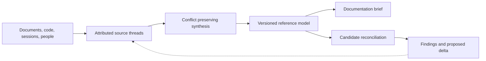

# Knowledge gathering

The knowledge package turns product evidence into a versioned reference model
that people can inspect and reconcile. It preserves the source, observed
behavior, accountable intent, and current model as distinct records. Its
procedures and tools belong to DocsFab; a consuming project owns its collected
knowledge.

The package requires Node.js 24.21.0 or later.

## Choose a starting point

| You need to… | Start with… |
| --- | --- |
| Assess a repository | [Assess product repository](skills/assess-product-repository/SKILL.md) |
| Register or mine evidence | [Register a source thread](skills/register-source-thread/SKILL.md), [mine agent sessions](skills/mine-agent-session-transcripts/SKILL.md) |
| Interview people or reflect a model change | [Interview the product model](skills/interview-product-model/SKILL.md), [reflect a model delta](skills/reflect-model-delta/SKILL.md) |
| Synthesize sources or reconcile behavior | [Synthesize source threads](skills/synthesize-source-threads/SKILL.md), [reconcile product behavior](skills/reconcile-product-behavior/SKILL.md) |
| Converge a documentation candidate | [Converge documentation](skills/converge-documentation/SKILL.md) |
| Inspect selectors and runtime-adapter contracts | [API and adapter reference](docs/api-and-adapters.md) |

## From evidence to a candidate



The loop keeps evidence and conflicts inspectable as a model evolves. Briefs,
findings, and candidates are proposed handoffs. They do not approve a model,
write a repository, or publish documentation. The [system architecture](../../docs/about/architecture.md)
shows how this package connects to workflow execution and delivery.

## Package map and local check

This package has eight procedures, linked above. The `src/` directory contains the local,
append-only control plane and runtime adapter; `contracts/` and `tests/` define
and exercise their boundaries.

For DocsFab itself, the Product Reference Model lives at
`.docsfab/reference-model` and public documentation lives under `docs/`. A
consuming repository chooses its own authorized record root. Run the package
checks from the repository root:

```sh
cd packages/knowledge
npm test
node src/cli.mjs help
```

To start the local control plane, provide an explicit data directory:

```sh
node src/cli.mjs serve --data /absolute/path/to/runtime-data --port 4310
```

It binds to loopback, and each mutation must name the event-stream version it
observed. For exact Git-bound snapshot, admission, recovery, and adapter
contracts, see the [API and adapter reference](docs/api-and-adapters.md).

## License

Package source code is licensed under Apache License 2.0
([`LICENSE`](../../LICENSE)). Knowledge procedures combine Apache-2.0 code and
CC-BY-4.0 instructions and documentation; see
[`skills/LICENSE`](skills/LICENSE) for both license texts.

For the package's import provenance and the explicit migration requirement for
older records, see the [source receipt](docs/api-and-adapters.md#source-receipt).
