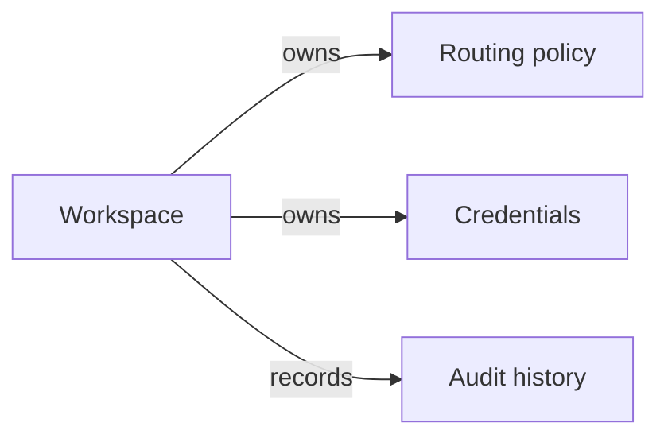
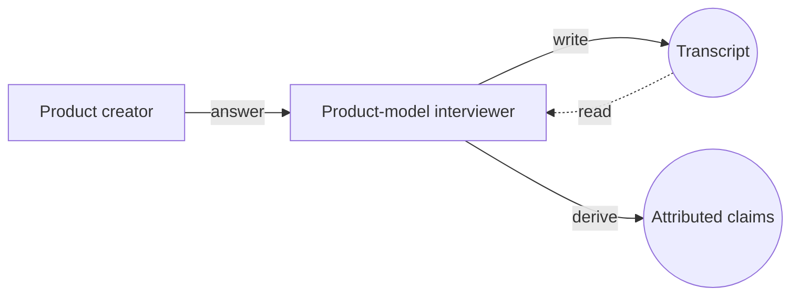
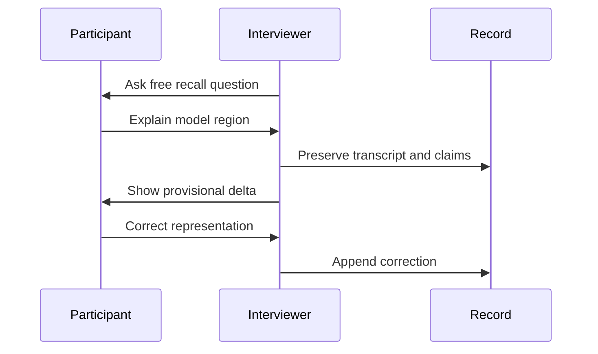
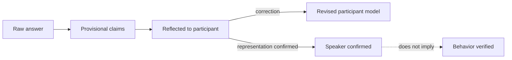

# Projection Patterns

Choose a view because it exposes a possible error, not because it is visually
appealing.

## Concept relationship

Ask whether the concepts, verbs, direction, and ownership boundary match the
participant's model.

## FMC-inspired composition

Use rectangles for active agents, circles for passive stores, dotted arrows
for reads, and solid arrows for writes.

Ask who can read or write each store, which channel is missing, and whether a
store has been mistaken for an actor.

## Sequence

Ask whether the order is possible, which step can repeat, and where an
approval or wait is missing.

## State or decision boundary

Ask which transitions are forbidden, who can authorize each transition, and
whether confirmation has been confused with verification.

## Rendering constraints

- Use bare, single-line labels without quotes, Markdown, ` `, or `\n`.
- Keep identifiers simple and unique.
- Put detail in a table below the diagram rather than long node labels.
- For complex diagrams, split by model region. Use ELK layout only when the
  target renderer supports Mermaid frontmatter configuration.
- Explain uncertain or disputed elements in text; do not rely on color.
