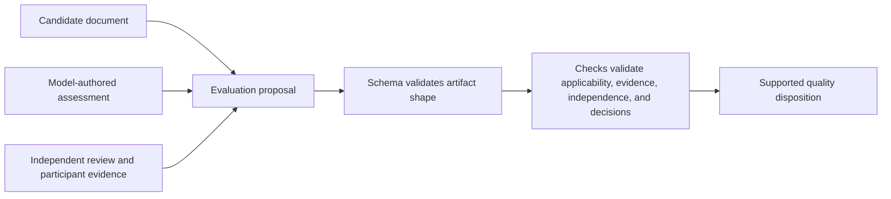

> This public distribution contains production quality policy and portable
> integrity checks. Benchmark inputs and their qualification suites remain internal.

# Quality policy and evidence

This package contains the deterministic rules DocsFab uses to check and assess
documentation: schemas, rubrics, formats, profiles, validators, fixtures, and
tests. It separates artifact validity from evidence quality, so a well-formed
result does not by itself count as a supported quality decision.

## Follow a quality asset

| To understand… | Open… |
| --- | --- |
| Accepted request, result, and evidence shapes | [`schemas/`](schemas/) |
| Content-type rules and dimension scores | [`rubrics/`](rubrics/) and [`profiles/`](profiles/) |
| Deterministic validation | [`checks/`](checks/) |
| Output and source-document handling | [`formats/`](formats/) |
| Portable package checks | [`tests/`](tests/) |



The package keeps production policy and its contract fixtures together. The
repository maintains system comparisons separately from this production
policy package. A fixture demonstrates the contract; it is not evidence of a
fresh model-backed run.

## Quality decisions

The layered evaluation validates artifact shape with JSON Schema, then checks
profile applicability, evidence, independence, and decision semantics. Hard
failures take precedence; missing required evidence remains
`insufficient-evidence` or `human-review`. Layer scores retain their dimension
vector. Legacy task-guide, concept-guide, and API-reference scores apply only
when that older evaluation is selected; do not compare their maxima or use a
legacy total as a layered result. A writer's output cannot provide independent
peer-review evidence for that same artifact.

The `nvidia-technical-documentation` profile is a compact baseline from the
NVIDIA Writing and Style Guide. It does not replace corporate legal, brand,
localization, or product rules. Product and renderer-specific rules belong in
the profile's lineage-bearing overlays.

## Runtime and validation

For how this package's canonical sources become locked runtime assets, see
[the skills and runtime contract](../skills/README.md#relationship-to-the-runtime).

The source test runner, distribution input catalog, portable smoke, and
`checks/score_harness_role_qualification.py` stay out of runtime staging.
Explicit [`runtime-policy/`](runtime-policy/README.md) inputs preserve installed
resource bytes independently of source-checkout validation commands.

From the repository root, run:

```sh
make validate
make test
make smoke
```

These checks do not run a model-backed workflow. The import record is
[`SOURCE_SNAPSHOT.yaml`](SOURCE_SNAPSHOT.yaml).
