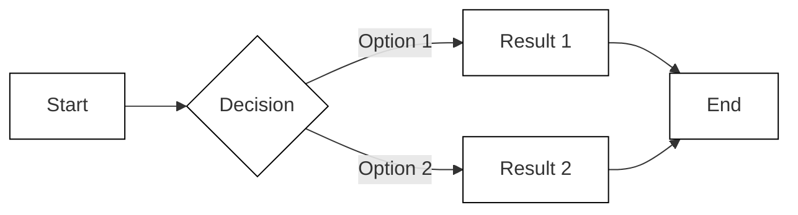

# [Add the Page Title Here]
<!-- @tpl:naming
Use title casing and noun phrasing, such as Memory Model Cache. Only page titles get denoted with a single hashtag (#).
-->

<!-- @tpl:example
- Memory Cache
- Reference Architecture and Task Groupings
- Security and Authentication for NeMo Retriever Embedding NIM
- Workflows
-->

<!-- This is the Conceptual template. Use it to explain a core or general concept and provide background information about a product or feature. You can also use the conceptual template to explain how things work. If applicable, be sure to include any alternatives so that users can understand the trade-offs. If you want to provide conceptual information AND one or more procedures, use the Blended Conceptual Template instead. -->

<!-- @tpl:example
To get started, refer to:

- [Quality Assessment and Filtering](https://docs.nvidia.com/nemo/curator/latest/curate-text/process-data/quality-assessment)
- [Memory Model Cache](https://docs.nvidia.com/nemo/guardrails/configure-guardrails/caching/model-memory-cache)
- [Reference Architecture and Task Groupings](https://docs.isaacsim.omniverse.nvidia.com/latest/introduction/reference_architecture.html)
- [Security and Authentication for NeMo Retriever Embedding NIM](https://docs.nvidia.com/nim/nemo-retriever/text-embedding/latest/security.html)
-->

<!-- @tpl:formatting
- Use a bulleted list of links to present brief summaries to help navigate users to other content.
- Use tables to organize complex information.
- Use headings, tables, or details blocks to present command variants.
- Use code blocks for examples, API patterns, or configuration structures sparingly.
- Use Mermaid diagrams sparingly to illustrate component relationships, data flows, or process steps.
- Use callouts for important warnings, notes, and tips.
-->

<!-- @tpl:naming
Rename the file and save it in the appropriate project repository. The filename gets included in the URL. Try to name your file in a way that the content can change without having to change the filename (and the URL). For better SEO, use hyphens instead of underscores. Avoid putting product names in file names whenever possible. For example, instead of nemoretriever-parse, a product-agnostic name could be "advanced-ocr-parsing".
-->

<!-- @tpl:example
- namespaces.rst
- memory-model-cache.rst
- workflows.rst
- data-store.rst
-->

<!-- @tpl:formatting
Provide the first paragraph here (Explain the "what"). Replace the following conceptual information with your own.
-->
Your first paragraph should name the concept, name the product, and link to the product overview page. You can mention the benefits of the concept, but do not describe it in detail yet. Ideally, the first paragraph should be no longer than two sentences, and the link to the product overview page should be the last thing in the paragraph. If there is a related page that the user should possibly visit instead, link to it in the first paragraph before the user invests time in reading this page.

<!-- @tpl:example
- To learn more about security and authentication, refer to [Product Name](/path/to/overview-gfm.md).
- To learn how [Product Name] handles and uploads data, refer to [Product Documentation](/path/to/overview-gfm.md).
- [Product Name](/path/to/overview-gfm.md) is typically installed and used as one part of a larger solution.
-->

<!-- @tpl:visual-representation
Optionally, provide a diagram here. You can include a diagram to help explain the concept. The diagram should be placed after the first paragraph. Add a sentence to introduce the diagram immediately before the diagram. Replace the following diagram examples with your own.
-->

The following diagram shows how Text Retriever NIM APIs can help a question-answering RAG application find the most relevant data in an enterprise setting:

<!-- @tpl:formatting
Provide the second paragraph here (Explain the "why"). Replace the following conceptual information with your own.
-->
Your second paragraph should start describing the concept in more detail. You can add more sections to describe different aspects of the concept. Explain why this information is relevant. Include background information or techniques for using the technology. Include use cases. You can also explain how the concept works and or how it fits into the larger ecosystem. Do not repeat information that already exists. Use links instead.

<!-- @tpl:example
Namespaces and projects are organizational entities that help you structure all other entities and files in a logical way. You can use namespaces and projects to organize other entities by user, team, or other criteria.
-->

<!-- @tpl:formatting
If the first and second paragraph only total three to four sentences, then combine them into a single paragraph.
-->

## [Add a Heading for the First Section Here]
<!-- @tpl:naming
Sections are optional. Use title casing for the heading. For example: [Cache Fragmentation](https://docs.nvidia.com/nemo/guardrails/configure-guardrails/caching/model-memory-cache#cache-fragmentation). Section headings are denoted with a double hashtag (##).
-->

<!-- @tpl:formatting
Provide the conceptual information for this section here. Replace the following example with your own text.
-->
With a default round-robin load balancing strategy, incoming traffic routes to each node in turn. The nodes build their own partial view of traffic, which reduces cache hit rates compared to a single-node deployment. This effect is called cache fragmentation and becomes more pronounced as the number of nodes increases.

You can address cache fragmentation in one of two ways:

1. Use a stateful load balancer to inspect the incoming request and route it to the same backend node on every request.
2. Use a cluster-wide in-memory store to store and read cache entries from all compute nodes in the cluster. This approach also helps when nodes restart because they can pull the cache state on startup.

### [Add a Heading for a Subsection Here]
<!-- @tpl:naming
Subsections are optional. Use title casing for the heading. For example: [Improving Cache Hit Rates with Consistent Hashing](https://docs.nvidia.com/nemo/guardrails/configure-guardrails/caching/model-memory-cache#improving-cache-hit-rates-with-consistent-hashing). Subsection headings are denoted with a triple hashtag (###).
-->

<!-- @tpl:formatting
Provide the conceptual information for this subsection here. Replace the following conceptual information with your own text.
-->
Stateful load balancing strategies route repeated identical requests to the same backend node rather than spreading them evenly. This approach increases cache hit rates and does not require any modifications to the library code. In consistent hashing, a property of the request, such as the request body or a header value, is hashed and used to select a backend node. Requests with identical properties always route to the same node, which improves cache hit rates. However, over time, nodes are added or removed due to scaling, deployments, or node failures. This causes some requests to remap to different nodes, and hit rates drop until the incoming traffic repopulates cache entries.

### [Add a Heading for a Subsection Here]
<!-- @tpl:naming
Subsections are optional. Use title casing for the heading. For example: [Improving Cache Hit Rates with Cluster Storage](https://docs.nvidia.com/nemo/guardrails/configure-guardrails/caching/model-memory-cache#improving-cache-hit-rates-with-cluster-storage). Subsection headings are denoted with a triple hashtag (###).
-->

<!-- @tpl:formatting
Provide the conceptual information for this subsection here. Replace the following conceptual information with your own.
-->
You can use a cluster-wide in-memory store, such as Redis, as an alternative to stateful load balancing. Supporting a cluster-wide in-memory store requires modifications to the library to read and write to the cluster storage. Instead of each node maintaining its own isolated cache, all nodes read from and write to a shared store. This approach eliminates cache fragmentation because a prompt cached by any node is available to all nodes regardless of how the load balancer routes requests. A cluster-wide store also improves resilience. When a node restarts, it does not start with an empty cache. Instead, the node can load previously cached entries from the shared store and benefits from cache hits immediately.

The trade-off is added infrastructure complexity and a network hop for each cache lookup. The shared store must be highly available and sized to handle the throughput of all nodes. Refer to the documentation for your chosen in-memory store for guidance on clustering, replication, and sizing.

## How the [Insert the Name of the Concept Here Using Noun Phrasing] Works
<!-- @tpl:optional
Use this section to explain how the concept works. This can also be a subsection of another section on the page. Explain how the concept works from the user's point of view. You can also include implementation details or code examples for common use cases at a high level. You should link to other pages that provide granular architecture and implementation details.
-->

<!-- @tpl:formatting
Provide the conceptual information for this section here. Replace the following example with your text.
-->
To interact with your projects, the server exposes a primary GraphQL API. By default, the server listens on http://localhost:10001. When installed on a remote location, you can access the server from your primary system using an SSH tunnel, with the server mapped to a different port.

## [Add a Heading for the Second Section Here]
<!-- @tpl:naming
Sections are optional. Use title casing for the heading. For example: [Importing Assets](https://docs.isaacsim.omniverse.nvidia.com/latest/introduction/reference_architecture.html#importing-assets). Section headings are denoted with a double hashtag (##).
-->

<!-- @tpl:formatting
Provide the conceptual information for this section here. Replace the following example with your text.
-->
There are extensions that enable importing CAD (Computer Aided Design) files into Isaac Sim, which handle conversion to OpenUSD. Extensions are core building blocks that interact with and add or extend the functionality of Isaac Sim.

### [Add a Heading for a Subsection Here]
<!-- @tpl:naming
Subsections are optional. Use title casing for the heading. For example: [Importing and Creating Environments](https://docs.isaacsim.omniverse.nvidia.com/latest/introduction/reference_architecture.html#importing-and-creating-environments). Subsection headings are denoted with a triple hashtag (###).
-->

<!-- @tpl:formatting
Provide the conceptual information for this subsection here. Replace the following conceptual information with your own.
-->
The asset importer can be leveraged for importing OBJ, FBX, and glTF formats. The CAD converter extension supports a variety of popular CAD files from applications including Catia, Solidworks, AutoCad, and Creo. This enables you to quickly convert and import your environment into Isaac Sim.

OpenUSD Connections and Data Exchange, formerly Omniverse Connect, is a collection of importers, exporters, converters, and USD file format plug-ins. They enable various 3D applications, products, and file formats to exchange data using OpenUSD.

Some CAD applications have connectors with Omniverse, which allows them to bring over more relevant and contextual information when converting to USD. For example, PTC Creo, Autodesk Revit, or Autodesk Alias have corresponding connectors. The files generated from their CAD converters will have all the visual meshes represented in OpenUSD.

### [Add a Heading for a Subsection Here]
<!-- @tpl:naming
Subsections are optional. Use title casing for the heading. For example: [Importing Robots](https://docs.isaacsim.omniverse.nvidia.com/latest/introduction/reference_architecture.html#importing-robots). Subsection headings are denoted with a triple hashtag (###).
-->

<!-- @tpl:formatting
Provide the conceptual information for this subsection here. Replace the following example with your text.
-->
Isaac Sim comes with a variety of robots already imported. The pre-imported robots can be found on the Robot Assets page. Isaac Sim also provides advanced options for importing other robots.

If your robot is in URDF, you can use the URDF Importer Extension from the GUI or from Python. This extension will import the visual meshes and the prim hierarchies (child-parent relationships), along with extra information about how the collision meshes, joints, and sensors are encoded.

You can also use the Onshape Importer and MJCF Importer Extension. With these importers, you will have to add the joint drives and may have to tune them. The Gain Tuner Extension allows you to visualize and tune the joints.

<!-- @tpl:formatting
If additional sections are needed, copy and paste the boilerplate sections above here.
-->

## Best Practices
<!-- @tpl:naming
Do not rename this section.
-->

<!-- @tpl:optional
Provide a list of best practices here. The more mature your product or feature becomes, the more likely you are to have best practices to share.
-->

Here are some best practices for using [insert the name of the concept here using noun phrasing].

- [Best Practice 1: When you use [Name of Concept], make sure to [best practice]. This [benefit of best practice]. For more information, refer to [Page Title](link-gfm.md).]
- [Best Practice 2: When you use [Name of Concept], make sure to [best practice]. This [benefit of best practice]. For more information, refer to [Page Title](link-gfm.md).]
- [Best Practice 3: When you use [Name of Concept], make sure to [best practice]. This [benefit of best practice]. For more information, refer to [Page Title](link-gfm.md).]

<!-- @tpl:example
Use namespaces to organize your entities and files in a logical way. You can use namespaces to group entities by user, team, or other criteria. For more information, refer to [Page Title](/path/to/link-gfm.md).
-->

<!-- @tpl:example
When you upload data to NeMo Retriever for extraction, make sure to format your data according to the supported formats and include all necessary metadata. For more information, refer to [Page Title](/path/to/link-gfm.md).
-->

<!-- @tpl:formatting
If you have a full page of best practices, add a link to it from here. For example: [Best Practices](https://docs.nvidia.com/deeplearning/tensorrt/latest/performance/best-practices.html).
-->
For more information, refer to [Best Practices](best-practices-gfm.md).

## Related Topics
<!-- @tpl:naming
Do not rename this section.
-->

<!-- @tpl:formatting
Provide a list of links to related topics. Be sure to include correct page titles and file names for the links. Generally, DO NOT include pages in the Related Topics section that are already referenced on the page.
-->

- [Related Conceptual Topic](link-gfm.md)
- [Procedure Topic](link-gfm.md)
- [Get Started](path/to/get-started/overview-gfm.md)
- [Tutorial Topic](tutorial-gfm.md)
- [Deployment Topic](deployment-gfm.md)
- [Troubleshooting](../troubleshooting/troubleshooting-gfm.md)
- [Marketing Page](link-gfm.md)
