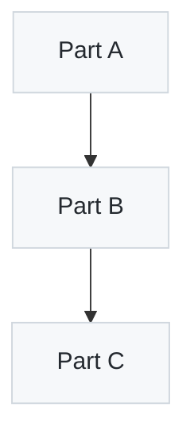

# Beginner Tutorial
<!-- @tpl:naming
Use title casing: Start with an active verb, such as Run Your First Speech NIM Microservice for Automatic Speech Recognition. Only page titles get denoted with a single hashtag (#).
-->

<!-- This is the Beginner Tutorial template. Use it for a hands-on beginner tutorial that teaches core concepts through guided practice. It is a learning-oriented document (Tutorial in the Diataxis framework) that builds understanding progressively. -->

<!-- @tpl:example
To get started, refer to [Run Your First Speech NIM Microservice for Automatic Speech Recognition](https://docs.nvidia.com/nim/speech/latest/get-started/tutorials/asr.html).
-->

<!-- @tpl:naming
Do not rename the file.
-->

<!-- @tpl:formatting
- Use tables to organize complex information.
- Use headings, tables, or details blocks to present command variants.
- Use code blocks for examples, API patterns, or configuration structures.
- Use Mermaid diagrams sparingly to illustrate component relationships, data flows, or process steps.
- Use callouts for important warnings, notes, and tips.
-->

**Goal**: [State the concrete outcome users will achieve by completing this tutorial.]

<!-- @tpl:example
**Goal**: By the end of this tutorial, you will have created sample JSONL input, built and ran a three-stage text curation pipeline locally, and inspected the filtered output.
-->

**In this tutorial, you will**:
<!-- @tpl:formatting
Provide and format the learning objectives here as an ordered list. Start each learning objective with an active verb. Replace the following example with your own text.
-->

1. [Deploy the ASR NIM Microservice](Link to the subsection under the Tutorial Steps section).
2. [Check the service readiness](Link to the subsection under the Tutorial Steps section).
3. [Get sample audio](Link to the subsection below under the Tutorial Steps section).
4. [List available models](Link to the subsection under the Tutorial Steps section).
5. [Run inference](Link to the subsection under the Tutorial Steps section).
6. [Verify the results](Link to the subsection under the Tutorial Steps section).

## Prerequisites
<!-- @tpl:naming
Do not rename this section.
-->

<!-- @tpl:optional
If applicable, provide and format the essential prerequisites that the user should complete before starting the tutorial as an ordered list. This should be a short list of prerequisites. Replace the following example with your own text.
-->

Before you start, you must complete the following prerequisites:

<!-- @tpl:example
1. Completed [Installation Guide](/path/to/installation-gfm.md) or [Quickstart](/path/to/quickstart-gfm.md)
2. [Prerequisite 2, for example: API key configured]
3. [Prerequisite 3, for example: Sample data downloaded]
-->

1. [Complete the required setup.]
2. [Configure the required credentials.]
3. [Download or create the required sample data.]

<!-- @tpl:example
1. Install a supported operating system.
2. Install the required Python version.
3. Verify that your machine meets the minimum RAM requirements.
4. (Optional) Install GPU drivers for accelerated workflows.
-->

## Related Concepts
<!-- @tpl:naming
Do not rename this section.
-->

<!-- @tpl:formatting
Include this section only if users need to understand certain concepts that are related to this tutorial before starting. Use a bulleted list of links to help users navigate to each conceptual topic. Use noun phrasing and title casing (Align with the Product Manager on this section).
-->

Understanding the following concepts will help you complete this tutorial:

<!-- @tpl:formatting
Add a description for the related concept. Replace the following example with your own text.
-->

- **[Name of the Related Concept such as Deduplication](path/to/related-concept-1)** — Comprehensive overview of deduplication techniques across text, image, and video modalities including exact, fuzzy, and semantic approaches.
- **[Name of the Related Concept such as Resource Allocation](path/to/related-concept-2)** — How NeMo Curator allocates CPUs, GPUs, and memory across pipeline stages for optimal hardware utilization.
- **[Name of Related Concept such as Auto-Balancing](path/to/related-concept-3)** — How the executor automatically balances resources across pipeline stages to eliminate bottlenecks.
- **[Name of Related Concept such as Throughput](path/to/related-concept-4)** — Scale from a single GPU to multi-node clusters with near-linear scaling.

Before diving in, you need to understand the necessary core concepts. For more information, refer to [Concepts](../conceptual/overview-gfm.md).

> **See also:** For deeper conceptual understanding, refer to [Concepts documentation](../conceptual/overview-gfm.md).

## Tutorial Steps
<!-- @tpl:naming
Do not rename this section.
-->

Work through each step in order, verifying your progress at each checkpoint.

### [First Major Step]
<!-- @tpl:example
Deploy the ASR NIM Microservice
-->

<!-- @tpl:formatting
Introduce the step and provide any additional context. Replace the following example with your own text.
-->
Choose a model and deploy it. This tutorial uses the Parakeet 1.1b CTC English (en-US) model with `mode=all`, which enables both streaming and offline inference.

<!-- @tpl:example
Create `data/input/sample.jsonl` with two records:

```json
{"id": "doc-1", "text": "A complete sentence with useful content."}
{"id": "doc-2", "text": "x"}
```
-->

1. **[Action 1]**

   ```bash
   # [Command or code]
   [example commands]
   ```

2. **[Action 2]**

   ```python
   # [Code example with inline comments]
   [import statements]

   # [Explain what this code does]
   [code]
   ```

**✅ Success Check**: [Describe what users should see.]

### [Second Major Step]
<!-- @tpl:example
Check the Service Readiness
-->

<!-- @tpl:formatting
Introduce the step and provide any additional context. Replace the following example with your own text.
-->
Build your first pipeline by connecting a reader, quality filter, and writer. The diagram below shows how data flows through these three stages.

<!-- @tpl:example
```python
from nemo_curator.pipeline import Pipeline
from nemo_curator.stages.text.filters import WordCountFilter
from nemo_curator.stages.text.io.reader import JsonlReader
from nemo_curator.stages.text.io.writer import JsonlWriter
from nemo_curator.stages.text.modules import ScoreFilter

pipeline = Pipeline(name="first-pipeline")
pipeline.add_stage(JsonlReader(file_paths="data/input/*.jsonl", fields=["text", "id"]))
pipeline.add_stage(
    ScoreFilter(
        filter_obj=WordCountFilter(min_words=5),
        text_field="text",
        score_field="word_count",
    )
)
pipeline.add_stage(JsonlWriter(path="data/output"))
pipeline.run()
```
-->




1. **[Action 1]**

   ```python
   # [Code example]
   [code with comments explaining each part]
   ```

2. **[Action 2]**

   <details>
   <summary>Option A</summary>

   ```python
   # [Code for option A]
   [code]
   ```

   </details>

   <details>
   <summary>Option B</summary>

   ```python
   # [Code for option B]
   [code]
   ```

   </details>

**✅ Success Check**: [Describe what users should see.]

### [Third Major Step]
<!-- @tpl:example
Get Sample Audio
-->

<!-- @tpl:formatting
Introduce the step and provide any additional context. Replace the following example with your own text.
-->
Run the pipeline end to end and examine the output directory to confirm that only high-quality records survived the filter.

<!-- @tpl:example
Run `python first_pipeline.py`, then inspect `data/output/part-00000.jsonl`. The output contains `doc-1`; `doc-2` is absent because it did not meet the word-count threshold.
-->

1. [Action 1]

   ```python
   # [Complete working example]
   [full code example that users can copy and run]
   ```

2. [Action 2 - Examine the results]

   ```bash
   # View the output
   [command to examine results]
   ```

   Example output:

   ```text
   [Expected output that confirms success]
   ```

**✅ Success Check**: [Describe what users should see as a final verification that the tutorial completed successfully.]

### [Fourth Major Step - Verification/Exploration]
<!-- @tpl:example
Verify the Results
-->

<!-- @tpl:formatting
Introduce the step and provide any additional context. Replace the following example with your own text.
-->
Verify your results match the expected output, then try adjusting the quality threshold and re-running to see how it affects the filtered dataset.

<!-- @tpl:example
Change `min_words` from `5` to `1` and run the pipeline again. Both records now appear in the output, demonstrating how the threshold changes filtering behavior.
-->

1. **Verify Your Results**

   ```python
   # Verification code
   [code that confirms success]
   ```

2. [Action 2 - Try it yourself]
   <!-- @tpl:optional
   Omit this challenge when the tutorial ends at verification.
   -->

   **Challenge 1**: [An alternative users can try]

   ```python
   # Hint: [Brief guidance]
   [partial code or starting point]
   ```

   **Challenge 2**: [Another variation]

## Troubleshooting
<!-- @tpl:naming
Do not rename this section.
-->

<!-- @tpl:optional
If you have a Troubleshooting Guide, cross-reference it to help users identify how to resolve issues that they may have encountered when completing the tutorial. Include cross-references to other troubleshooting sections.
-->

If you encountered issues during this tutorial, refer to the [Troubleshooting](../troubleshooting/troubleshooting-gfm.md). For installation-specific issues, see the Troubleshoot Installation section in [Installation](installation-gfm.md).

## What You Learned
<!-- @tpl:naming
Do not rename this section.
-->

<!-- @tpl:formatting
Provide a summary of what users have accomplished. Format the summary as an unordered list.
-->

<!-- @tpl:example
In this tutorial, you have:

- ✅ [What they accomplished in step 1]
- ✅ [What they accomplished in step 2]
- ✅ [What they accomplished in step 3]
- ✅ [What they accomplished in step 4]
-->

<!-- @tpl:example
In this tutorial, you have:

- Deployed a NIM container using CONTAINER_ID and NIM_TAGS_SELECTOR to select a model and inference mode, and saw that the container handles model download, optimization, and serving automatically.
- Verified readiness using the health endpoint, which tells you when the service is ready to accept requests.
- Discovered available models using the --list-models flag, which shows what a running NIM is serving.
- Compared streaming and offline transcription. Streaming returns partial results in real time and is suited for live applications. Offline processes the full audio and returns a complete result, suited for batch workflows.
- Used both gRPC and HTTP to interact with the service. gRPC is the primary protocol for streaming. HTTP/REST is simpler for offline requests and integration.

For more detail, continue with:

- **[Concept 1]** — [Concepts](/path/to/overview-gfm.md)
- **[Concept 2]** — [Concepts](/path/to/overview-gfm.md)
- **[Concept 3]** — [Concepts](/path/to/overview-gfm.md)
-->

## Next Steps
<!-- @tpl:naming
Do not rename this section.
-->

<!-- @tpl:formatting
Use a bulleted list of links to help navigate users to other related resources such as user guides and tutorials. Replace the following example with your own example. Do not include links to pages that have not been created yet. Provide an introductory sentence that summarizes the main next steps. Replace the following example with your own text.
-->

Continue to an intermediate tutorial to learn how to create multi-stage pipelines.

- **[Next Tutorial](path/to/next-tutorial)** — Continue learning with [description of next tutorial].
- **[Related Task Guide](path/to/how-to)** — Learn how to [specific task related to what they just learned].
- **[Concepts Deep Dive](../conceptual/overview-gfm.md)** — Understand the concepts behind what you just built.
- **[API Reference](path/to/reference)** — Explore all available options and parameters.

<!-- @tpl:formatting
Add more links here as needed.
-->
