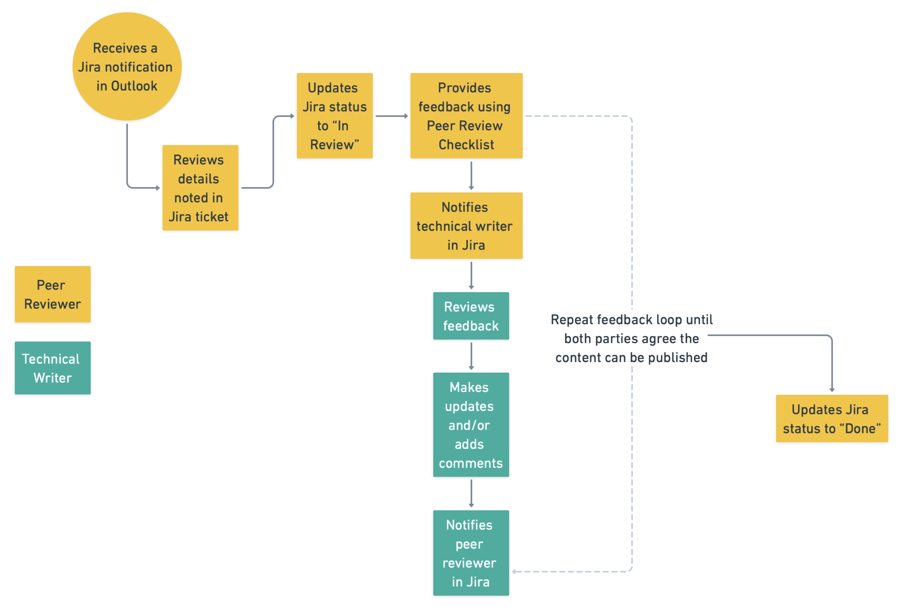

# Quickstart for [Product Name]
<!-- @tpl:naming
Use title casing: Start with "Quickstart for" followed by [Product Name], such as Quickstart for NeMo Curator Audio Curation. Only page titles get denoted with a single hashtag (#).
-->

<!-- This is the Quickstart template. Use it for a fast-track getting started experience that gets users to their first success as quickly as possible with minimal explanation; for detailed setup, link to the Installation Guide. For the GitHub Flavored Markdown variant, use the quickstart-gfm.md file. -->

<!--  @tpl:example
To get started, refer to [Quickstart for NeMo Curator Audio Curation](https://docs.nvidia.com/nemo/curator/latest/get-started/audio).
-->

<!-- @tpl:naming
Rename the file and save it in the appropriate project repository. The filename gets included in the URL. Try to name your file in a way that the content can change without having to change the filename (and the URL). For better SEO, use hyphens instead of underscores. Avoid putting product names in file names whenever possible. For example, instead of nemoretriever-parse, a product-agnostic name could be "advanced-ocr-parsing".
-->

<!-- @tpl:example
- text-curation-quickstart.md
- image-curation-quickstart.md
-->

<!-- @tpl:formatting
- Use tables to organize complex information.
- Use in-page tabs (`tab-set`) to present OS-specific and language-specific command variants within a step.
- Use code blocks for examples, API patterns, or configuration structures.
- Use Mermaid diagrams sparingly to illustrate component relationships, data flows, or process steps.
- Use callouts for important warnings, notes, and tips.
-->

<!-- @tpl:formatting
Provide an introductory sentence that explains what the Quickstart will help users accomplish. Replace the following example with your own text. Cross-reference the Installation Guide or any comprehensive Configuration/Get Started Guides to help users obtain more detailed information. Replace the following example with your own text.
-->
This Quickstart Guide walks you through the process for installing NeMo Curator, running a small text filtering pipeline, and inspecting the curated output. For a detailed walkthrough, refer to the [Installation Guide](installation.md).

## Prerequisites
<!-- @tpl:naming
Do not rename this section.
-->

<!-- @tpl:optional
If applicable, provide and format the essential prerequisites as an ordered list. Replace the following example with your own text. This should be a short list of prerequisites. Cross-reference the Prerequisites page.
-->

Before you start, you must complete the following prerequisites:

1. Start each step with an active verb.
2. Try to avoid “Ensure that”.

<!-- @tpl:example
1. Install Python 3.10 or later.
2. Obtain an API key with available credits.
3. Verify 2 GB of free disk space is available.

For comprehensive system prerequisites and verified configurations, refer to [Prerequisites](/path/to/prerequisites.md).
-->

## Quickstart Steps
<!-- @tpl:naming
Do not rename this section.
-->

To quickly get started with [Product Name], complete the following steps:
<!-- @tpl:formatting
Provide the steps for the quickstart here. Replace the following steps with your own.
-->

1. Start each step with an active verb.

   <ol type="a">
    <li>Include nested ordered lists for steps that require the user to complete a series of actions formatted using HTML.</li>
    <li>Include multiple items in the list.</li>
        If you find yourself only adding one item, then consider rewriting the parent numbered item to include the item.
   </ol>

2. Include multiple steps.
   <!-- @tpl:formatting
   If you find yourself only adding one step, then you do not need an ordered list. You can simply present the information in paragraph form.
   -->
3. Add an unordered list after an ordered item that does not have the user follow a series of sequential actions, such as a
   list of parameter descriptions:

   - `image.repository`: Specifies the container/NIM to deploy.
   - `image.tag`: Defines the version of that container/NIM.

4. Include tables after steps for complex information.
   Do **not** try to duplicate reference information. Simply cross-reference any reference topics.

   <!--  @tpl:formatting
   For easy maintenance and better readability, you can format the table in HTML instead of markdown:

   <table>
   <thead>
     <tr>
       <th>Argument</th>
       <th>Description</th>
     </tr>
   </thead>
   <tbody>
     <tr>
       <td>
           <code>--enable-auto-tool-choice</code>
       </td>
       <td>
           <p>Allows the model to choose between generating text or calling a tool. Required for tool calling.</p>
       </td>
     </tr>
    <tr>
       <td>
           <code>--tool-call-parser &lt;parser&gt;</code>
       </td>
       <td>
           <p>Built-in parser name for extracting tool calls from model output. Must match the model’s tool calling format (for
           example, llama3_json for Llama 3.1 and 3.3).</p>
       </td>
     </tr>
     <tr>
       <td>
           <code>--tool-parser-plugin &lt;path&gt;</code>
       </td>
       <td>
           <p>Path to a custom tool-call parser file. Accepts an absolute path or a path relative to the model checkpoint
           directory (the path is used as-is — no basename stripping). Required only when no built-in parser fits your model.</p>
       </td>
     </tr>
   </tbody>
   </table>
   -->

5. Enter (Optional) at the beginning of a step to indicate if it is optional.
6. Add diagrams or screenshots for complex steps.
   <!-- @tpl:example
   
   -->

   <!-- @tpl:visual-representation
   Do not include diagrams or screenshots after every step in the procedure.
   -->
7. Do **not** format steps as headings.
   <!-- @tpl:formatting
   All steps should be formatted as body text.
   -->
8. Include one sentence for each step.
   Enter a hard return after the step and describe what happens after completing the step when necessary.
9. Limit your procedure to nine steps.

<!-- @tpl:example
1. Install the base package first, such as `pip install nemo-curator`, then add modality-
   specific or GPU extras only after the first run works end to end.

   [Provide the simplest installation method. Use one or two commands maximum.]

   ```bash
   # Install [Product Name]
   pip install [package-name]
   ```

2. Create `data/input` and `data/output`, and then place a small JSONL sample in the input directory
   so that the first pipeline has something real to process.

   ```bash
   # Set up configuration
   [configuration command or file creation]
   ```

   :::{important}
   Include any critical notes about configuration, such as API keys or credentials.
   :::

3. Run a small text-quality or dedup pipeline against the sample file so the command produces
   filtered records and a new output manifest.

   ```bash
   # Run the example
   [command to execute]
   ```

   **✅ Success Check**: [Describe what users should see if everything works correctly.]

4. Check that the output directory contains curated records, per-stage metrics, or a summary
   showing how many rows were kept and filtered.


   ```bash
   # Check the output
   [verification command]
   ```

   Example output:

   ```text
   [Expected output that confirms success]
   ```
-->

## Minimal Code Example
<!-- @tpl:naming
Do not rename this section.
-->

<!-- @tpl:optional
Include this section only when users need a copy-paste script to integrate the product into their own code. Otherwise, skip this section when the quickstart only involves the CLI or the install-and-run steps already produce a complete result. Replace the following example with your own text.
-->

<!-- @tpl:example
```python
from nemo_curator.pipeline import Pipeline
from nemo_curator.stages.text.filters import WordCountFilter
from nemo_curator.stages.text.io.reader import JsonlReader
from nemo_curator.stages.text.io.writer import JsonlWriter
from nemo_curator.stages.text.modules import ScoreFilter

pipeline = Pipeline(name="first-run")
pipeline.add_stage(JsonlReader(file_paths="data/input/*.jsonl", fields=["text", "id"]))
pipeline.add_stage(
    ScoreFilter(
        filter_obj=WordCountFilter(min_words=5),
        text_field="text",
        score_field="word_count",
    )
)
pipeline.add_stage(JsonlWriter(path="data/output"))
pipeline.run()
```
-->

Use this self-contained example to get started quickly with a copy-paste working setup.

```python
# Minimal working example
[import statements]

# [Brief inline comments explaining each step]
[code that demonstrates core functionality]

# Run it
[execution code]
print("[Success message]")
```

## Next Steps
<!-- @tpl:naming
Do not rename this section.
-->

<!-- @tpl:formatting
Use in-page cards to help navigate users to other related resources such as key features, user guides, and tutorials. Replace the following example with your own example. Do not include links to pages that have not been created yet. Provide an introductory sentence that summarizes the main next steps. Replace the following example with your own text.
-->

<!-- @tpl:formatting
Help navigate users to other related resources such as core concepts, user guides, and the reference overview. Replace the following example with your own example.
-->

Now that you have a working setup, you should explore the following resources in greater detail:

- **Learn the fundamentals**:
   - [Key Features](../about/key-features.md)
   - [Beginner Tutorial](beginner-tutorial.md)
- **Understand the advanced configurations**: [Reference Overview](../reference/reference-overview.md)
