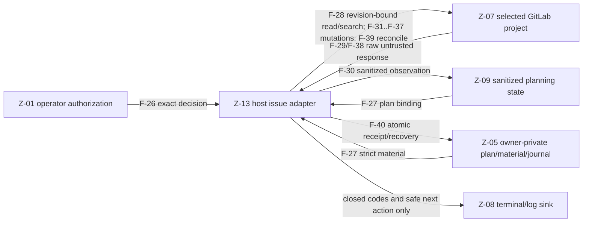

<!-- Diataxis: reference. This versioned detailed model is the canonical security contract. -->

# Credential and data-boundary threat model

This document proposes DocsFab's revised local-product security boundary. The
canonical, mechanically checked flow/control map is
[`security/threat-model.v1.json`](../../security/threat-model.v1.json). The separate
[`security/threat-model-reviews.v1.json`](../../security/threat-model-reviews.v1.json)
binds review decisions to the exact model digest.

The model does not self-assert approval. The committed
`security/threat-model-reviews.v1.json` is an immutable candidate manifest, not
review state: it contains no reviewer identity, action, reviewed commit, or
`approved` flag. Approval remains external GitLab closure evidence produced by
the fixed-purpose verifier from API-returned facts. Until #110, #111, and #112
land, this document also describes a target contract rather than claiming that
every required control is already implemented.

## Executive decision

DocsFab owns the boundaries it creates: exact model messages, model-visible tool
results, provider adapters, diagnostics, durable product evidence, private
artifacts, fixed-purpose local Git/GitLab publication, the host-owned #47
GitLab issue lifecycle, and #103 read-only maturity-cascade tracker observation. GitLab and
organizational CI own credentials committed to repository history and generated
repository changes.

A whole-repository token scan therefore cannot grant or deny DocsFab workflow,
write, or publication authority. It inspects content that may never leave the
repository and blocks realistic work without protecting a DocsFab-controlled
boundary. Retain the manually invoked standalone repository scan only as an
advisory diagnostic; it has no override ceremony and no authority.

DocsFab will retain a narrower defense-in-depth guard at the actual model egress
boundary. The guard examines only the exact serialized message or exact tool
result about to become a model message. Recognized credential material fails
there with one content-free diagnostic and a context-narrowing action. This
does not prove that a request is free of arbitrary confidential information.

## Security invariants

- DocsFab never copies host-owned inference, Metadata/catalog, Git, or `glab`
  credentials into model data, records, logs, patches, commit/MR metadata, or
  shared manifests. Provider output and repository/patch content remain
  untrusted and can independently contain credential material or lookalikes.
- Only data crossing a DocsFab-controlled boundary can affect DocsFab workflow
  eligibility.
- Repository secret enforcement is an organizational GitLab/CI responsibility.
- The model has no unrestricted shell, process, environment, arbitrary network,
  Git, `glab`, credential-helper, or agent-socket capability.
- Raw content-bearing artifacts are owner-private operator state. Only an
  allowlisted projection is shareable evidence.
- Read-only remains the default for bounded workflows. The persistent
  `live-agent` command enables documentation-scoped writes by default;
  `--read-only` removes edit, write, and host-command tools. Write and
  publication authority bind to exact inputs and are rechecked immediately
  before mutation.

## Live-agent terminal surface

The flows, controls, and decisions in this document describe bounded workflow
tools and host-only adapters. They do not describe the persistent
`docsfab live-agent` command path.

On that path:

- Documentation-scoped `edit` and `write` are enabled by default.
- The model-facing `bash` tool is not an unrestricted shell. Each exact
  command requires terminal approval, runs with documentation-only filesystem
  writes, and inherits selected CLI authentication paths. Linux bubblewrap does
  not unshare the network namespace.
- Conversation text, a loaded skill, and write mode do not grant merge,
  protected-branch, or other consequential remote authority.

`D-05` continues to exclude an unrestricted shell from the bounded workflow
contract. The live-agent command path is a separate, terminal-approved surface.
This section describes that surface for review. It is not a Product Security
approval and does not add live-agent flows to
[`security/threat-model.v1.json`](../../security/threat-model.v1.json).

## Trust zones and principals

| Zone | Principal or store | Trust decision |
|---|---|---|
| `Z-01` | Invoking user, DocsFab process, environment, local credential stores | Trusted local capability. Compromise of this zone is outside the current single-user product boundary. |
| `Z-02` | Selected repository and immutable Git object graph | Operator-selected but untrusted content. Repository text can contain prompt injection or sensitive data. |
| `Z-03` | Disposable tracked-only workspace, context, and confined tools | DocsFab-controlled derived-content zone. It contains repository content but no ambient host capability. |
| `Z-04` | Hosted provider or local inference service | External, explicitly operator-approved endpoint. It receives every exact model message. |
| `Z-05` | Private records, caches, patches, delivery capsules, and journals | Owner-private, content-bearing local state; not a publication boundary. |
| `Z-06` | Fixed-purpose host Git and `glab` adapters | Trusted local capabilities that may use host authentication and are never model tools. |
| `Z-07` | GitLab project and organizational CI | External organizational destination and repository-policy authority. |
| `Z-08` | Terminal, progress callbacks, and captured logs | Operator-visible sink that may be forwarded or retained by another system. |
| `Z-09` | DocsFab policy and prompt core | Trusted bounded orchestration: prompt construction, guards, response normalization, and evidence projection without direct credential transport. |
| `Z-10` | Authenticated Metadata or catalog endpoint | External purpose-bound service returning untrusted descriptive model data. It is distinct from inference. |
| `Z-11` | Isolated validation subprocess | Untrusted repository-selected code running under #37's required credential-free OS isolation boundary. |
| `Z-12` | Fixed-purpose provider/catalog adapters | The only inference/Metadata transport components that receive their distinct host-owned credentials. |
| `Z-13` | Fixed-purpose host GitLab issue adapters | Trusted local capabilities added by #47 and #103. They alone receive tracker authentication for exact lifecycle material or revision-bound read-only maturity observation; neither is a model tool. |

The repository, model output, provider responses, Git/`glab` output, and error
payloads are data, not authority. Deserialized records and receipts are evidence,
not capabilities. Only locally issued, operation-bound authorization can mutate
a workspace or SCM state.

## End-to-end data flows

The JSON contract maps each flow to plausible threats and concrete controls.
Every retained or required control reciprocally names its flows and threats, and
the test suite rejects orphan mappings.

| Flow | Boundary and data | Required disposition |
|---|---|---|
| `F-01` | Host credentials move from `Z-01` only into fixed-purpose SCM `Z-06`, provider/catalog `Z-12`, or GitLab issue `Z-13` adapters. | Each adapter receives only its purpose-specific credential; values never enter orchestration/model/evidence data. |
| `F-02` | One immutable repository commit moves from `Z-02` to disposable `Z-03`. | Export admitted tracked regular files without `.git`, ignored/untracked data, unsafe links, ambient Git configuration, or helpers. |
| `F-03` | Selected context moves from `Z-03` to prompt core `Z-09`; a private cache copy moves to `Z-05`. | Bind revision/content/policy/budget identity and minimize for the step. |
| `F-04` | Operator/workflow data from `Z-01` and selected context from `Z-03` join only in prompt core `Z-09`. | Construct the explicit message graph without ambient state; this makes the context-to-prompt direction visible. |
| `F-05` | The exact guarded request moves from `Z-09` to transport `Z-12`. | Apply the exact outbound credential guard; content minimization, not credential matching, addresses over-selection. The request carries a virtual workspace and repository-relative paths, never a host absolute path. |
| `F-06` | `Z-12` sends the exact request and transport-only inference credential to `Z-04`. | Purpose/origin binding, redirect rejection, bounded transport, and no credential in message data. |
| `F-07` | Raw response stream, output, tool calls, usage, and provider failures move from `Z-04` to `Z-12`. | Treat every field as untrusted inbound data; do not infer safety from provider privilege. |
| `F-08` | Normalized but still untrusted model output moves from `Z-12` to `Z-09`. | Admit only bounded response/tool-call shapes and guard downstream durable/public sinks. |
| `F-09` | An allowlisted tool request, including model-proposed write bytes and the operation-bound authorization identity, moves from `Z-09` to confined workspace `Z-03`. | Validate tool name, repository-relative arguments, exact write authority, and untrusted bytes; no shell/SCM/environment/network capability. |
| `F-10` | A bounded repository result moves from `Z-03` to `Z-09` before the next model request. | Canonical path/race checks, closed failures, and exact credential guard before model visibility. Results name workspace-relative or virtual governed-asset paths, and a search payload has this host's roots replaced. |
| `F-11` | Diagnostics from `Z-06`, `Z-09`, `Z-11`, and `Z-12` converge on terminal/log sink `Z-08`. | Discard all raw provider/catalog/validation/Git/`glab` output; emit closed codes, counts, and safe actions. |
| `F-12` | Model, context, workflow, and delivery evidence from four zones converges into a private record in `Z-05`. | Preserve #52 owner-only storage; reject recognized inbound credential leakage before durable serialization. |
| `F-13` | An allowlisted projection moves from private `Z-05` to shareable `Z-08`. | Rebuild from a closed schema; raw records, output, content, paths, and credentials do not cross. Shared text passes the egress function, which replaces this host's undeclared roots. |
| `F-14` | Untrusted content-bearing workspace changes move from `Z-03` to a private patch in `Z-05`. | Exact identity, owner-only retention, explicit write authority, unchanged source; CI—not generic DocsFab token matching—governs repository content. |
| `F-15` | Exact authorized patch/commit inputs move from `Z-05` to fixed-purpose Git `Z-06`. | Preserve #37's host-only adapter, safe config, current authorization, and artifact identity. |
| `F-16` | `Z-06` launches repository-selected validation in `Z-11` with a read-only tree, private scratch, and small credential-free environment. | Required OS isolation denies source/credential reads, network, host writes, and descendant escape; unavailable isolation fails closed. |
| `F-17` | Exit state plus untrusted bounded stdout/stderr returns from `Z-11` to `Z-06`. | Discard raw output, verify filesystem/isolation probes, and retain only a closed validation result. |
| `F-18` | Exact commit/ref plus transport authentication moves from `Z-06` to GitLab `Z-07`. | Create-only/ref-bound push, current authority, bounded discarded output, and destination CI. |
| `F-19` | A bounded GitLab query or sanitized draft-MR request moves from `Z-06` to `Z-07`. | Host auth remains transport-only; title/body/source/target are schema-derived and revalidated before POST, and their text passes the egress function first. |
| `F-20` | Raw GitLab response/auth diagnostics move from `Z-07` to `Z-06`. | Treat provider output as untrusted, bound it, and never return raw data to model/log/record. |
| `F-21` | Sanitized GitLab observations and receipt move from `Z-06` to private `Z-05` and public `Z-08`. | Allowlist project/MR identities and closed evidence; reject credential-bearing values. |
| `F-22` | An exact-label catalog query moves from `Z-09` to `Z-12`. | Bind approved origin/request policy without transporting a credential in orchestration data. |
| `F-23` | `Z-12` sends the query plus distinct transport-only Metadata/catalog credential to `Z-10`. | Exact purpose/origin, redirect rejection, and no inference-credential fallback. |
| `F-24` | Raw authenticated JSON, headers, cursors, and errors move from `Z-10` to `Z-12`. | Authentication proves source only; response remains untrusted and raw data is not persisted or logged. |
| `F-25` | Schema-validated credential-free observation/provenance moves from `Z-12` to `Z-05`, `Z-08`, and policy core `Z-09`. | Descriptive-only evidence cannot directly approve runtime configuration. |
| `F-26` | The operator's host-verifiable, operation-bound write/publication decision moves from `Z-01` to policy core `Z-09`, host publisher `Z-06`, and issue adapter `Z-13`. | Bind decision, workflow/operation, revision, patch/plan, tracker operation/material, destination, issuance, and expiry; revalidate before every mutation. |
| `F-27` | Exact plan, authorization, material bytes, expected tracker state, and idempotency keys move from owner-private `Z-05`/policy `Z-09` to issue adapter `Z-13`. | Revalidate the strict manifest and secure store identity; material never travels as a caller-selected file argument or model/durable evidence. |
| `F-28` | `Z-13` sends an exact bounded project, commit, issue, or milestone read/search plus transport-only authentication to selected GitLab `Z-07`. | Fixed host/project/executable/endpoint grammar, exact revision binding, no redirect or generic endpoint authority, and no credential in query data. |
| `F-29` | Raw project/commit/issue/milestone JSON, bodies, relationships, errors, and authentication diagnostics return from `Z-07` to `Z-13`. | Treat recursively as untrusted data; bound time/pages/bytes/count/structure and discard raw content after inert normalization. |
| `F-30` | Sanitized revision-bound tracker observation moves from `Z-13` to private `Z-05`, policy `Z-09`, and terminal `Z-08`. | Emit only allowlisted state, fingerprints, and material/identity digests; bind assessment/workspace/freshness, while titles/descriptions/comments/labels and raw API fields do not cross. |
| `F-31` | Exact authorized saga/issue creation moves from `Z-13` to `Z-07`. | Bind title/description bytes, approved labels/milestone, expected state, and idempotency marker immediately before mutation. |
| `F-32` | Exact authorized title/description update moves from `Z-13` to `Z-07`. | Literal-safe material transport, exact issue identity, optimistic concurrency, and fresh authorization. |
| `F-33` | Exact authorized label add/remove moves from `Z-13` to `Z-07`. | Only approved labels and operation keys; fail on tracker drift or unavailable labels. |
| `F-34` | Exact authorized milestone assign/move moves from `Z-13` to `Z-07`. | Bind issue and milestone identities and expected current state. |
| `F-35` | Exact authorized related/blocking link or parent task-list mutation moves from `Z-13` to `Z-07`. | Bind source, target, parent, relationship, state, and idempotency identity. |
| `F-36` | Exact authorized comment creation moves from `Z-13` to `Z-07`. | Send exact private bytes through a literal-safe channel with an idempotency marker; never expose local file expansion. |
| `F-37` | Exact authorized close/reopen moves from `Z-13` to `Z-07`. | One issue and target state only; destructive bulk close remains unsupported. |
| `F-38` | Raw mutation response, error, or ambiguous completion returns from `Z-07` to `Z-13`. | Never treat an unconfirmed potentially successful transport as safe to retry; discard raw response content. |
| `F-39` | `Z-13` performs an exact idempotency/material reconciliation query against `Z-07`. | Reconcile-only after ambiguity, with the same token destination, operation key, and material digest bindings. |
| `F-40` | Sanitized lifecycle receipt/recovery journal moves from `Z-13` to private `Z-05` and terminal `Z-08`. | Atomically retain confirmed prefix, bounded before/after state, ambiguity, and safe next action; revalidate bytes/inode/mode/link count before trust. |

### GitLab issue-lifecycle boundary diagram

### Threat register

| Threat | Plausible failure scenario | Disposition |
|---|---|---|
| `T-01` | A host-owned credential is copied into model or durable/public data. | Keep it inside a purpose-specific adapter and reject exact boundary leakage. |
| `T-02` | The provider receives more proprietary, personal, or otherwise sensitive tracked content than the workflow needs. | Minimize and budget exact context; credential scanning does not mitigate this threat. |
| `T-03` | Repository prompt injection attempts to gain host capability. | Constrain capability rather than trusting text: no shell/SCM/environment and confined tools only. |
| `T-04` | A provider key follows a redirect or crosses to a wrong-purpose origin. | Purpose/origin bind the adapter and reject redirects. |
| `T-05` | A tool result exposes headers, environment, helper output, host paths, or raw errors, or a publisher sends one of this host's roots into a published artifact. | Give the model a virtual workspace, use fixed-purpose adapters, safe result schemas, and the exact outbound guard, and replace this host's undeclared roots at egress. |
| `T-06` | Raw adapter or serialization output reaches logs, manifests, or MR metadata. | Discard payloads and emit only closed, allowlisted evidence. |
| `T-07` | Another local user reads content-bearing private artifacts. | Verify owner-only atomic storage and fail closed where modes cannot be proved. |
| `T-08` | A stale/substituted patch reaches the wrong revision, worktree, or remote ref. | Bind exact identities and recheck operation-bound authorization. |
| `T-09` | The model reaches SCM tools/credentials or untrusted content becomes command authority. | Keep fixed-purpose Git/`glab` adapters host-only and discard raw output. |
| `T-10` | An unrelated token-shaped repository fixture blocks work or creates a false safety claim. | Remove repository-wide eligibility authority and assign repository policy to CI. |
| `T-11` | Repository-selected validation reads host/source state, writes outside scratch, networks, escapes child control, or leaks output. | Preserve #37 OS isolation and fail closed when it is unavailable. |
| `T-12` | An approved model service retains or misuses intentionally sent content. | Make endpoint trust explicit and accept it as a deployment decision. |
| `T-13` | Metadata/catalog credentials cross purpose/origin or raw/poisoned responses become logs or configuration authority. | Use distinct authentication, normalize untrusted responses, and keep provenance descriptive until separately approved. |
| `T-14` | A privileged provider emits credential material or lookalikes into output, records, patches, logs, or SCM metadata. | Guard durable/public sinks; keep patches untrusted/private and delegate repository-content enforcement to CI. |
| `T-15` | A GitLab token reaches a substituted host/project/executable, redirect, or wrong-purpose command. | Exact origin/project/executable binding, fixed command grammar, and transport-only authentication. |
| `T-16` | `--field`/`@path`, raw material arguments, or a substituted pathname disclose local files, credentials, or issue text. | Exact owner-private material store plus a literal-safe transport channel with no caller-selected file expansion. |
| `T-17` | Concurrent apply, crash-after-success, or ambiguous completion duplicates a non-idempotent issue operation. | Serialize by exact plan, durably journal confirmed prefixes, and require idempotent reconciliation before retry. |
| `T-18` | Expired/substituted observation or authorization, repository drift, or tracker drift is accepted after an early preflight. | Bind authentic assessment/workspace/revision and monotonic observation freshness; revalidate operator/host/project/plan/material/expiry and affected tracker state immediately before every mutation. |
| `T-19` | A private input or receipt parent/path/link/inode/owner/mode is substituted between check and use. | Owner-private path-walk and identity checks at every store boundary. |
| `T-20` | A receipt is modified, relinked, or replaced after atomic rename and later trusted for replay. | Post-rename revalidation plus exact journal-chain/idempotency binding. |
| `T-21` | Raw GitLab issue bodies, API responses, permission/auth diagnostics, or exceptions reach model, receipts, logs, or shared evidence. | Recursive inert decoding, content-free failures, and bounded allowlisted projections only. |

### Repository export and context selection

The operator's repository choice authorizes DocsFab to inspect the selected
immutable revision locally. It does not authorize the whole revision to be sent
to a provider. Context preflight chooses a revision-bound, budgeted subset, and
confined read tools can expose additional tracked content only through the fixed
step tool policy. Repository content remains untrusted even when tracked.

Read-only source-obligation, technical, editorial, and final-quality steps
render text with
1-based physical source-line coordinates. The `[source-line N]` prefixes are
display-only retrieval aids: they are not file content and do not enter exact
edit or write matching. Blank source lines retain coordinates; images and tool
metadata do not receive them. A coordinate identifies a retrieved source line
but does not prove that a model claim about that line is correct. Before adding
coordinates, these review reads inspect the complete raw text file for
credential-shaped material and fail content-free even when a requested range
would not include the match. Raw reads in authoring steps keep their existing
selected-result boundary.

CREATE and REVIEW source-obligation ledgers remain untrusted model evidence.
The host confines every locator to the admitted source boundary, reads the
tracked file itself, and binds its digest to the original scope and producer
observation. A ledger cannot add a source, target, tool, write, or publication
capability. Before writing or admitting final evidence, the host rejects source
or scope drift. An authorized candidate edit is checked separately against the
current workspace and does not replace the immutable producer evidence. Only
approved candidate paths can differ after a write. Every other source path must
retain its producer digest, and final correction requires current search
revalidation.

The current canonical correction response is also untrusted model evidence. It
contains bounded fact inventory, accounting, coverage, verdict, and issue-to-fact
judgments, but no independent finding, source-evidence, action, or impact prose.
The host validates target membership and inverse fact links, derives the
unchanged technical result from exact admitted fact text and fixed templates,
and binds both the complete proposal and derived result to the ledger, original
source authority, and retained source checks. This normalization prevents a
second model-authored factual copy from becoming canonical. It does not prove
that the model-derived source facts are true or complete.

Ignored files, untracked files, `.git`, common host configuration, dependencies,
and unsafe links are absent from the model workspace. This prevents ambient
host data from joining a request; it does not certify tracked content as public
or credential-free. Repository owners must select an endpoint whose data policy
is appropriate for the selected content.

### Prompt and provider boundary

The exact request is the security boundary—not the repository that supplied
some of its data. Request construction admits only:

1. DocsFab's fixed system instruction;
2. the selected workflow, step, and governed-skill instruction;
3. explicit operator input admitted by that workflow;
4. the revision-bound context packet; and
5. prior model messages and confined tool results required for that session.

Environment enumeration, host paths, auth headers, credential files, helper
output, and raw adapter errors are not request inputs. The model session's
working directory is a virtual `/workspace`, repository instructions carry
repository-relative paths, and governed skills are named only under
`.docsfab-governed-assets/`. Immediately before a
message or tool result crosses into the endpoint, the exact outbound guard
rejects recognized credentials without retaining or echoing the match. This is
defense in depth against an assembly regression, selected committed credential,
operator mistake, or malicious adapter. It is deliberately not a repository
scan and cannot be overridden by revision/rule/expiry ceremony.

The provider credential is installed only inside the provider adapter and is
attached through the provider's normal transport authentication. Endpoint
purpose, API format, HTTPS origin for remote providers, and redirect policy are
bound before the request. Metadata discovery and inference use distinct
credentials; judge and policy-model endpoints remain separately configured.

Provider response direction is a separate boundary. Raw stream events, model
text, tool-call proposals, usage, and provider failures return from `Z-04` to
`Z-12`, then only normalized but still untrusted output reaches `Z-09`. A
privileged provider can independently emit a host-secret value learned through
another channel or a credential-shaped lookalike. DocsFab's outbound isolation
does not prove inbound output safe. `C-15` therefore guards durable/public sinks;
private patch bytes remain untrusted content governed by review, validation, and
GitLab/CI rather than a generic token gate.

The exact credential detector is intentionally incomplete: unknown families,
split/transformed encodings, encrypted values, proprietary secrets, personal
data, and arbitrary confidential text can pass it. It is defense in depth for
recognized credentials, not DLP and not a mitigation for context over-selection.

### Authenticated Metadata and catalog boundary

Catalog discovery is not an anonymous variant of model inference. The policy
core sends an exact-label query to the fixed-purpose adapter (`F-22`); only that
adapter attaches the distinct Metadata/catalog credential for the exact
approved origin (`F-23`). It cannot fall back to the inference key, follow a
redirect, or attach authentication to another purpose/origin.

Authenticated JSON, headers, cursors, and failures return as untrusted `F-24`
data. Authentication proves which endpoint answered, not whether its fields are
safe, complete, or approved. The adapter discards raw response/auth diagnostics
and emits only allowlisted, credential-free observation/provenance (`F-25`).
That evidence is descriptive until the separate proposal/provenance/approval
chain authorizes configuration; catalog data cannot self-promote.

### Tool calls and results

Repository text can instruct the model to ignore policy, read a host path, run a
shell, query Git, or print credentials. DocsFab treats this as a capability
attack, not a prompt-classification problem. The model sees only the closed tool
set for its step. Filesystem operations remain under the active disposable
workspace (plus an explicit read-only governed-skill root), and write steps are
limited by workflow authorization.

For a write step, the tool call includes untrusted model-proposed file bytes as
well as its validated relative path. The call is admitted only under the exact
`F-26` write authorization; `C-09` is enforced at `F-09`, before the workspace
mutation, rather than inferred later from a captured patch. This makes the
provider-output-to-workspace-to-patch path explicit: `F-07` -> `F-08` -> `F-09`
-> `F-14`. `T-14` follows the same path, while `C-06` confines the write and
`C-11` leaves repository-content enforcement to destination CI.

Tool adapters never read environment values, credential stores, `.git`, Git
helpers, `glab` authentication, or arbitrary network resources. They collapse
path denial and internal exceptions into closed safe failures. Before a
successful tool result becomes a new provider message, it passes the same exact
boundary guard as initial context.

### Logs, records, and patches

Terminal output and progress are potentially forwarded sinks. They contain
closed event types, codes, counters, digests, allowlisted identifiers, and safe
next actions—not raw provider/tool/Git/`glab` payloads or exception text.

Preserve #52's boundary: raw run records are not public logs. They intentionally contain untrusted model output,
operator instructions, repository identity, and selected local paths. Context
caches and patches contain repository bytes. These artifacts use verified
owner-only directories/files and fail closed on unsafe roots, links, ownership,
mode, or identity changes. Serializer guards ensure host credentials do not
enter even private durable records. Shared manifests, receipts, scorecards, and
MR provenance are separate content-minimized allowlisted projections.

A captured patch stays private until a separate publication authorization. It
binds the immutable base, content digest, size, and changed paths, and its source
checkout remains unchanged. DocsFab does not use generic token-pattern scanning
of the patch as publication authority. Destination validation and GitLab/CI
enforce repository-content policy; exact model egress and public metadata have
their own boundary controls. A privileged provider can emit credential material
or lookalikes without DocsFab ever supplying a host credential; patch privacy,
review, isolated validation, and destination CI—not a false absolute
"credential-free patch" invariant—govern that inbound risk.

### Git and GitLab

Git and `glab` are host-only adapters, not model tools. The model cannot select
commands, arguments, refspecs, credentials, helpers, endpoints, titles, MR
bodies, generic issue endpoints, or tracker mutations. DocsFab constructs those
from validated plan/evidence fields and rechecks current authorization and
external state immediately before mutation.

Git transport and `glab` may use the invoking user's normal authentication only
inside their fixed-purpose process boundary. Authentication probes and command
output are discarded. Publication records retain only bounded identities,
digests, closed states, and an exact draft-MR identity. Publication targets the
operator-selected project; it does not merge, approve, force-update an existing
branch, change repository settings, or write a protected/default branch.

Issue #47 adds separate trusted adapter `Z-13`; it does not extend `Z-06` or the
model tool set. Planning remains credential-free and read-only. The adapter
supports bounded issue/milestone reads plus exact create, title/description,
label, milestone, relationship/parent-task, comment, close/reopen, and reconcile
operations only after an authorized plan is sealed. Exact issue/comment material
is owner-private input, not durable evidence, and never uses `glab --field` or an
`@path` convention that could turn bytes into local-file read authority.

Issue #103 adds a second fixed-purpose use of `Z-13`, also outside the model
tool set. The maturity cascade caller supplies only an authentic assessment and
its exact active workspace; host/project identity, the `glab` executable,
authentication, endpoints, and time are captured or resolved by the host
boundary. The observer matches the selected repository remote, requires the
assessment revision to exist in that exact GitLab project, and limits total
elapsed time, response bytes, pagination, issue count, and decoded structure.
Its child environment contains only required execution/configuration values and
GitLab authentication—not provider/catalog credentials, SSH agent capability,
or unrelated environment secrets. Raw titles, descriptions, labels, milestone
data, and responses are reduced to issue state, fingerprints, and content
digests. The resulting object remains private policy input, is bound by object
identity to the authentic assessment/workspace/project snapshot, expires on a
monotonic clock, and cannot authorize tracker mutation. Structurally valid,
caller-built, replayed, substituted, or stale observations fail closed.

The lifecycle boundary checklist is mandatory:

- bind the HTTPS GitLab host, project, authenticated operator, operation key,
  plan/material digest, exact expected tracker state, issuance, and expiry;
- validate owner-private input ancestors, pathname, regular-file identity,
  ownership, mode, link count, and bytes before use;
- preflight identity, permissions, supported operation, labels/milestones, and
  current tracker state, then revalidate authorization and affected state at the
  final boundary immediately before each mutation;
- serialize the exact plan across processes, persist prepared/confirmed journal
  states atomically, and reconcile duplicate or ambiguous completion by exact
  idempotency marker and material digest before any retry;
- recursively inert-decode raw GitLab values, discard bodies/diagnostics, and
  retain only bounded before/after state, digests, confirmed prefix, ambiguity,
  and a content-free safe next action; and
- re-open and revalidate receipt bytes, inode, ownership, mode, and link count
  after atomic rename and before any later recovery decision; post-rename
  tampering is a closed failure, never completion evidence.

The adapter intentionally does not support issue deletion, confidential-state
changes, membership/project-setting changes, destructive bulk close, generic
GitLab API calls, caller-selected commands, or direct model mutation. A token is
transport authentication, never plan data or evidence. A successful process exit
without an exact confirmed remote identity is ambiguous, not permission to retry.

The #103 read-only observer additionally permits only exact project metadata,
repository-commit, and bounded issue-list endpoints. Its sanitized result may
rank documentation work but reports `trackerMutation: not-authorized`; it is
not a lifecycle plan, authorization, credential container, or reusable cache.

Once pushed, repository content is visible according to GitLab project policy.
GitLab/CI owns committed-credential enforcement, protected branch rules, access,
retention, and administrator visibility. DocsFab remains responsible for never
placing host credentials or raw adapter output in commit/MR or issue-lifecycle
metadata and evidence.

### Isolated validation subprocess

Issue #37 added a separate validation boundary; it is not model shell access.
After exact patch materialization, host adapter `Z-06` launches configured
repository validation in `Z-11` without a shell. The subprocess receives a
small credential-free environment, a read-only delivery tree, and private
scratch only. The required OS boundary denies source checkout/Git metadata and
host credential reads, network access, delivery-tree/host writes, and child
lifecycle escape. A behavioral probe must prove those denials before validation.

Repository validation code and its stdout/stderr are untrusted. Raw output is
bounded and discarded; only exit state and closed validation evidence return to
the publisher. If the platform cannot supply the required OS isolation or the
probe cannot prove it, validation fails closed with no publication. Application
path checks or a credential-free environment alone are insufficient.

## Threats and retained controls

The canonical scenarios are `T-01` through `T-21`; controls are `C-01` through
`C-24`. Important relationships are:

- `C-01`, `C-05`, and `C-10` keep provider and SCM authentication inside their
  purpose-specific host adapters (`T-01`, `T-04`, `T-09`).
- `C-02`, `C-03`, `C-06`, and `C-12` minimize repository egress and prevent
  prompt injection from becoming host capability (`T-02`, `T-03`, `T-05`).
- `C-04` is the required exact outbound guard. It rejects actual recognized
  credential egress without restoring repository-wide authority. It does not
  mitigate proprietary/PII over-selection (`T-02`); `C-03` does.
- `C-03` and `C-07` carry the host-path boundary (`T-05`): the model works in
  a virtual workspace and never receives a host absolute path, and each
  production publisher replaces this host's undeclared roots through one
  egress function. The one exception is the runtime Slack webhook status
  block, which still screens path shapes instead. A path in model content is
  not refused. A host-path finding must show that an undeclared root can
  reach a published artifact.
- `C-07` and `C-08` separate safe diagnostics/shared projections from private
  content-bearing state (`T-06`, `T-07`).
- `C-09`, `C-10`, and `C-14` bind writes and publication to exact current
  authority and immutable artifacts (`T-08`).
- `C-11` assigns committed-repository enforcement to GitLab/CI and removes the
  mis-scoped availability/control claim (`T-10`).
- `C-13` makes provider trust explicit rather than presenting local transport
  or credential scanning as a confidentiality guarantee (`T-12`).
- `C-15` treats privileged provider/catalog/SCM output as untrusted and guards
  durable/public sinks without claiming private patch content is safe (`T-14`).
- `C-16` preserves #37's credential-free OS-isolated validation subprocess and
  fail-closed unsupported-platform behavior (`T-11`).
- `C-17` separates Metadata/catalog authentication from inference and turns raw
  authenticated responses into descriptive-only provenance (`T-13`).
- `C-18` keeps #47 issue reads and each supported lifecycle mutation in a
  host-owned fixed-command adapter (`T-09`, `T-15`, `T-21`).
- `C-19` binds preflight and the final mutation boundary to exact fresh
  authorization and tracker state (`T-08`, `T-18`).
- `C-20` protects exact content-bearing inputs and receipt paths before use and
  after rename (`T-16`, `T-19`, `T-20`).
- `C-21` serializes plans and makes ambiguous remote success reconcile-only,
  preventing duplicate non-idempotent operations (`T-17`, `T-20`).
- `C-22` recursively inert-decodes GitLab responses and emits sanitized bounded
  observations/receipts only (`T-01`, `T-06`, `T-14`, `T-21`).
- `C-23` binds token destination and uses a literal-safe material channel that
  cannot interpret `@path`, shell, environment, or arbitrary files as authority
  (`T-01`, `T-09`, `T-15`, `T-16`, `T-21`).
- `C-24` preserves #103's host-only, exact-project/revision, bounded read path
  and makes only an authentic assessment/workspace-bound, monotonic-expiring,
  sanitized tracker snapshot eligible for read-only cascade selection (`T-01`,
  `T-06`, `T-09`, `T-14`, `T-15`, `T-18`, `T-21`).

Each control entry states its owner, implementation status, exact requirement,
and verification evidence. `required-by-issue-111` means the threat model
requires the control but current code is not evidence that it is complete.

## Controls removed from product authority

The governing decisions are:

| Decision | Resolution |
|---|---|
| `D-01` | Explicitly supersede #32's eligibility/override assumption; #110/#112 keep historical raw/effective scan fields readable but grant them no authority. |
| `D-02` | Retain a credential guard only at the exact model message/tool-result boundary. |
| `D-03` | Retain the standalone repository scan solely as a no-authority advisory command. |
| `D-04` | GitLab and organizational CI own committed-repository credential enforcement. |
| `D-05` | Unrestricted shell/process/environment/network/SCM capability is excluded. |
| `D-06` | Hosted and local inference share request controls but require different explicit endpoint trust decisions. |
| `D-07` | Preserve #52: raw records/patches are owner-private; only allowlisted projections are shareable. |
| `D-08` | Generic token scanning cannot gate patch capture or publication. |
| `D-09` | Preserve #37: repository validation runs only in the credential-free OS-isolated subprocess and fails closed if unavailable. |
| `D-10` | Authenticated catalog output remains untrusted descriptive evidence until a separate approval chain. |
| `D-11` | Host credential isolation does not prove inbound provider output or private patches credential-free. |
| `D-12` | Keep #47 roadmap planning/model execution credential-free; only a separate host adapter may consume exact private material and authorization, mutate supported issue state, reconcile ambiguity, and emit sanitized evidence. |
| `D-13` | Preserve #103's separate host-owned read-only observation; selection accepts no caller-supplied GitLab authority or replayable snapshot, and the sanitized result cannot authorize tracker mutation. |

### Whole-repository scan gate (`X-01`)

Remove the whole-repository scan from assessment, generation, write, and
publication eligibility. A tracked synthetic token in an unrelated test or
source file never crosses the relevant boundary and presents no plausible
DocsFab-controlled failure scenario. Its presence cannot authorize or deny a
workflow.

### Scanner override ceremony (`X-02`)

This explicitly supersedes #32's revision/rule/reason/expiry override ceremony
for normal workflows. It authorizes a mis-scoped gate and encourages users to
treat token-pattern coverage as a security boundary. #110/#112 preserve the
historical raw `securityScan` and `securityScanEffectiveDisposition` fields for
read compatibility, but neither field nor a historical authorization gains new
authority.

### Non-sensitivity claims (`X-03`)

Neither an empty repository scan nor a clean exact-boundary scan proves content
non-sensitive. Known-pattern detection cannot classify proprietary, personal,
export-controlled, or otherwise confidential content. Provider/repository choice
and organizational data policy remain explicit operator responsibilities.

## Hosted, local, and delivery modes

### Hosted inference

Exact messages leave the host for an approved remote origin. DocsFab enforces
message construction, exact-boundary credential checks, origin/redirect policy,
tool confinement, and content-free evidence. Provider access, retention,
training, residency, subprocesses, and administrative controls are external
trust decisions. Selecting a hosted endpoint must be permitted for the selected
repository content.

### Local inference

Local inference receives the same bounded messages and confined tool protocol.
It avoids a remote transport boundary but is not automatically sandboxed. The
local service can have its own filesystem, environment, logging, or network
privileges outside DocsFab. The deploying operator owns that service boundary;
DocsFab does not claim that `localhost` makes request content private.

If a local endpoint does not require a credential, none is invented. If it does,
the same purpose/origin/message separation applies.

### Local-user GitLab delivery

The host publisher is a distinct phase after model execution. It consumes an
exact private patch and sanitized plan under fresh explicit authorization. Git
and `glab` use operator-owned credentials, but their tools and raw output never
enter the model session. The patch crosses into the selected GitLab repository;
only content-minimized commit/MR metadata and receipts are generated by DocsFab.

The #47 issue lifecycle is a second distinct host phase. It consumes one exact
owner-private mutation plan/material bundle, never model-generated command
authority. Reads/searches produce only sanitized observations. Each create,
update, label, milestone, relationship/parent-task, comment, close/reopen, or
reconciliation call is separately bound to fresh authorization and expected
tracker state. Serialized journals and exact idempotency markers prevent
concurrent duplicates; potentially successful but unconfirmed calls become
reconcile-only. Raw bodies, API responses, credentials, and local paths remain
outside model data and durable/shareable evidence.

## Why unrestricted shell is excluded

An unrestricted shell is not a convenience omitted from the current UI; it is
outside the product's security architecture. A shell could enumerate the
environment, read credential files and agent sockets, invoke credential helpers,
inspect arbitrary host paths, open network connections, run Git/`glab`, start
long-lived children, and bypass fixed-purpose adapter schemas. That would
collapse `Z-03`, `Z-06`, and `Z-01` into one model-controlled capability.

DocsFab has not implemented a production OS/container sandbox that makes those
operations both necessary and safe. Application path canonicalization is
defense in depth for the intentionally narrow filesystem tools; it is not a
justification for shell. A future unrestricted-shell proposal requires a new
threat model, OS isolation evidence, credential brokerage, network policy,
process-lifecycle control, and separate product/security approval.

The persistent `live-agent` `bash` tool is not that excluded unrestricted
shell. It is a separate surface: exact-command terminal approval,
documentation-only filesystem writes, and no network-namespace isolation. It
does not repeal `D-05`.

## Trust assumptions and accepted risks

The machine contract records `R-01`, `R-02`, `R-03`, `R-04`, `R-05`, `R-06`,
`R-07`, and `R-08`. In summary:

- the invoking user, DocsFab process, dependencies, kernel, and local credential
  store are trusted; hostile-host/root containment is out of scope;
- exact selected context can contain confidential non-credential information;
- hosted providers and local services can retain or misuse request data under
  policies DocsFab does not control;
- prompt injection can influence reasoning and output within granted tools,
  so validation and human/destination review remain required;
- GitLab users, administrators, and CI can see authorized pushed content and
  exact issue/comment material after lifecycle mutation; and
- local model processes may possess independent host capabilities even though
  DocsFab grants none as tools;
- exact credential matching misses unknown families, split/transformed
  encodings, encryption, proprietary secrets, PII, and arbitrary confidential
  text; and
- a privileged provider can independently emit credential material or
  lookalikes into output/private patches, which remain untrusted even though
  DocsFab never supplied host credentials.

These are accepted deployment/product risks, not claims that token scanning
mitigates them.

## Explicitly out of scope

- hostile-host/root or compromised-DocsFab-process containment;
- production multi-tenant isolation, hosted credential brokerage, revocation,
  and user-role intersection;
- general repository DLP or replacement of GitLab/CI secret enforcement;
- provider-side retention, training, jurisdiction, or local-service sandboxing;
- unrestricted shell, process, network, generic SCM, merge, approval,
  repository-administration, issue deletion, confidential-state, membership,
  project-setting, or destructive bulk-close tools; and
- automatic classification of all confidential or regulated content.

## Implementation and verification plan

This issue publishes the responsibility decision and reviewable mappings.
Implementation evidence is deliberately split:

1. #47 implements `C-18` through `C-23`: the fixed-purpose host-owned issue
   adapter, final authorization/drift boundary, secure stores, serialized
   recovery, inert normalization, and literal-safe GitLab material channel.
2. #103 implements `C-24`: the host-owned, exact-project/revision, bounded
   read-only tracker observer and authentic freshness-bound cascade input.
3. #110 removes repository-scan eligibility and normal override ceremony while
   explicitly superseding #32's product assumption and preserving historical
   raw/effective scan record readability without authority.
4. #111 hardens the exact model/tool/evidence/GitLab credential boundaries and
   implements `C-04` and `C-15` while preserving #52 owner-only raw state and
   #37 isolated validation.
5. #112 adds realistic leakage fixtures, negative repository controls, mode
   coverage, record migration, and independent security review.

The structural test for this document verifies required stage coverage,
unique/reciprocal flow-threat-control mappings, explicit decisions, exact model
digest binding, and the two-role approval policy. It does not pretend that a
passing test is product or security approval.

## External approval gate

The committed candidate manifest is deliberately non-self-referential. It binds
the exact model/document digests, GitLab project, repository directory of the
package that holds the reviewed files (`packagePath`), and the required
approval-rule names, but it never stores an MR head, reviewer, approval event,
or approval status. A commit cannot contain its own SHA, and recording approvals
in a later commit would move the MR head after review. Approval state therefore
remains external closure evidence; there is no post-approval manifest commit.

Before #109 can close:

1. commit and push the frozen candidate, then create an MR whose current head is
   that exact candidate commit;
2. configure exact GitLab approval rules named `DocsFab security review` and
   `DocsFab product review`, with the authorized reviewer memberships owned by
   the project rather than claimed in repository JSON, and require GitLab to
   reset approvals when the MR head changes;
3. wait until GitLab's exact current diff version is collected with a non-null
   patch ID and the MR is no longer `checking` or `approvals_syncing`, then
   obtain one unconditional current approval through each rule from distinct
   users while the candidate remains the MR head;
4. record an external evidence request containing only the candidate commit, MR
   IID, and the two system-note IDs to fetch; this request is untrusted input;
5. set `DOCSFAB_THREAT_MODEL_REVIEW_GITLAB_HOST` to the candidate's `gitlabHost`,
   then run `npm run security:verify-threat-model-reviews -- <evidence.json>`
   with the operator's existing `glab` authentication for that host. The
   verifier refuses before any GitLab request when the setting is missing or
   names a different host;
6. retain the verifier's content-free result in GitLab closure evidence, without
   committing it or any reviewer identity to the candidate branch; and
7. leave the head frozen, re-run `npm run check` and `npm run build`, and rerun
   the live verifier immediately before merge/closure.

The verifier fetches the MR, latest diff version, candidate manifest, model,
document, current `approval_state`, current approved users, and each exact note
through fixed-purpose GitLab API calls. Project approval settings must report
`reset_approvals_on_push: true`, and the MR head must equal the requested
candidate commit. The MR must be outside GitLab's asynchronous `checking` and
`approvals_syncing` states; the latest diff version must be `collected`, name
that same head, and contain a non-null patch ID. This prevents old approvals
from being accepted during the short post-push interval before GitLab resets
them. Per-MR approval-rule overrides are forbidden; each exact named regular
rule must require at least one approval and report `approved: true`. Fetched
file SHA-256 values must equal the fetched candidate manifest. For each role,
the exact named rule must currently list the note author as approved; the notes
must be distinct, API-returned `system: true` events whose body is exactly
`approved this merge request`. The two authors must be distinct. The verifier
never trusts self-declared action, role, author, timestamp, digest, or
reviewed-commit fields. After the awaited note reads, it re-fetches the exact MR
head, collected diff identity and patch ID, project setting, approval state, and
current approvals and requires the same facts before emitting evidence.

Ordinary comments, unrelated system notes, `/diffs` links, rule-name lookalikes,
invented rule membership, unsettled or substituted diffs, stale/revoked
approvals, a changed MR head, candidate file drift, duplicate events, or one
user serving both roles fail closed. The external request contains no
credentials and the verifier emits only a closed result with the model ID, the
GitLab host it verified against, IDs, and digests.
The `glab` child receives a purpose-minimized environment containing only its
GitLab authentication and required host execution variables; provider/catalog
credentials and the SSH agent socket are absent. Raw GitLab output and
authentication never cross the host adapter.
This repository does not fabricate reviewer identity or approval.
