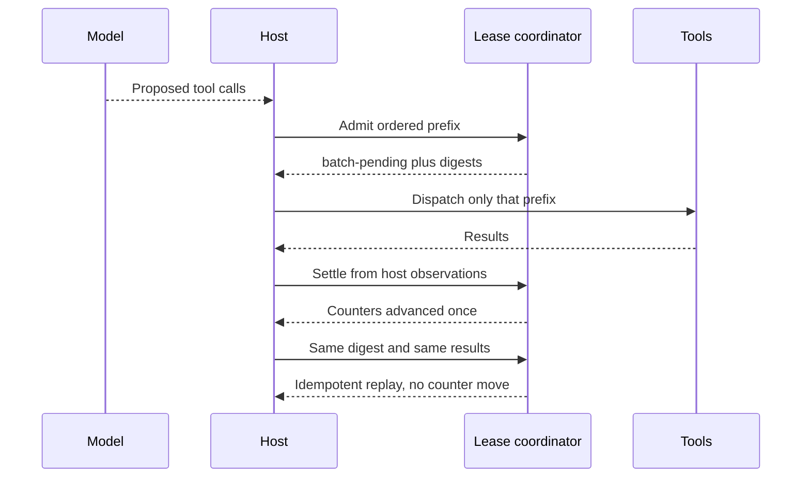
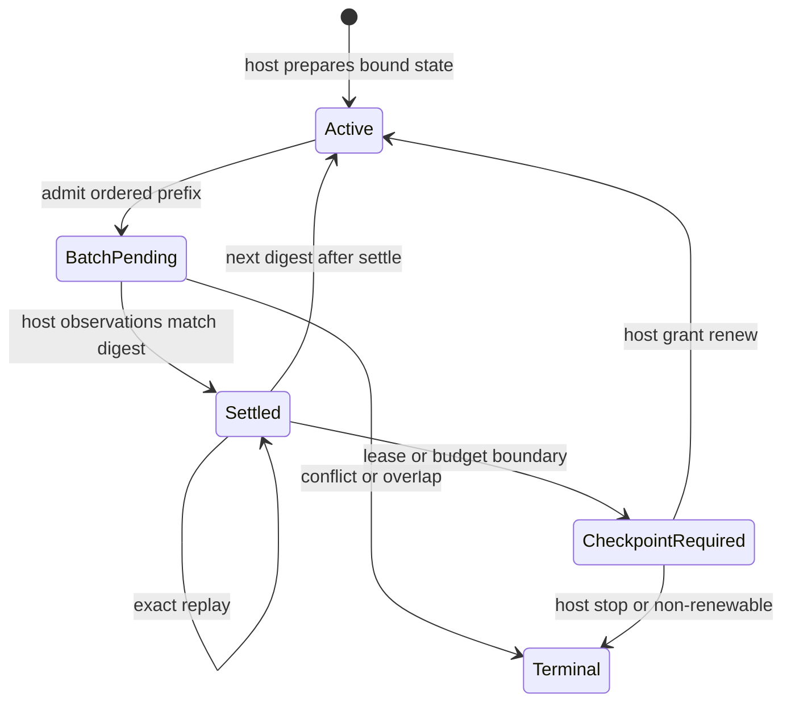

# Execution leases and checkpoints

DocsFab's version-1 execution-lease contracts define renewable, bounded grants
without depending on Pi or any other model harness. They are data contracts only:
they do not themselves authorize repository writes, provider access, or tools.
Those authorities must already exist and remain bound to the same execution
identity.

## Default bounds

The default policy grants 100 executed tool calls per lease, permits four leases,
caps the step at 400 executed tool calls, and permits 512 provider turns. A policy
also carries maximum cumulative input tokens, output tokens, elapsed
milliseconds, compactions, and an optional known cost in integer micro-US-dollars.

Policy decoding rejects non-positive or unsafe bounds, a lease larger than the
hard call ceiling, a hard ceiling that the declared leases cannot represent, and
provider-turn capacity below the tool-call and lease-boundary requirement. A
zero-compaction policy remains valid for compatibility with the existing
deterministic stop-only governor.

Those four values are not independent. The decoder enforces
`callsPerLease <= hardToolCallCeiling`,
`hardToolCallCeiling <= callsPerLease * maxLeases`, and
`maxProviderTurns >= hardToolCallCeiling + maxLeases`, so a fixed set of defaults
is valid only for turn budgets at or above `ceiling + maxLeases`. Callers passing
a smaller provider-turn budget get a shape shrunk to fit by
`resolveLeaseShapeForTurns`, which is why the numbers above describe the ceiling
this policy can reach rather than what every caller receives.

The authoritative values are `EXECUTION_LEASE_DEFAULTS` in
`src/execution/lease-contracts.ts`. This prose restates them, which means it can
go stale: it read 15/4/60/64 for some time after the shipped values became
25/4/100/128, and no gate caught it. The shipped values became 100/4/400/512 on
2026-09-11.

Experimental answer-record discovery uses the version-2 absent-aggregate policy
instead of these whole-attempt defaults and renews at the configured calls-per-
lease cadence. An explicit host override for an applicable per-run aggregate
dimension is refused with the setting named; it is not silently ignored and
does not switch the run back to finite defaults. Project policy cannot override
per-run dimensions. Per-request limits and the renewal cadence remain active.

Those bounds describe the ceiling this policy can REACH, not what a lane
receives. `resolveLeaseShapeForTurns` fits the shape to each lane's sealed
provider-turn budget, and only the two Bedrock Claude Inference Hub records seal
512 turns. A lane sealed at 128 turns resolves to 100 calls per lease, two
leases, and a 126-call step ceiling, because `turns - leases` binds below the
400 this table permits.

## State and accounting

Every state records the current lease number and calls executed in that lease,
provider turns, compactions, cumulative token/time/cost use, the preceding
checkpoint digest, and six tool-call counters:

- `requested`: every call presented to governance;
- `executed`: calls actually dispatched;
- `succeeded` and `failed`: the exact partition of executed calls;
- `denied`: calls rejected by ordinary tool authorization;
- `governanceBlocked`: calls rejected by execution governance, including an
  overflow call at a lease boundary.

The equations `executed = succeeded + failed` and
`requested = executed + denied + governanceBlocked` are mandatory. Counters and
cumulative use cannot regress. A blocked overflow therefore increments
`requested` and `governanceBlocked`, never `executed`.

Cost is either `{status: "known", microusd: N}` or
`{status: "unavailable", reason: "pricing-unknown" | "pricing-stale"}`. The
unavailable variants are not zero spend. When a policy has a cost ceiling, they
fail renewal closed with `cost-unavailable`. Such a run may persist a zero-use
initial state and content-free denial boundary, but it cannot claim provider,
tool, compaction, or token execution while governed cost remains unavailable.

## Renewal boundary

A checkpoint contains only a closed reason, sequence, immutable identity and
policy digests, previous-checkpoint digest, cumulative state, and its own digest.
Renewal is possible only at a `lease-exhausted` or `budget-boundary` checkpoint
after the current lease's exact allowance has been consumed. A grant names the
next lease, its call allowance, and every unchanged remaining provider-turn,
token, time, and known-cost budget. It cannot increase any other authority.
Renewing from sequence two or later requires the public caller to supply the
complete preceding checkpoint and decision history. The validator reconstructs
that chain, requires the grant at the checkpoint immediately before every lease
transition, and rejects missing, reordered, or substituted predecessors. The
sequence-one decoder remains strict and never infers omitted history.

The identity digest binds inference attempt and retries consumed, authorization,
immutable repository revision, context packet, accumulated evidence, tool policy,
and context authority. Checkpoints and decisions must keep that identity. State
progression also preserves cumulative compactions, calls, tokens, elapsed time,
and cost across renewal.

The identity itself binds the canonical policy digest. Checkpoints and decisions
repeat it, so a boundary issued under one policy cannot be replayed with wider
provider, token, time, cost, compaction, lease, or tool-call limits.

If conditions overlap, denial uses one frozen, safety-first precedence:
security, authorization, cancellation, evidence preservation, context, hard call
ceiling, input/output/time/cost ceilings, provider turns, lease count,
non-renewable checkpoint, and terminal/unavailable provider conditions. Evidence
retains the complete ordered set considered as well as the selected reason.

## Durable evidence and compatibility

An execution-lease record binds its validated policy and identity, initial state,
ordered checkpoint chain, ordered decisions, final state, optional closed
terminal reason, and record digest. Canonical JSON serialization is byte-stable;
persisted string and byte parsing also rejects non-canonical JSON encodings.
Object decoding remains available for in-memory construction and validation.
Before any field is read, projected, or hashed, decoding recursively requires
inert plain JSON data. It rejects unknown or non-enumerable fields, symbols,
sparse or custom-prototype arrays, custom object prototypes, accessors, present
optional fields whose value is `undefined`, counter/checkpoint regressions,
invalid decisions, and digest changes. The record contains no prompts, tool
arguments or results, repository contents, host paths, or credentials, so it can
reconstruct lease boundaries without becoming a raw run record.

Every version-1 record begins at lease one with authoritative zero counters,
token use, elapsed time, and, when pricing is known, zero cost. Its first
checkpoint is sequence one, has no predecessor, and must also be in lease one,
so it cannot omit earlier boundaries.
Every transition to a higher lease number must be caused by the grant recorded
at the immediately preceding checkpoint, and every persisted state in that
renewed lease remains within that grant's exact call allowance, including when
provider-turn capacity made the grant smaller than the policy's usual lease size.
A denial is the final checkpoint, its reason matches the terminal reason, and no
counters move afterward. A persisted grant may have an unchanged final state
and no terminal reason only to represent interruption after the decision but
before the new lease began; any later checkpoint must enter the granted lease.
A `workflow-completed` checkpoint is likewise final, unchanged, decision-free,
and paired with the `completed` terminal reason.

Resource and lease terminal reasons are causal rather than descriptive labels.
Without a matching persisted denial, the final state must prove the selected
reason under the same precedence used by renewal: hard-call, cumulative
input/output/time/cost, unavailable-cost, provider-turn, lease-count, and
non-renewable-checkpoint reasons cannot be claimed by a zero or otherwise
non-exhausted state.

Existing fixed-governor inference-attempt evidence migrates to a separate
`docsfab-fixed-governor-compatibility` projection. It retains only attempt
outcome, content-free identity, final provider/tool/compaction counts, and a
digest of the historical turn ledger. It always records `renewable: false` and
never invents lease authority for an older run.

The V1 projection retains its historical serialized shape and hash. Its current
reader accepts the appended `host-runtime-failure` outcome and preserves that
required outcome value; consumers of newly migrated records must update their
closed outcome reader. The paired host-origin detail is strictly validated on
input but is not part of this legacy projection.

The migration accepts justified historical omission of attempt fields that were
not present in older evidence, but validates every field that is present,
including retry booleans, bounded duration and backoff values, model, usage,
tool summaries, identity, and turn evidence. Unknown attempt fields and raw
provider payloads are rejected rather than silently discarded.

## Host-owned coordinator

The pure coordinator exported from `src/execution/index.ts` turns these
contracts into a deterministic admission state machine without importing Pi. A
host first prepares policy-, identity-, pricing-, and context-bound state, then
owns each compare-and-swap transition through `active`, `batch-pending`,
`checkpoint-required`, and `terminal` phases. It must persist the returned state
and decision before dispatching the authorized ordered prefix. Only the exact
pending call digests may be settled. The pending batch and decision also persist
the exact provider-turn, compaction, input-token, output-token, elapsed-time,
context, and internally priced cost grant. Settlement derives each cumulative
delta from host observations and rejects any overrun before accounting it.
Missing, unsafe, unpriced, or otherwise unbounded executable tranches are never
dispatched.

The following sequence is one authorized prefix. The model may propose calls.
The host admits, dispatches, observes, and settles. Exact observation replay
does not move counters.

The coordinator is a state machine. Conflict (same digest, different results)
and overlap (a second distinct digest while a batch is pending) fail closed.
A new digest after settle is the next batch.

This page is the coordinator contract. The Pi session adapter follows the same
idempotent-replay rule: consumed batches remain tombstones, duplicate
`turn_end` is `duplicate-settle`, and checkpoint JSON is telemetry. Freeze #178
and the host-owned settlement decision record.

Failed and deliberately re-dispatched calls consume executed-call authority.
The coordinator separately counts chargeable attempts as `executed + denied`
under its own digest-bound policy, state, and checkpoint chain. For version 1,
the ceiling is derived from the selected policy: `callsPerLease * maxLeases`,
limited by the applicable shared or separate tool-call pools. The [default
bounds](#default-bounds) provide 100 calls per lease across four leases, with a
400-call hard ceiling. A lane's smaller provider-turn budget can lower its
selected ceiling, and an explicit host setting can tighten it further. Version
2 answer-record discovery has no whole-attempt chargeable-attempt aggregate;
its calls-per-lease value is a renewal cadence, while per-request limits remain
in force.
Parallel calls beyond an applicable remaining allowance are governance-blocked and
never dispatched or charged. This preserves the underlying lease contract's
executed-call equations while preventing repeated authorization denials from
bypassing an applicable host ceiling.

Provider progress is an absolute, monotonically sequenced observation whose
digest and context-authority binding are verified before accounting. Exact
replay is idempotent; gaps, regressions, substitutions, sparse arrays, accessors,
unknown fields, and Proxy values fail closed before Proxy traps can run. Known cost is derived from cumulative token use
and the bound integer pricing rates. Callers cannot assert a cheaper cost in a
resource envelope. When a cost ceiling exists but pricing is unavailable, the
coordinator emits an explicit terminal `cost-unavailable` decision before any
provider or tool execution.

Each batch and renewal is preflighted against remaining lease and hard-call
authority, provider turns, input and output tokens, elapsed time, known cost, and
the latest context observation. A batch crossing a lease boundary receives only
the ordered prefix still authorized. Renewal requires the coordinator-generated
checkpoint plus the complete causal checkpoint/decision history. For version 1,
a grant beyond the selected aggregate ceiling is denied. A lane with a smaller
selected ceiling stops sooner.

The contract and coordinator are exported from `src/execution/index.ts`.
Integration into schema-versioned workflow run records is a later execution
layer and must preserve these decoders and host-owned compare-and-swap boundary
rather than duplicating or weakening their invariants.
