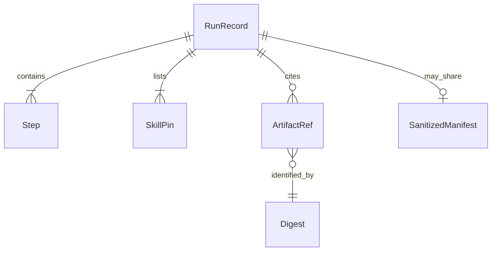

# Run records

DocsFab writes one structured JSON record for every workflow run. Schema version
2 separates provenance from transient execution state and does not embed API
keys, environment variables, tool arguments, tool results, or patch contents.

The shareable shape is identifiers and digests. Payloads stay outside the
record. A publication plan is a different object.



`SkillPin` is the hashed crate identity, not live `SKILL.md` bytes.
`ArtifactRef` has kind, digest, and revision. Tool arguments, tool results,
prompts, and patch contents are not attributes of `RunRecord`.

## Inference progress

While an inference step is running, the record may retain the latest
content-free Pi boundary observation: provider-turn and tool-execution totals,
latest token usage, and fixed tool-activity counts. Tool activity is grouped
as answer-record submission, report submission, candidate validation,
read/search, or other. Each category reports cumulative `started`, `settled`,
and `errorResults` counts. `errorResults` copies Pi's
`tool_execution_end.isError` bit; it can include a semantic refusal and does
not determine whether an answer was admitted. The answer-record ledger remains
the admission authority.

These counts contain no tool names, call identifiers, arguments, or results.
The activity breakdown is optional for compatibility with older saved
observations; readers continue to accept observations that contain only the
aggregate boundary counters.

## Record family index

This page is the hub for the run-record contract family, and also keeps the
largest single family (rejection accounting, in [Review Response
Admission](#review-response-admission) below) at this path so history and blame
stay useful. The other families live in sibling pages:

- [Run record](run-record.md): storage, indexing, provenance, recovery, gap
  lifecycle, and release-readiness projections.
- [Step records](step-records.md): execution evidence, required-skill
  availability, and bounded authoring candidates.
- [Failure classification](failure-classification.md): the closed `failure`
  class/layer/code vocabulary.
- [Input asks](input-asks.md): durable knowledge-continuation receipts for a
  stopped, resumable `needs-input` run.
- Rejection accounting: [Review Response Admission](#review-response-admission),
  below.

## Review Response Admission

The Pi adapter admits technical and editorial review responses before it stores
the step summary. Both responses must be one strict JSON object. Normal JSON
whitespace and key order are accepted. DocsFab validates the object and stores
its canonical JSON form.

The documentation planner, the editorial assessment envelope, the
source-obligation ledger, technical verification and correction, the review
result, the quality artifact, the contract placeholder scan, the semantic
evaluation judge, the source readiness assessment, the repository bootstrap
result, and the semantic comparison proposal find that object with one shared
extraction policy (#1426, #1427). A reply that holds exactly one JSON object
inside a Markdown fence, or beside prose, is read as that object and is then
admitted or refused on its content. With several fences, only a fence whose
opening info string begins with `json` (ignoring case) or is empty can hold the
answer. One such fence is read even if its JSON is malformed; two or more are
ambiguous and refused. A `text` illustration is ignored. A reply with
no JSON object is refused as not JSON. Authoring revision accounting still
parses the whole reply; #1426 records why.

The step decoders in that list read only the final assistant message of the
attempt, never text joined across its tool turns (#1427). The one exception
is a structured answer cut at the output limit on a step whose reply the
harness admits (#645): its retained prefix is stitched to the continuation
that finished it. Source readiness, repository bootstrap, and the semantic
comparison proposal are decoded outside the harness, so a cut answer there
declines instead of continuing. A JSON object in an earlier
tool turn is not the answer. A final turn with no text is a retryable blank
response, and a final turn with prose but no object is refused.
The last entry of the attempt's `turns` evidence is the turn that answered;
no separate field records it.

Current technical verification uses the closed
`{review, coverage, factInventory}` wrapper. The `review` value must satisfy
`review-result.schema.json`. Each coverage entry names one repository-relative
target page, its `verified` or `unverified` status, supporting evidence, and a
reason. `unverified` means a claim the page makes cannot be compared with any
admitted source because none addresses it. Missing command execution is not
grounds for `unverified`; it belongs in the affected facts' `uncertainty`. Every verification, provisional
judgment, and correction contract states this rule once (#1296). Coverage paths
must be unique. When the host supplies an authoritative
focused scope or approved documentation plan, the coverage paths must match
that target list exactly. Without such a list, model-reported coverage records
only the pages checked and does not prove complete documentation-set coverage.
An unverified page requires a `human-review` verdict.
For CREATE Manifest V3, a source-support gap stops the run before revision as
`needs-input` (#1297). A gap is an admitted target whose coverage is
`unverified`, or a sealed source-obligation ledger dimension that is
`unverified` whatever coverage the model reported. The host first validates the
whole selection context, so stale, forged, or malformed evidence still fails
with its own `authoring-candidate-*` code. The stop is an evidence-coverage
outcome, distinct from malformed evidence:

- `workflowOutcome` is `needs-input`, with one `missing-governed-input` finding
  and one `governed-input` decision per gap, bound 1:1 by `inputId`
  `source-support:<dimension>:<page>`. `documented-behavior` stands for a page
  with unverified coverage and no dimension gap.
- A finding code is `authoring-candidate-unverified-coverage`, the retained
  rejection code, when the page's coverage is unverified, and
  `source-obligation-unverified-dimension` for a host-owned dimension gap.
- `verify-technical-accuracy` is the `needs-input` step. Its `error` keeps
  `authoring-source-support:<code>:<technical summary SHA-256>`, and it keeps
  its admitted technical correction evidence. Every earlier step stays
  `succeeded`, and no revision or suffix step is scheduled.
- `authoringExecution.selection` is `null`. The candidate-zero draft is
  retained as `finalPatch` for inspection and is never delivered. The run does
  not record `failure` or `authoringCandidateRejection`.

NEXT is `docsfab do --continue <run-id>`. Each slot takes a repository file
(`--attach <path>`, or the path as a live-agent reply). The continued job keeps
the original instruction and names the file in its `instructionContext` as an
approved source for that page and dimension. It plans again, because the
retained plan cannot bind the new source, and verification decides support
again. A CREATE never completes while a gap remains (#870).

An `update-documentation` run given `--comparison-workspace`,
`--comparison-base`, or `--reader-source` keeps them in `readerEvidenceRequest`
from its queued save, so every stop retains them:

- `comparisonRequest`: `{ "kind": "workspace" }`, or `{ "kind": "base-head",
  "baseRevision", "headRevision" }` with full object IDs. It is the request,
  not a resolved snapshot, so `workspace` re-resolves at the continued
  revision.
- `readerSources`: `{ "role", "path" }` nominations, each role and path once,
  at most `execution.readerSourceNominations` of them, the catalog bound
  reader admission enforces.

A run that had neither carries no field. Only operator-supplied values are
kept: never a reader handoff's comparison or sources, merged-MR-assembled
sources, a host default, or source bytes. A continuation re-admits the
original comparison and the original nominations followed by its own file
fills, each role and path once, and its own record keeps that union, so a
later continuation carries it too. A `base-head` comparison continues at its
`headRevision`; a different `--revision` refuses `continue-revision-mismatch`.
A value this host cannot decode refuses `retained-reader-input-malformed`, and
a union over `execution.readerSourceNominations` refuses with that limit's
code, `reader-source-nominations-over-bound`, naming the observed count. Both
refusals happen before the supersession claim and leave the run open. The
publication gate and the doc-improvement reader decode the field and admit it
only on `update-documentation` records.

A `create-documentation` or `update-documentation` run given `--source`,
`--pr`, or `--mr` keeps what it bound in `retainedEvidenceBindings`, from its
queued save, so every stop retains it:

- `sources`: one `{ "path", "sha256" }` per `--source` file, sorted by path,
  with the SHA-256 of the file's bytes at the run's revision.
- `changeRequest`: the merge request the run bound, as `{ "selector",
  "projectId", "textSha256" }`. The selector carries the host and project
  path the forge returned, and `textSha256` is the digest of the merge
  request text the run bound. That text records the merge and squash commits
  GitLab reported, so the digest pins them too.

A run that bound neither carries no field. A `--change` range needs no copy
here, because its `changeSources` entry already pins its commits. An InputAsk
continuation binds the same files again, and the same range by the full
commit IDs its `changeSources` entry names, never by the range the operator
typed, so `HEAD~1..HEAD` keeps naming the original commits after the branch
moves. Before the queued save, the host reads each file again at the
continued revision and compares the continuation's pins with the stopped
run's:

- A file whose content changed refuses `continue-binding-moved`.
- A binding only one of the two runs carries refuses
  `continue-binding-conflict`.
- A range compares its kind, repository, object format, range semantics,
  base, head, merge base, and diff base. It never compares labels or
  `changeSourceSha256`, so a label such as `head-not-ancestor-of-workspace`
  after a branch switch does not refuse.

Either refusal saves no record for the continuation and leaves the stopped
run open. A run bound to a merge request, a pull request, or a GitHub commit
refuses `continue-binding-forge-unsupported` before the supersession claim,
because a continuation cannot read the forge again yet. A value this host
cannot decode refuses `retained-evidence-bindings-malformed`, also before the
claim. A record saved before this field continues without its `--source`
files, as it did before. The publication gate and the doc-improvement reader
decode the field; the readiness and live-corpus readers, which read neither
workflow, refuse it.

The continuation runs under a run ID minted before it starts. The host first
claims `input-ask-supersession/<stopped-run-id>.<sequence>.json` beside the run
records, with an unpadded integer sequence and an exclusive link. The claim names
that ID and the owning process's ID and birth identity; no run record changes.

One predicate defines a continuable input stop: a create or update
`needs-input` run with named InputAsk slots that resumability calls resumable.
The open-run list, supersession, refusals, and continue all use it. The latest
claim supersedes the stopped run only while one of these holds:

- the continuing run is a continuable input stop itself;
- it is `queued` or `running`, or has no record yet, under a live owner
  (an owner whose birth identity cannot be read counts as live, as knowledge
  continuation treats it);
- it `succeeded`.

Any other state reopens the stopped run: `failed`, `cancelled`, a `needs-input`
or `needs-human-decision` run that is not a continuable input stop, or a claim
whose owner is no longer alive. The host releases its claim when the
continuation ends without saving a record. A second continuation, whether it
arrives during the first one's preflight or races it for the same claim, is
refused by name. A refusal names the run that now holds the chain, following
continued stops to it. One chain therefore has at most one open run.

A `create-documentation` or `update-documentation` run given `--change`,
`--mr`, or `--pr` cites the change it bound in `changeSources`, from its queued
save, so every stop the runner records carries it:

- One entry per sealed change-source record the run bound. A run binds one
  change, so the list holds one entry, except for a release range, which
  holds one entry per unit record its page bound, in index order. Entries are
  unique by `changeSourceSha256`; the list has no bound of its own beyond the
  contract decoder's array limit.
- Each entry is `{ "schemaVersion": 1, "kind": "docsfab-run-change-source",
  "sourceKind", "provenance", "repository", "objectFormat", "rangeSemantics",
  "base", "head", "mergeBase", "diffFrom", "labels", "fileCount",
  "commitCount", "changeSourceSha256", "observations" }`, copied from the
  sealed record. `base` is `null` when the pinned revision has none, such as a
  root commit. Object IDs have the width of `objectFormat`. `labels` are the
  record's labels, sorted. The counts are the record's file and commit counts.
  `observations` holds one `{ "role", "observationId" }` for the diff and one
  for the manifest, in acquisition order.
- It holds no commit subject, path, or diff text. Those stay in the diff and
  manifest observations it names, which the run's span citations cite.

A run with none of these options carries no field. A stop before the runner
starts, such as a request-interpretation stop, a first-pass contradiction, or a
preflight refusal, carries none either, because the citation comes from the
runner's queued save. A continuation binds the same commits again, so its
record cites them too. When the host resolved a change but reached the workflow
without the record it acquired, the run refuses `change-source-record-unbound`
before the workflow starts; that is a DocsFab defect to report. Labels never
block: no gate refuses a record for its labels. The publication gate decodes
the field and admits it only on `create-documentation` and
`update-documentation` records. The doc-improvement reader, which reads
`update-documentation` records, decodes it too. The readiness and live-corpus
readers, which read neither workflow, refuse it. The field is unrelated to the
`changeSources.*` limits, which bound the range itself.

A run given `--change release:<base>..<head>` also cites its units index in
`changeSourceRelease`, which is not a change record and so is not a
`changeSources` entry: `{ "schemaVersion": 1, "kind":
"docsfab-run-change-source-release", "repository", "objectFormat", "base",
"head", "releaseUnitsSha256", "observationId", "units", "pageUnits",
"omittedUnits", "remainingUnits", "continuation" }`. `units` counts every unit
the index lists, `pageUnits` those on this run's page, `omittedUnits` the page
units a per-unit bound left without a record, and `remainingUnits` those on
later pages; `continuation` is the selector that binds the next page, or
`null` when none remain. The two fields decode together: a `release-range`
entry in `changeSources` needs this field, and this field needs exactly
`pageUnits - omittedUnits` such entries from its repository, so a page whose
every unit was omitted carries this field alone. Readers admit and refuse it
exactly as `changeSources`.

`factInventory` assesses all six source-behavior dimensions: input
representations, defaults and overrides, mutable state, destinations and trust,
error/status/retry behavior, and environment prerequisites. Applicable
dimensions contain bounded facts with stable IDs, specific source locators,
documentation dispositions, uncertainty, and issue cross-references.
Not-applicable dimensions require a substantive source-backed reason;
unverified dimensions require a missing-evidence limitation and a
`human-review` verdict. The required `bounded-not-proven` completeness marker
records that structural accounting cannot prove discovery of every material
source fact.

Ordinary and provisional technical verification continue to return that
three-field wrapper. A current canonical correction instead returns the closed
version 3 proposal described in [Execution evidence](step-records.md#execution-evidence). The
host derives and validates the same three-field `VerificationResult` before it
stores the step summary. It does not admit model-authored finding, evidence,
action, or impact prose through the canonical proposal.

Retained pre-inventory `{review, coverage}` wrappers and direct technical
review-result summaries remain readable through an explicit historical path.
Their projected results carry a missing-inventory limitation; DocsFab does not
rewrite them or imply that current source coverage was enforced when they ran.

Editorial review uses `review-result.schema.json` directly. Both review forms
reject unsafe paths, credentials, unexpected keys, and inconsistent verdicts. A
host path in review prose is ordinary text. A `pass` has no issues, and `needs-revision` has at least one issue.
If the shipped schema cannot be loaded, the step ends with a nonretryable
`malformed-response` diagnostic. Other malformed responses use the existing
bounded malformed-response retry policy. Rejections keep the attempt's model,
usage, turn, tool, and execution-lease evidence. Rejected response text is kept
only in the bounded, redacted `rejectedReplyExcerpt` described below, never in
a code, location, or fingerprint. Every technical rejection records a finite code and contract
location in the attempt's `rejection` field. JSON parse failures record a
syntax code, such as `json-unexpected-end` or `json-invalid-escape`, with
location `$response`. Review schema failures name the first broken rule, such
as `review-schema-enum` at `$.review.issues[].severity`. Correction fact-link
refusals name the link that failed, such as `fact-link-unknown-obligation` at
`$.issueJudgments[].obligationIds[]`. A rejection without a finer reason
records its outer code at `$response`. These codes contain no response text.

Locations name members of the reply the model returned. When a correction
envelope nests the verification result under `verificationResult`, a
verification location is rebased onto it, for example
`$.verificationResult.review.verdict` or `$.verificationResult.factInventory`.
A provisional judgment or V3 correction reply carries no verification result:
the host derives one from the judgment. For those replies, `$.issueJudgments`,
`$.obligationJudgments`, `$.coverage`, and `$.verdict` locations name reply
members, while `$.review` and `$.factInventory` locations name the derived
verification result.

A rejected `malformed-response` attempt also records `rejectedReplyShape`, a
structural fingerprint of the SPAN the step's own decoder parsed. For every
step whose decoder reads the shared extraction policy's span, that is the JSON
document inside a fenced or prose-wrapped reply, and `replyChars` counts that
document and not the envelope around it (#1426). The authoring revision writer
parses the whole reply and is fingerprinted as it arrives. Before this, a fenced
reply recorded `malformed-json` at offset 0 with no paths beside a rejection its decoder had
raised against the extracted document, which named nothing an operator could
act on. It states whether the
reply parsed and, when it did not, the parser's code, syntax detail, and
character offset. For a parsed reply, it lists the root type, the top-level
keys, and each distinct key path with its value type, occurrence count, and
the shortest and longest string or array length. It never records a string
value, prefix, or sample. A key is listed by name only when a DocsFab response
contract declares it: the union of the keys the review, verification,
provisional judgment, correction, source-obligation ledger, editorial
assessment, and quality response decoders enforce, and the property names in
the frozen `review-result`, `documentation-quality-evaluation`, and
`quality-score` schemas. Every other key, including one that is shaped like an
identifier, is counted in `undeclaredKeys` and written as `<undeclared>`. A
declared key that matches a credential rule is also undeclared. Array members share
one `[]` path. The fingerprint describes nesting to
`inference.rejectedReplyShapeMaxDepth` levels and lists at most
`inference.rejectedReplyShapeMaxEntries` paths and top-level keys. A host can
set either bound within its catalog range with
`DOCSFAB_INFERENCE_REJECTED_REPLY_SHAPE_MAX_DEPTH` or
`DOCSFAB_INFERENCE_REJECTED_REPLY_SHAPE_MAX_ENTRIES`. Startup refuses a value
outside that range. Record readers apply the writer's credential-key rule to
every listed key and path segment and refuse a record that breaks it, and
operator surfaces print only contract-declared keys. The vocabulary also ships
as a generated JSON mirror,
`packages/runtime/src/execution/response-contract-vocabulary.generated.json`,
for readers that cannot load runtime TypeScript. It is a derived product like
the limits mirrors: `npm run check:static`, `npm run check:pins`,
`npm run preflight`, and `runtime:derived:preflight` fail when it is stale.
The model-output catalog generator (#1130) renders it; regenerate it with
`npm run generate:model-output`. The local-workflows report
filters every key through the mirror, prints `<undeclared>` for the rest, and
shows only counts for a fingerprint from an older or unknown schema.

Beside the fingerprint, the same attempt records `rejectedReplyExcerpt`
(#1690), a bounded, redacted excerpt of the same trimmed text, so an operator
can see why the reply was refused without a transcript. It has these fields:

- `replyChars`: the reply length, equal to the fingerprint's `replyChars`.
- `parseOffset`: where the strict parser stopped, copied from the
  fingerprint's `parse.offset` when the parser reported one.
- `segments`: at most three non-overlapping ranges in reply order, each with
  `role`, `start`, `end` (reply character offsets, end exclusive), and
  `text`. `head` starts at character 0 and `tail` ends at the reply's end. A
  `parse-position` window, centered on `parseOffset`, is added only when the
  parser stopped between the head and the tail. Each segment copies at most
  `inference.rejectedReplyExcerptChars` UTF-16 code units (default `512`). An
  edge that would fall inside a surrogate pair moves inward, so a segment never
  splits a character, and an unpaired surrogate the reply already carried is
  written as U+FFFD. The strict record reader refuses an unpaired surrogate, so
  either would otherwise make the whole run record unreadable.
- `omittedChars`: every reply character no segment copied, stated with the
  `limit` name and the `bound` in force, so truncation is never silent.
- `redactions`: how many spans were replaced by `[REDACTED]`.

Redaction runs on the whole reply before it is cut, so a segment edge never
leaves a recognizable piece of a credential behind. It replaces every span
that the shared guards find: assigned credential material
(`credentialMaterialSpans`, the ranges `redactCredentialMaterial` removes), the
shared text credential shapes (provider, forge, and cloud tokens, bearer values,
and JWTs), whole JWTs including the signature (back-to-back tokens each match),
whole PEM and PGP private-key blocks (through the END line, or to the end of the
reply when it is cut off), the userinfo of a URL of any scheme (such as
`postgres://user:password@`), `Authorization: Basic` values, and the display
sanitizer's URLs and home-directory paths, which can name a user. When the canonical repository
credential screen still matches a redacted segment, the segment is kept as
`withheld: "credential-material"` with empty text, as is every segment when a
guard cannot run. The bound applies to each segment and is a host retention
policy (catalog scope `per-host`). A host can set it
from `0` through `4096` with `DOCSFAB_INFERENCE_REJECTED_REPLY_EXCERPT_CHARS`;
`0` keeps no text and still states the reply length. Startup refuses a value
outside that range.

Record readers (the scorecard, attempt migration, and live-corpus decoders)
admit an excerpt only beside a valid fingerprint with the same length and parse
position, with closed keys, ranges inside the reply and no longer than the
recorded bound, counts that add up, and no unpaired surrogate in segment text.
Any non-negative recorded bound reads, so lowering the catalog maximum later
leaves older records readable. They do not refuse segment text that the credential screen matches, so a
screen rule added later cannot make an older record unreadable. Instead,
`docsfab runs show` redacts and screens each segment again, withholds a
segment the screen matches, and replaces this host's roots before it prints the
excerpt under the attempt's `RETRIES` line. Segment text prints as a JSON string
with control, format, and line-separator characters escaped. `--json` carries
the same projected excerpt as `retryDispositions[].rejectedReplyExcerpt`, and
its output escapes the same characters as `\uXXXX`. The run index copies only a
closed `rejectedReplyExcerpt` flag, never the text. The excerpt stays in
private run records: the `FAILURE` footer, the local-workflows report and its
JUnit file, and sanitized evaluation or acceptance manifests do not copy it.

A refused attempt can carry `rejectionSubject` beside `rejection`: what the
refused rule refused, as paths the host already knows and never reply text
(`execution/rejection-subject.ts`). It is one closed shape:

- `{kind: "source-path", path}`: a CREATE source-obligation reply cited a path
  outside the plan's bound sources (`write-target-source` for a page the run
  writes, `unauthorized-source` for any other path). The path is
  recorded only when it is one of the plan's write paths or a tracked regular
  file at the run's revision; otherwise the subject is
  `{kind: "source-path", withheld: "not-host-known"}`.
- `{kind: "changed-paths", declared, observed}`: a revision writer's
  `changedPaths` disagreed with its mutation
  (`revision-accounting-changed-path-mismatch`, `unchanged-applied`). Both are
  sorted, distinct lists of plan write paths.
- A path longer than `inference.rejectionSubjectPathMaxChars`, or a list longer
  than `inference.rejectionSubjectMaxPaths`, is withheld as `over-bound`, never
  cut; a changed-paths subject then keeps `declaredCount` and `observedCount`.

Attempt readers admit a subject only on a `malformed-response` attempt that
also carries `rejection`, and check each path's shape against the bounds'
maximums. The subject never enters a retry prompt.

An attempt that an older host refused with `host-path-disclosure` can carry
`hostPathDisclosure`, two closed values and never the path. No current step
writes it; attempt readers still accept it so those records decode:

- `root`: the first segment of the refused absolute path, one of the host
  roots the older screen listed (for example `usr`, `private`, `Users`, or
  `tmp`), or the form name `file-uri`, `windows-drive`, `windows-separator`,
  or `home-tilde`.
- `inAdmittedSource`: `no` when the older screen checked admitted repository
  source content and the token was not one of its path tokens; `unavailable`
  when the screen received no admitted source content, or the form was not an
  absolute root path.

A reader refuses any other key or value. The `FAILURE` footer for such an
attempt prints `Rejected by host-path-disclosure at $` without these values;
`docsfab runs query` exposes them as `hostPathRoot` and
`hostPathInAdmittedSource`.

Every attempt the Pi harness runs, succeeded or failed, also records
`modelTelemetry` (#1185). It is the provider's own account of the attempt, in
closed values and integers only:

- `finishReason`: how the last landed provider turn finished, one of `stop`,
  `length`, `tool-use`, `content-filter`, `error`, `aborted`, or `unknown`. The
  provider's raw token decides when the transport kept one, because it is more
  specific than Pi's mapped stop reason. A token that no known transport uses is
  `unknown`, and the token itself is not copied here. The governed turn keeps
  the closed raw token as `rawStopReason`. Absent when no provider turn landed.
- `outputTokens` and `outputAllowance`: the output that same turn produced and
  the per-request allowance it was sent with. A turn Pi sent but was aborted in
  before it landed is not the reported turn.
- `providerLatencyMs`: milliseconds from each provider turn's start to its
  settled assistant message, summed across the attempt. Tool execution is not
  included. The attempt's `durationMs` remains its wall clock.
- `providerError`: present only when the last landed turn was an error and its
  last request actually left the host. `class` is one of `rate-limit`, `auth`,
  `server`, `timeout`, `content-filter`, `network`, `stream-incomplete`,
  `invalid-request`, or `unknown`. `stream-incomplete` (#1696) is a 2xx OpenAI
  Chat Completions stream whose body ended cleanly with no finish reason, no
  `[DONE]` event, and no structured error event. `httpStatus` is the status of a non-2xx response that the host
  received, and `retryAfterMs` is its `Retry-After` in milliseconds.
  `streamErrorStatus` is the failing status (400-599) that a structured error
  event inside a 2xx stream declared in its integer `error.code`, such as
  `data: {"error":{"type":"service_unavailable","code":503}}`. It is never
  recorded with `httpStatus`. A declared status decides the class the same way
  a transport status does (a declared 504 is `timeout` and any other 5xx is
  `server`), and a known server-fault `error.type` (for example
  `service_unavailable` or `overloaded_error`) with no declared status is
  `server`. A status is never parsed out of error text. A `retryAfterMs` is
  recorded only with the `httpStatus` of the response that carried it, and the
  record decoders refuse one without it (#1253). A request that DocsFab
  refused before sending carries no provider error. That includes a turn
  governor or step physical-attempt refusal, an outbound credential guard
  refusal, and a payload or provider boundary rejection. The provider's error text is never retained.

A sent provider error also decides whether the step retries (#1247, #1253).
Its `providerError.class` is read before any message-text rule and names a
verdict: `network`, `server`, and `stream-incomplete` are retryable
`provider-transient`, `timeout`
is retryable `timeout`, and `rate-limit` with an `httpStatus` (a 429) is
retryable `throttled`. `content-filter` and a `rate-limit` with no `httpStatus`,
including one with only a `streamErrorStatus` of 429, are terminal
`provider-terminal`, and `auth` and `invalid-request` are terminal
`invalid-request`. None of these is ever retried, whatever words the provider's
error text shares with a transport fault or a malformed response. An `unknown`
class, and an attempt with no `providerError`, keep the text classifier's
verdict, so records and attempts without the telemetry behave as before.

The telemetry describes the attempt's last landed provider turn, so it decides
only a failure that is that provider answer. A failure with a coded rejection
keeps its verdict. For every other failure, a terminal verdict is applied first
and always overrules a retryable one, including an uncoded `malformed-response`
that the text classifier read from the provider's error message. A retryable
verdict never replaces a `context-exhausted`, `malformed-response`, or
`blank-response` failure, and replaces only a retryable category or
`provider-terminal`, the text classifier's fallthrough. A failure the host
decided is terminal is therefore never made retryable by the telemetry. A
failure that is already terminal keeps its recorded category. The re-decided
error's message names only the category,
the class, and any HTTP or in-stream status, for example `Model request failed
[provider-transient; retryable=true]: the sent provider request ended with a
network error.` The in-turn provider replay reads the same class through the
same table, so none of these terminal errors is replayed inside the turn
either.

`host-runtime-failure` is reserved for a typed host failure captured at the
execution-lease coordinator boundary. Its attempt carries the exact
content-free `hostFailureOrigin` pair (`execution-lease-coordinator` /
`invalid-execution-lease-coordinator`). That pair takes precedence over any
provider telemetry: the failure is recorded as `infrastructure` at the
`inference` layer with the coordinator code. It is non-retryable and is not a
provider outcome. Records with this new outcome require a reader that knows
the appended category; existing historical records and their serialized
projections are unchanged.

When the coordinator rejects an accounted checkpoint, the saved lease snapshot
may remain in `checkpoint-required`: the host preserves the last valid
transition instead of attempting a second terminal transition. The reader
accepts that phase only with this paired host outcome and still checks the
attempt binding and tool, usage, and turn counters.

A scheduled retry's `backoffMs` is the policy's exponential wait,
`baseDelayMs * 2 ** (attempt - 1)`, lengthened to the attempt's own
`providerError.retryAfterMs` when that is longer, and never above
`maxDelayMs`. A `retryAfterMs` is honoured only with the
`providerError.httpStatus` it came with (#1253). A `Retry-After` that is not a
positive safe integer is no request. The runtime and every validator derive
the wait through `inferenceRetryBackoffMs` in
`src/records/inference-retry-disposition.ts`. A record written before #1247
with the plain exponential wait still validates.

A reply cut at the output limit is not a contract-shape rejection. Its attempt
records `finishReason: "length"` and a `rejection` whose code is the cut's
shape at `$response`: `text-truncated` (partial text arrived),
`output-truncated` (nothing arrived), or `tool-arguments-truncated` (a tool
call was cut twice). A reply that fails to parse after a normal `stop` keeps the
parser's own code, such as `json-unexpected-end`. The record decoders refuse an
unknown key, a value outside these sets, and a `providerError` on a succeeded
attempt. Records written before #1185 carry no `modelTelemetry`, and absence
reads as unavailable. The [run index](run-record.md#run-index) copies these fields onto
`attempt` rows (#1236), so `docsfab runs query --group-by
finishReason,providerErrorClass` counts attempts by them.

New attempts may also carry `providerResponses`, a separate closed v1
measurement of physical provider response bodies. Each observation contains a
request sequence, a terminal disposition, bytes actually yielded by the body
stream, and the HTTP status when a response was received. It never stores a
URL, header, body, provider error text, or credential. `complete` means the
stream reached EOF; `no-body` records a response with no body; `cancelled`,
`read-error`, and `limit-refused` keep only bytes already observed, so those
counts are partial; `no-response` means the dispatched send did not produce a
response. A `pending` state and its request sequence identify dispatched
requests whose body had no terminal outcome when the attempt snapshot was
taken. The runtime does not drain a body to complete this measurement.

Sequences are sorted in the durable record even if response streams finish out
of order. The decoder rejects duplicate sequences, malformed states, and
undeclared fields. Older records may omit `providerResponses`; absence means
unavailable. The legacy fixed-governor compatibility projection validates this
optional current field but does not add it to its older output schema. This is
distinct from `modelTelemetry`, whose v1 schema remains unchanged.

Judgment rows stay lenient: the host ignores an `issueJudgments`,
`obligationJudgments`, or replacement row key that the judgment contract does
not declare. An accepted provisional or V3 correction judgment attempt instead
records `judgmentRowKeyAudit`: for each row type, the number of rows, the
number of undeclared key occurrences, and the names of only those undeclared
keys another DocsFab response contract declares. Every other key is counted,
never named. The local-workflows report shows these counts under "Judgment row
keys (accepted replies)" as a measurement for deciding row strictness. When a bound
applies, `truncation` names the limit, the bound, and how many containers,
paths, or keys it left out.

Whether a technical review or correction rejection may be retried is decided
once, by its recorded reason code, in the closed table
`TECHNICAL_REJECTION_RETRYABILITY` in
`src/workflow-execution/technical-rejection-retryability.ts` (#1238). The table
covers every outer technical code, every `inventory-*` reason, and every
correction judgment and fact-link reason, with a one-line reason for each. A
new code fails the typecheck until the table classifies it. A reason the table
marks model-correctable retries within the configured read-only allowance
(`retry.maxRetries`), and the retry prompt states that reason's rule. No check
is loosened: every attempt is validated in full. Three codes are terminal and
stop on the first attempt, whatever allowance remains: `unsafe-disclosure`
(credential material), `source-authority`, and `target-authority`.
Host defects are never retried. A missing host admission or target set raises
an authority code, a missing host schema keeps its own non-retryable flag, and
a host exception without host rejection state stays terminal. A reply that
fails strict parsing and is not framed as a JSON object (empty, prose, or a
top-level array) is retried with the `unframed-reply` condition, whose retry
asks for only the object. A declined attempt's code alone therefore does not
always say why; a record that carries `retryRule` names the rule. Under a
read-only policy that lists `malformed-response`, a technical attempt recorded
with `retryable: false` and `retryDecision: declined` is one of these:

- a code the table marks terminal (`unsafe-disclosure`, `source-authority`, or
  `target-authority`);
- a missing host schema, recorded as `invalid-review`;
- a host exception or a raiser-terminal refusal inside a correction boundary,
  recorded under that boundary's code, such as `invalid-shape`;
- on an older record only, a strict-JSON refusal of a reply without object
  framing, recorded as `json-<code>` or `json-<detail>` at `$response`.

Those codes are model-correctable in the table, so for them the declined flag
comes from the raising site, not from the code. `docsfab runs show` reports each
case as `declined-host-refusal` with `Rejected by <code> at <location>`, and the
run index keeps the same code and location.

Fact-inventory rejections can include a fixed
`inventory-*` reason at `$.factInventory`, identifying a dimension, locator,
fact, or finding-link contract failure without copying rejected values.
A V3 correction or provisional judgment that links an obligation ID the sealed
ledger never issued records `fact-link-unknown-obligation` at
`$.issueJudgments[].obligationIds[]` under the outer `invalid-fact-link` code.
It is retryable. The retry names the unissued IDs, only identifier-shaped ones,
and the issued set. Neither is written to the record.
A judgment reply links issues to facts only through
`issueJudgments[].obligationIds` (#1342). The host derives each retained or
replacement fact's `issueIds` from those links, and ignores an `issueIds` field
that an obligation judgment or replacement still carries. A fact that is not
documented and that no issue judgment links records `judgment-fact-unlinked` at
`$.issueJudgments[].obligationIds` under the outer `invalid-fact-link` code. It
is retryable, and it is declared in the model-output catalog. An issue judgment
whose linked obligations yield no fact that is not documented, because each is
documented or rejected or none is named, records `judgment-links-no-open-fact`
at `$.issueJudgments[]` under the same outer code. It is retryable. Before
#1342 the host omitted such a judgment silently. A retained judgment row or a
refined replacement whose `documentationDisposition` is missing or outside the
five admitted values records `judgment-documentation-disposition-invalid` at
`$.obligationJudgments[].documentationDisposition` or
`$.obligationJudgments[].replacements[].documentationDisposition` under the
outer `invalid-fact-inventory` code (#1401). It is retryable and declared in the
model-output catalog. Earlier records carry `inventory-fact-disposition` at
`$.factInventory` for the same defect. The two-direction
agreement codes `fact-link-documented-fact`,
`fact-link-judgment-omits-linked-facts`, `fact-link-judgment-fact-mismatch`,
`fact-link-judgment-missing-fact`, and `fact-link-unknown-issue` can no longer
be raised on a model reply. They remain terminal integrity checks of a
host-built proposal or sealed record, and earlier records that carry them keep
their meaning and failure class.
Both judgment contracts list the allowed issue `severity` and `category`
values. A judgment with any other value records `judgment-severity-invalid` at
`$.issueJudgments[].severity` or `judgment-category-invalid` at
`$.issueJudgments[].category` under the outer `invalid-review` code. It is
retryable, and the retry restates the allowed values, never the rejected one.

The documentation planner, the update-documentation editorial assessment
envelope, and the editorial review result record a `rejection` for every
refusal (#1423). Where a shared code states the rule, they use it at their own
location:

- `invalid-json`: the reply is not JSON.
- `invalid-shape`, `invalid-value`, `empty-required-field`, and
  `duplicate-entry`: the reply broke a rule at the named location, such as
  `$.planBinding.pages[].disposition`.
- `credential-material`: the reply disclosed credential material.
- `host-path-disclosure`: an older host refused the reply for a host path.
  No current step raises it; it remains readable in saved records.

The model-output catalog declares four more codes:

- `reply-json-wrapped`: the reply held more than one eligible Markdown fence,
  which the shared extraction policy refuses as ambiguous. A reply with
  exactly one fenced or prose-wrapped document is read as that document
  (#1426), so a broken document inside one fence records `invalid-json`.
- `documentation-plan-source-binding-coverage`: the planner's source bindings
  did not cover exactly the pages it changes.
- `editorial-assessment-evidence-unavailable`: an assessment cited an artifact
  the host did not admit.
- `review-result-verdict-issues`: a review verdict disagreed with its issues.

The final quality evaluator's answer records its own catalog codes (#1697),
with the member as the location. That answer is either one JSON object
that holds `evaluation` and `qualityScore`, followed by the report as Markdown,
or the `{evaluation, qualityScore, reportMarkdown}` JSON envelope. The envelope
is admitted exactly as before the answer form existed. A reply that both forms
would read as a complete answer is refused rather than guessed:

- `quality-envelope-json`: the reply's JSON is not strict JSON. The location is the
  member the parser was reading, or had just finished, when it stopped:
  `$.evaluation`, `$.qualityScore`, `$.reportMarkdown`, or `$` outside them.
  A reply that opens as an object and holds a fenced block, such as a JSON
  summary copied into `reportMarkdown`, records the reply's own break rather
  than the block's keys.
- `quality-envelope-duplicate-key`: the reply repeats a key in one JSON
  object. The location is the top-level member that is repeated, or that holds
  the object with the repeated key; `$` for any other key.
- `quality-envelope-shape`: the reply is in neither form (at `$`), or a
  member has the wrong type or an empty report (at that member). At `$`, the
  leading object has other keys, or the reply holds several fenced JSON
  documents instead of opening with its bare object. That second case records
  this code rather than the shared `reply-json-wrapped`, whose rule would tell
  the evaluator to return only JSON.
- `quality-envelope-json-after-object` (at `$`): the text after the answer's
  object opens with more JSON (`,`, `:`, `"`, `{`, `}`, or `]`), such as an
  envelope closed one brace early.

The text after the answer's object must be only a report. Each way it is not
records its own code at `$.reportMarkdown`, so the retry names that problem:

- `quality-envelope-report`: the text is missing or does not open with a
  Markdown heading line.
- `quality-envelope-report-fence`: a code fence is still open when more report
  text follows it, or a fence line inside a code block opens another block of
  the same kind. A bare fence line with only blank lines after it at the end
  of the report hides nothing; it is admitted, and the stored report drops it.
- `quality-envelope-report-member`: the report names `evaluation`,
  `qualityScore`, or `reportMarkdown` as a JSON member outside a fenced code
  block or an inline code span on one line.
- `quality-envelope-report-envelope`: the report holds a whole
  `{evaluation, qualityScore, reportMarkdown}` envelope, even in a fence, so
  both forms would read the reply as a complete answer.

A nested review result is located under `$.summary`. A refusal that no rule
explains, such as a host fault, records `unknown` at the part being read.
Apart from the quality evaluator's answer form, which replies are admitted, and
whether a refusal is retried, is unchanged.

When a malformed response is retried, the next attempt's prompt names the
refused attempt's `rejection` code and location and states the rule behind
that code, for example:

```text
Host validation feedback for this bounded retry:
The previous response failed host rule inventory-fact-locators at $.factInventory.
Each fact needs at least one source locator, and its locators must be distinct. Every sourceLocators entry is one specific repository-relative locator: ...
Return a complete replacement that satisfies this rule and the rest of the selected response contract.
This feedback grants no new tools, source access, write scope, retries, or publication authority.
```

The rule text comes from a closed host catalog kept next to each validator:
`src/workflow-execution/source-obligation-rule-hints.ts`,
`src/workflow-execution/review-response-rule-hints.ts`,
`src/workflow-execution/quality-rejection-rule-hints.ts` for the final quality
evaluator, the editorial envelope entry in
`src/harness/response-correction.ts`, and every model-correctable rule in
`config/model-output/rules/`. A code whose rule
depends on its location, such as `inconsistent-status`, has a hint per
location. A code family, such as `review-schema-<keyword>`, has a rule per
member and a family rule only for a code outside it. The review-schema rules
are keyed by the frozen-schema validator's closed keyword list
(`STAGED_QUALITY_SCHEMA_MISMATCH_KEYWORDS` in
`src/evaluation-report/quality-schema-validation.ts`), so a keyword the
validator starts to name fails the typecheck until its rule is written. A
code shared by several decoders, such as `invalid-shape`, has one rule that
is true for each of them.
A code with no catalog entry is still named with its location. An attempt with
no coded reason, or with a reason the record could not retain, receives the
generic response-contract guidance without naming a rule. The code and
location pass the same grammar and length bound as the attempt record, so the
feedback never carries response text or error messages. The one bounded
exception is `fact-link-unknown-obligation`: its correction also carries the
unissued IDs the reply cited, only identifier-shaped ones within the
`technicalCorrection.identifierMaxChars`, `technicalCorrection.maxJudgmentFactIds`,
and `technicalCorrection.maxIssueJudgments` bounds. The retry prompt repeats
those IDs and lists the issued set from the sealed ledger. A judgment that
rejects every obligation of an applicable ledger dimension, without a
substantive rejection for each, records `inventory-dimension-facts` at
`$.obligationJudgments`, not at `$.factInventory`, because a judgment reply
never carries the inventory. Its correction names those dimensions from the
fixed dimension list. The retry prompt lists each one's obligation IDs and the
admitted source paths from the sealed ledger. Rule hints
change neither which rejections are retried nor the retry budget.

Host response contracts show no copyable example value (#1282). Each example
string in a contract shape is either closed vocabulary, such as
`bounded-not-proven` or a `pass|needs-revision|human-review` choice, or an
angle-bracketed placeholder from `CONTRACT_PLACEHOLDERS` in
`src/workflow-execution/contract-placeholders.ts`, such as
`<limitation code the evidence establishes>`. For a step whose structured
host contract renders placeholders, after the step's own in-harness decoders
admit the reply, the harness refuses a reply that repeats one of those
placeholders under a key where that contract shows it. It also refuses a
literal an earlier contract showed there that describes no run, such as
`bounded-code`. Sentences that could be true answers are never retired, and
the same value under any other key, such as a verbatim `quote`, is admitted.
The attempt records a retryable `malformed-response` with rejection
`contract-placeholder-copied` at the contract location of the copied value,
for example `$.editorialAssessmentProposal.limitations[]`, and the class
`model-content`. The retry names that rule and never repeats the value.
Readiness, repository bootstrap, and other steps whose contract renders no
placeholder are never checked, so their own decoders, including a terminal
`credential-material` refusal, decide the reply. Where the check applies, it
runs after every in-harness decoder. It also yields for any reply that
carries credential material, detected by the same screen the contract kit
uses, so a disclosure refusal that runs after the harness returns still
decides the reply. One example is the quality evaluator's terminal
`candidate-credential-material` preflight.
The quality evaluator's answer form is decoded before this check. A report
that is only the contract's placeholder does not open with a heading line, so
it records `quality-envelope-report` at `$.reportMarkdown`, also retryable,
rather than `contract-placeholder-copied`. A placeholder copied into the
three-member envelope's `reportMarkdown` string, or a retired report literal
that opens with a heading, still records `contract-placeholder-copied` at
`$.reportMarkdown`.
Structured response admission uses the completed assistant message rather than
reassembling its final value from progress deltas. Reasoning blocks do not
substitute for the answer, and the same response validators still apply.

The final document-quality evaluator keeps its existing human-readable report
contract. Its handoff retains technical fact IDs, linked issue IDs, and source
locators for final reconciliation. For `review-documentation`, a canonical
current technical summary also becomes a final-artifact admission obligation.
The host also binds the evaluator to the immutable selected quality profile.
Hard-gate failures must be exact, unique IDs from that profile; explanatory
text belongs in rationale or finding fields. Every layer gate must also occur
unchanged in the top-level gate set. A layer confidence cannot exceed its
weakest profile-required dimension, and overall confidence cannot exceed the
weakest required dimension across the evaluation. The evaluator response is a
candidate until the host runs the locked semantic and cross-artifact
validators on the attempt that returned it.
Every non-documented fact must be traceable within one structured final finding
by its fact ID, linked technical issue IDs, complete source locators, and
uncertainty. The evaluator supplies the fact ID, issue IDs, and uncertainty.
Before staging, the host carries the fact's admitted source locators onto the
first finding that holds all three, when no such finding already cites every
locator exactly (#1267). It adds one evidence entry per missing locator, with a
fixed description naming the fact and `provider_id`
`docsfab-host-locator-carry`. The trace check then runs on the staged
artifact. An evidence `locator` field cites a locator only when the locator
fills a whole run of `;`-separated entries, so a `path: label` locator whose
label contains `;` stays one locator (#1281). The check links facts only
through evaluator-authored text; it reads locators, not text, from
host-carried entries.
Technical inventory limitations and unverified dimension reasons
must remain explicit final limitations. A schema-valid artifact that loses this
trace receives a failed `technical-trace-incomplete` validation binding; it
cannot receive a passed quality-artifact seal. Retained artifact recovery repeats
the same check. Historical prose and pre-inventory summaries remain readable
without retroactive enforcement.

When the locked evaluation validator refuses the artifact with
`evaluation-invalid`, the failed step also records
`qualityValidationRejection`: the validator, a closed code, an evaluation
contract location, and the number of issues the validator reported. A schema
violation is named from the frozen evaluation schema, such as
`evaluation-schema-required` at `$.evaluation_id`. A profile-semantics
violation is classified from the validator's first diagnostic, such as
`required-dimension-not-applicable` at `$.layers`. When the validator cannot
use its own inputs, the code names that instead: `evaluation-input-unreadable`
when it could not read a file, and `evaluation-pack-invalid` when the locked
profile or schema it read is malformed. An unrecognized diagnostic reads as
`evaluation-profile-semantics` at `$`. The record never copies validator or
evaluator text.

Every other quality-path step failure records `qualityValidationRejection` the
same way (#1237), so no quality failure is uncoded. Its `validator` field names
the check that refused, in pipeline order:

| `validator` | Outer failure | Codes | Location base |
| --- | --- | --- | --- |
| `candidate-admission` | Step error, no binding | `quality-candidate-missing`, `quality-evaluator-identity-unbound`, `quality-technical-verification-unadmitted`, `quality-technical-verification-changed` | `$` |
| `candidate-staging` | `candidate-invalid`, `target-scope-mismatch`, `artifact-integrity-invalid` | `candidate-*` (for example `candidate-selection-mismatch` at `$.selectionSha256`), `staged-artifact-unreadable` | The candidate envelope: `$.evaluation…`, `$.qualityScore`, `$.reportMarkdown`, `$.selectionSha256` |
| `evaluation` | `evaluation-invalid`, `validator-unavailable` | As described above, plus `evaluation-validator-unavailable` | The evaluation |
| `technical-trace` | `technical-trace-incomplete` | `technical-trace-<violation>`, for example `technical-trace-missing-fact-id` at `$.findings` | The evaluation |
| `quality-score` | `quality-score-invalid` | `score-*`, for example `score-total-sum-mismatch` at `$.total` | The quality score |
| `report-finalization` | `report-binding-invalid` | `report-*`, for example `report-limitation-duplicate` at `$.limitations` | The report's validated result summary |
| `report-binding` | `report-binding-invalid` | `report-*`, for example `report-target-mismatch` at `$.target` | The report's validated result summary |
| `final-report-staging` | `candidate-invalid`, `artifact-integrity-invalid` | `final-report-invalid`, `final-report-unstored` | `$` |
| `binding-storage` | `artifact-integrity-invalid` | `validation-binding-unstored` | `$` |

After the final evaluator exhausts its existing attempts to produce strict JSON,
the host can decline the quality artifact while retaining the successful write.
The step records `candidate-admission` with `quality-envelope-json` at a location
declared by that model-output rule. Strict checkout and publication readers accept
this diagnostic as an unavailable quality artifact, without a quality report or
score. The remaining patch, editorial, credential, and publication checks still
apply.

Report finalization adds the host's own limitations (the experimental profile
ceiling, pending audience baselines, and incomplete repository discovery) only
when the report does not already list that exact value. The comparison uses
the row value the report validator extracts, whatever accepted row prefix the
evaluator used. The evaluator's single statement is kept (#1239), so
`report-limitation-duplicate` means the report repeated one of its own
limitations.

A host check stops at its first failure, so its `issueCount` is 1. A technical
trace refusal counts the violations the trace inspection retained. A score or
report validator refusal is classified from the validator's first diagnostic,
as the evaluation validator's is. An unrecognized diagnostic reads as
`quality-score-semantics` or `report-binding-semantics` at `$`, and a refusal
that listed no issue reads as `quality-score-validator-refused` or
`report-binding-validator-refused`. A locked validator that could not run
records `<validator>-validator-unavailable`, for example
`evaluation-validator-unavailable`, with the outer `validator-unavailable`. An
unexpected host fault inside a check, such as a file system or store error,
records that check's `<check>-integrity-failed`, for example
`report-finalization-integrity-failed`. The host's own guards around the
locked validators record `validator-workspace-not-private`,
`validator-lock-entry-missing`, `validator-input-not-regular`, or
`validator-input-digest-changed` under the check that was running. A missing
lock entry found before any binding can be sealed fails the step with
`validator-lock-entry-missing` under `candidate-staging` and no binding. When the failed validation binding
itself cannot be stored, the outer code becomes `artifact-integrity-invalid`
and the step records `validation-binding-unstored`.

The host validates the final evaluator's artifact inside each inference
attempt, so a refusal the evaluator can repair gets a correction round (#1246).
The closed table `QUALITY_REJECTION_RETRYABILITY` in
`src/workflow-execution/quality-rejection-retryability.ts` classifies every
code above, including each `evaluation-schema-<keyword>`, as model-correctable
or terminal, with a one-line reason. A new code fails the typecheck until the
table classifies it. A model-correctable code is a rule the locked evaluator
contract states: the evaluation validator's profile and schema rules, the
technical trace, the score validator's rules, the candidate's profile, model,
revision, scope, and path fields, and the report's limitation section, whose
rows are at most 512 characters each. That
attempt is recorded as `malformed-response` with its `rejection` code and
location, and it retries within the configured read-only allowance
(`retry.maxRetries`). The retry prompt states the code's rule from
`src/workflow-execution/quality-rejection-rule-hints.ts`, for example:

```text
Host validation feedback for this bounded retry:
The previous response failed host rule technical-trace-missing-uncertainty at $.findings.
The finding that names a not-documented technical fact and its issue ids must also contain that fact's uncertainty text exactly, character for character.
Return a complete replacement that satisfies this rule and the rest of the selected response contract.
This feedback grants no new tools, source access, write scope, retries, or publication authority.
```

For `evaluation-schema-enum`, `evaluation-schema-const`, and
`evaluation-schema-additional-properties`, the retry also names what the frozen
evaluation schema declares at that location (#1697). For
`evaluation-schema-required`, whose location names the missing key, it names
every key the schema requires on that key's parent object. A key that only a
conditional branch requires is not named. For a bound code, such as
`evaluation-schema-min-items`, `evaluation-schema-max-length`, or
`evaluation-schema-maximum`, it names the number the schema sets there. All of
these come from the schema, never from the refused reply, for example:

```text
The locked evaluation schema allows only these values at evaluation.target.intended_outcome_classes[]: "orientation", "conceptual-reasoning", "task-completion", "reference-lookup", "problem-recovery", "change-awareness".
The locked evaluation schema requires these keys at evaluation.layers.transferable_understanding: "decision", "confidence", "dimensions", "hard_gate_failures", "limitations".
The locked evaluation schema sets minItems to 1 at evaluation.findings[].verification_evidence.
```

Every attempt is validated in full, and no rule is relaxed. A reply that passes
seals the step as usual. When the allowance ends on a model-correctable code,
the last attempt records `retryDecision: exhausted`, or `declined` when the
allowance is zero, and the step stops with the failed binding and
`qualityValidationRejection`, as above. Terminal codes stop on the first
refusal, whatever allowance remains, and leave the attempt's outcome as the
provider returned it. They are host faults (`*-integrity-failed`,
`*-validator-unavailable`, `evaluation-input-unreadable`,
`evaluation-pack-invalid`, and the storage, lock, and input guards),
host-built values, a validator refusal that named no issue, a check that
repeats a field a host or locked check already accepted (for example
`report-limitations-mismatch`), and the security refusals
`candidate-not-inert` and `candidate-credential-material`. The host writes
`evaluation.target.paths` from the selected scope before staging, so
`candidate-target-outside-scope` and `candidate-target-paths-invalid` are
host-built refusals.

`packages/runtime/src/evaluation-report/quality-check-rejections.ts` lists
every producer and exports every code as `QUALITY_CHECK_REJECTION_CODES`. The
`step` row of the run index carries each code as `rejectionSource:
quality-validation`, and the terminal footer prints it, for example
`Rejected by report-limitation-duplicate at $.limitations (1 quality validator
issue).`

Each quality code has one failure class (#1186), in
`QUALITY_VALIDATION_REJECTION_FAILURE_CLASSES`, and the inner code's class wins
over the binding's outer code:

- A well-formed value the evaluator wrote that breaks a host rule is
  `model-content`, for example `report-limitation-duplicate` or
  `score-total-sum-mismatch`. A wrong type
  or field set in an evaluator artifact is `contract-shape`, for example
  `score-field-missing`.
- A refusal of something the host wrote (the selection digest, the bindings,
  the evaluation target, the report's validated result summary) or of an artifact an earlier check
  already admitted is a producer-side binding defect: `contract-shape`. This
  includes the four candidate admission codes and most report validator codes,
  for example `report-target-mismatch`.
- A host fault is `infrastructure`: every `<check>-integrity-failed`,
  `*-unstored`, and `<validator>-validator-unavailable` code,
  `staged-artifact-unreadable`, a locked asset whose bytes changed on disk,
  and `validator-lock-entry-missing`.
- `validator-workspace-not-private` is `operator-input`, because the validator
  workspace sits beside the state directory you chose.
- A code that covers several causes is `unknown`: every
  `<validator>-validator-refused` code (the validator listed no issue, which
  also happens when it crashed or was stopped at its time or output limit),
  `report-binding-semantics`, `report-input-unreadable`, and
  `report-summary-block-count`.

The findings projector emits one bounded finding per linked source fact instead
of concatenating every fact ID into one truncated evidence string. Each such
finding carries the fact and technical issue identity, original and normalized
source locators, and uncertainty when those fields fit the review finding
contract. Any field omitted by the finding or byte ceiling produces a precise
limitation pointing back to the retained technical step summary. Inventory
limitations and unverified reasons remain visible in projection limitations.
Range and section locators preserve their original evidence text while the
normalized finding location uses the first valid repository-relative path and
line with partial-fidelity limitations.
