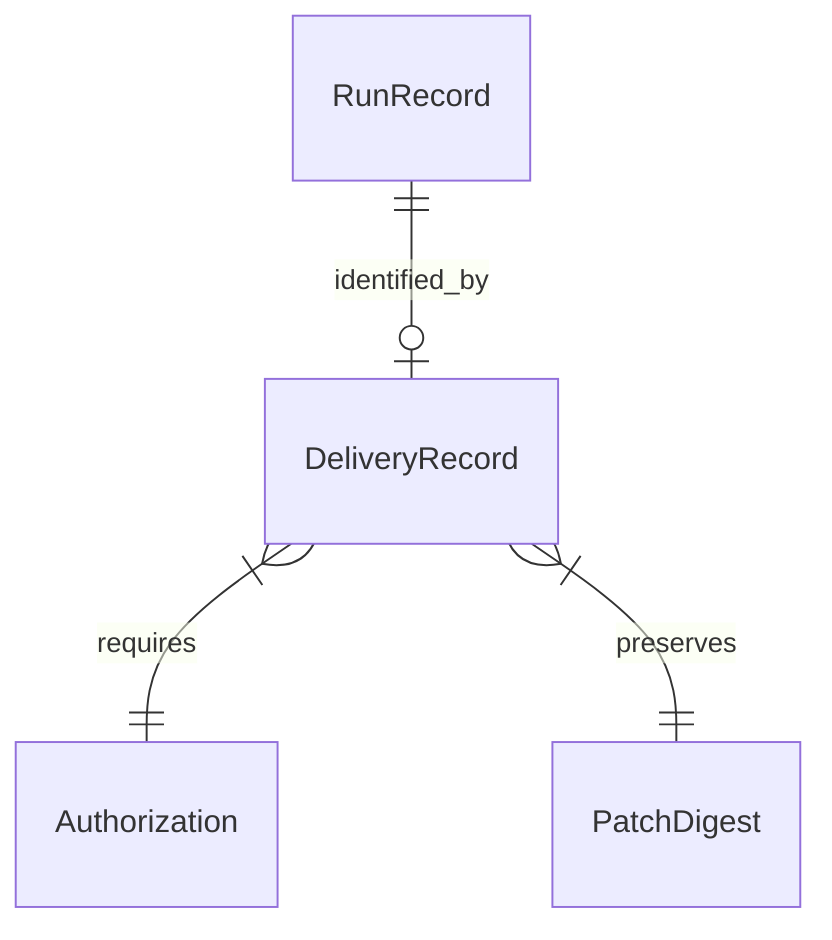

# SCM delivery records and recovery

`ScmDeliveryRecordV1` is DocsFab's harness-neutral, content-free receipt for an
authorized local-user SCM delivery. It is separate from the model RunRecord:
the model produces a governed patch, while a host service records each external
delivery boundary without exposing Git or provider credentials to the model.

The receipt is bound to the exact publication plan, run record, repository,
immutable base revision, source and target branches, and preserved patch. Its
idempotency key is deterministic for the run, provider, repository, immutable
base, target, and patch. The optional source-branch choice remains plan-bound
but is deliberately excluded from that key, so changing it on retry finds and
rejects or resumes the existing delivery instead of creating a second one.

The delivery receipt is not an extension of the raw run record. It binds the
run, the patch digest, and an in-process authorization. Credentials never
appear on either object.



A deserialized lookalike of `Authorization` is not a grant. Changing the
optional source branch on retry must find the existing receipt rather than
mint a second delivery.

## State and evidence

The monotonic success path is:

```text
planned -> prepared -> validated -> committed -> pushed -> opened
```

Each transition adds only structured evidence: a private-workspace key and
base revision, validation command and summary digests, commit revision, pushed
revision, and draft merge-request identity. Every attempt has a deterministic
sequence identity. `opened` is terminal success; `failed` and `recovered` are
dispositions over the last confirmed state rather than ambiguous extra phases.

An executed transition requires the exact affirmative
`LocalUserPublicationAuthorizationV1` capability issued in-process for the
plan; a deserialized lookalike is not authorization. Read-only discovery never
advances a receipt. A reconciliation decision can select the next safe action,
but the resulting boundary is recorded only after that action executes under an
exact in-process authorization capability. Replaying an already recorded boundary
also requires an opaque in-process host confirmation bound to the exact current
receipt, sanitized observation, and reconciliation decision; serialized
lookalikes are not authority.

## Retry and reconciliation

Before any retry mutates SCM state, the host publisher supplies a sanitized
`ScmDeliveryObservationV1` describing discovered worktree, validation, local
commit, remote branch, and merge-request state. `reconcileScmDelivery` returns a
content-addressed, content-free advisory next action. It cannot mutate or
confirm the receipt or skip an unrecorded boundary. A crash is recovered by
rerunning the next boundary from the durable receipt—prepare, validate, commit,
push, or open—as an idempotent host operation. The operation may reuse matching
external state, then records its exact evidence under that in-process authorization.
Conflicting commits, branches, or merge requests fail closed. Merge-request
identity is the immutable project/source/target/head tuple plus DocsFab's exact
versioned provenance marker, not its human-editable title or surrounding body
prose. Missing, conflicting, or multiple markers are conflicts. A supposedly
successful receipt whose merge request no longer matches external state cannot
silently remain valid.
Committed-or-later retries bind detached worktree rehydration to the exact
commit SHA already present in the durable receipt. Preparation never moves that
published ref and rechecks authorization immediately before each new index,
filesystem, validation-launch, and durable receipt mutation.

This module validates caller-supplied observations and computes deterministic
reconciliation decisions; it does not itself inspect a worktree, query a Git
remote or provider, or persist receipts. The isolated delivery worktree and
acceptance-harness integrations must provide and verify those observations.
The local-user publisher now supplies those observations and exercises every
commit, push, and MR interruption boundary against real local Git plus the
bounded fake provider. Live-provider acceptance remains the separately gated
#42 evidence boundary.

The local-user publisher persists transitions in an owner-private, append-only
journal. Every numbered slot binds the previous receipt digest and is claimed
with an atomic no-clobber hard link followed by directory sync. A
credential-free helper performs journal reads and creates relative to an
OS-held working directory; root or journal pathname replacement can only make
the operation fail and cannot redirect receipt bytes into the replacement.
Concurrent CAS writers compete for one deterministic next slot, and a losing
writer reloads and reconciles the winner.

Before the initial claim, the file store also writes one immutable,
content-addressed publication-plan binding. The binding adds no repository,
delivery, receipt, or credential path to the already bounded and
credential-scanned plan, and lets a later process locate the exact receipt by the
operator-confirmed plan digest before mutable GitLab preflight. A plan binding
cannot authorize work: retries still require a newly issued in-process
capability, current checks at each mutation boundary, and exact receipt CAS.

Failures retain the last confirmed state, a closed failure code, and the next
safe operator action. Patch-only recovery is available without GitLab
authentication, but succeeds only after the caller supplies bytes whose length
and SHA-256 match the already-bound owner-private patch artifact. The bytes are
verified in memory and never added to the durable receipt.

## Durable-data boundary

Receipts contain no patch bytes, raw Git or `glab` output, remote URLs with
credentials, tokens, credential paths, prompts, model output, or unrestricted
host paths. The provider-neutral durable-shape validator accepts internally
consistent GitLab and GitHub receipts, including canonical `/pull/<number>`
GitHub URLs. The current plan-bound creator remains the local-user GitLab
adapter from #38; a future GitHub preflight can target the same shape without
coupling it to Pi. Existing RunRecord and patch-only artifacts are unchanged.

The checked-in structural fixture is
`test/fixtures/runtime-evaluation/delivery/scm-delivery-record-v1.json`; its
tests verify required
fields, evidence accumulation, terminal dispositions, exact replay states, and
executable external-state reconciliation cases.

Deterministic tests exercise real local Git commits and pushes, fake GitLab
responses, cross-process MR serialization, and crashes before and after the
provider POST. The separately authorized live GitLab create/close evidence is
owned by #42; #40 remains open until that acceptance run is recorded.
