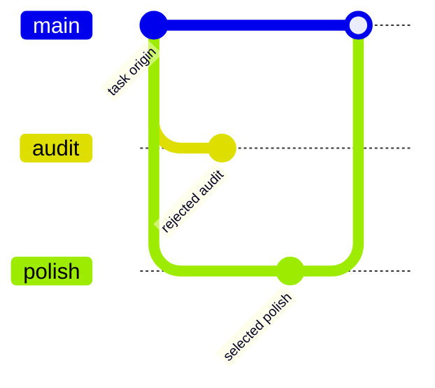

# Task origin and decision lineage

DocsFab records how a task entered the product separately from what a workflow
or model later concluded. The v1 contracts are harness-neutral and live under
`src/lineage/`; they do not depend on Pi session state.

## Origin states

Every current task has exactly one origin:

- `operator-directed` binds the exact bounded request and structured task to an
  operator approval.
- `docsfab-recommended-approved` additionally binds DocsFab's recommendation
  and its evidence, then requires an operator approval of that exact
  recommendation, request, and task identity.
- `docsfab-autonomous` binds the task to content-free identities for the #97
  request, assessment, workflow decision, authorization, source #97 candidate,
  the distinct selected lineage candidate, and maturity evidence. The trusted host verifier is responsible
  for checking those referenced #97 artifacts before accepting the content-free
  challenge; public digest-shaped lookalikes remain inert.
- `historical-unknown` makes missing historical provenance explicit. It has no
  request or task identity and can never satisfy an authority gate.

The durable origin binds a repository revision, request digest, task kind, and
canonical task digest. Raw instructions and task bodies remain
outside the lineage record. Helpers use the shared WorkflowRunner task
normalizer, reject recognized credential material, and digest the exact bounded
input without persisting its text.

Lineage is not the run record and not the prompt. One origin. One selected
workflow candidate. Every other candidate is an explicit reject.

The selected candidate digest must match the task origin. A rejected
alternative keeps its own evidence. Guessing a historical origin is
forbidden; use `historical-unknown`.

## Workflow choice

Decision lineage carries the complete bounded candidate set. Each candidate is
derived from a registered workflow, including its exact ordered step IDs,
task identity, prerequisite identities, prerequisite evidence, eligibility,
and a bounded reason-code identifier. Exactly one current candidate is selected, it must be
eligible, and its task digest must match the task origin. Every other candidate
must have an explicit rejected-alternative record and evidence.

The selected lineage candidate digest and the source #97 candidate digest are
separate identities because the schemas cover different fields. Autonomous
lineage records both and binds the source digest to the autonomous selection;
directed and approved-recommendation lineage must leave the source digest null.

Historical lineage has no candidates, selection, or inferred rationale. Later
migration must not guess what older records did not establish.

## Responsibility is not authority

Each decision names one domain (`task`, `repository`, `workflow`, `scope`,
`path`, `write`, `validation`, `tracker`, or `publication`) and one responsible
actor:

| Actor | Permitted authority source | Effect |
| --- | --- | --- |
| operator | operator approval | authoritative |
| host policy | host policy | authoritative |
| deterministic workflow | workflow contract | authoritative |
| model | none | advisory only |

A model-attributed decision must point to an authoritative decision in the same
domain that bounds it. It cannot attach an approval or promote itself to an
authoritative effect. Task responsibility must agree with the origin class, and
workflow responsibility must identify the exact selected candidate. Every
current record has exactly one authoritative decision in each domain; advisory
model contributions may be added only beneath that domain's authoritative
ceiling.

## Authenticity and persistence

Current lineage is minted only through an internal host verifier. The verifier
receives a content-free challenge that binds repository, revision, request,
task, origin class, candidates, selection, rejections, and responsibility. It
returns a host-owned timestamp and one receipt identity. Receipt reuse is
rejected.

The public capability is opaque: copying its visible `kind` does not copy its
private identity. Serialized origin and lineage artifacts are deliberately
inert. A strict decoder verifies a closed schema and every canonical digest but
does not grant authority. Restoring authority requires the original private
capability and byte-equivalent decoded artifacts. This permits an exact resume
without allowing a record to be replayed for another request or revision.

## Durable Knowledge Continuation

The direct CLI knowledge route can retain a first-pass stop after its disposable
workspace is removed. The stop is bound to the original run ID, repository
identity and revision, create or update workflow, normalized instruction digest,
candidate snapshot, original-task binding, and the complete lineage projection.
The `knowledgeContinuationReceipt` is a separate receipt from the native
`knowledgeResumeReceipt` used for ordinary candidate imports. Its digest-bound
artifact references identify the retained candidate bytes, original-task bytes,
origin, lineage, and task record in owner-private storage.

Continuation restores the original authenticated lineage through the internal
host verifier. The recovered origin and lineage keep their original timestamp,
receipt, origin, decisions, and scope byte-for-byte. A separate
`docsfab-task-lineage-recovery-authorization` records the current recovery
challenge and host receipt. A serialized or copied authority value cannot grant
authority, and the current recovery authorization cannot replace historical
issuance.

Only `create-documentation` and `update-documentation` support this durable
selector. The later invocation supplies a new attributed candidate snapshot and
the existing candidate and write grants. It continues the recorded original
task and lineage. An omitted `--instruction` is restored only after the trusted
stopped receipt and private task artifacts pass validation. If supplied, the
instruction must have the same normalized digest. The workflow, repository,
revision, lineage, and instruction binding cannot be changed by the continuation.
The historical origin and lineage remain immutable while the current recovery
authorization is recorded separately. A writer-completed continuation can use
the existing publisher reconciliation only with a fresh matching delivery
grant, exact retained delivery intent and target, and the same publisher
idempotency key; a mismatch or unsafe uncertainty yields bounded recovery.

Canonical persistence accepts only UTF-8 JSON with no duplicate keys, unsafe
numbers, unknown fields, accessors, proxies, sparse arrays, or noncanonical key
ordering. Public projections retain only revision-bound digests, origin class,
selected workflow, and the actor/effect of each decision. They omit operator
identifiers, approvals, recommendations, autonomous-cycle internals, prompt
text, task bodies, paths, credentials, and private reasoning.

Epic #118 publication narratives must consume `projectTaskLineage` (directly
or via `docsfab/publication`) rather than inventing a third provenance
dialect. See [Publication provenance projectors](publication-provenance-projectors.md).

## Versioning and evaluation

Schema v1 uses identity-only migration. Unknown versions fail closed. Historical
records can be represented only by the explicit, inert `historical-unknown`
constructor; v1 never upgrades missing evidence into authority.

The deterministic fixture is
`test/fixtures/task-lineage-v1.json`. The focused test covers all four origins,
candidate and rejection binding, actor constraints, canonical round trips,
inert decoding and exact restoration, replay, revision drift, tampering,
responsibility expansion, content-minimized projection, and unknown versions.

Runtime capture, trusted historical recovery, and durable knowledge continuation
are covered by the runtime continuation and run-capture tests. Unknown versions
and substituted serialized authority still fail closed.
