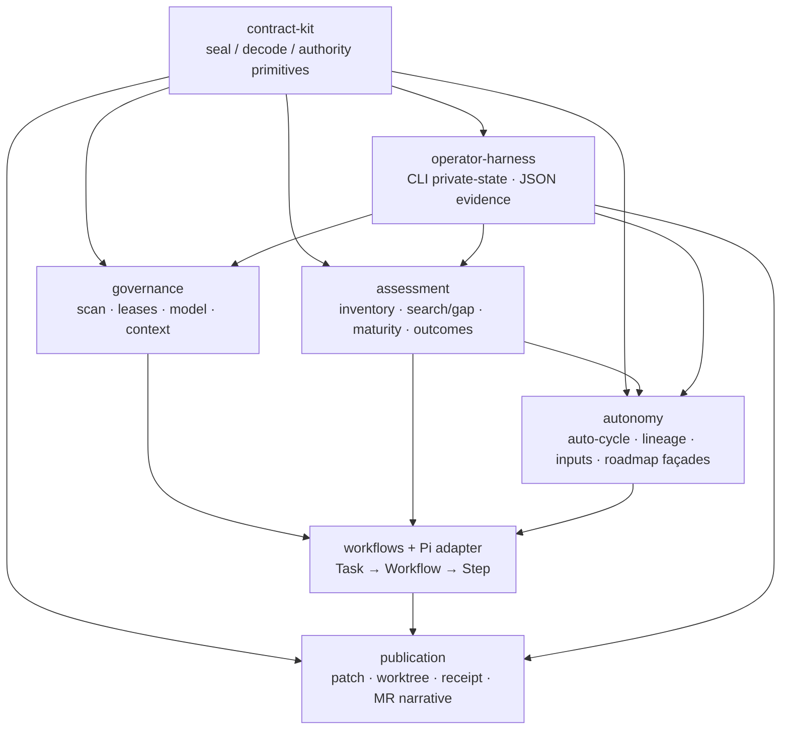

# Soft dependency reference

This appendix is the normative product-package reference for
`npm run check:soft-deps` (Epic D2, #151). For the trust boundary and the
high-level architecture, see [DocsFab architecture](../../../../../docs/about/architecture.md).

## Product package map

Runtime work belongs in explicit product seams rather than files that mix
assessment, delivery, and host authority. The map below describes the current
homes for those seams. Shared closed-schema and host-authority primitives
live in `src/contract-kit/`.

These seams preserve the [contributor boundaries](../../../AGENTS.md):
read-only is the default and writes need explicit authorization; SCM and model
credentials stay out of prompts, run records, fixtures, and repository files;
the model operates only inside the selected repository workspace; and the
`Task -> Workflow -> Step` contract stays independent of Pi.

| Package | Responsibility | Current home |
| --- | --- | --- |
| **contract-kit** | Shared seal/decode, canonical digest glue, inert assert, exact-key reject, hash/id/timestamp helpers, credential-reject hook, and host-authority WeakMap factory. Harness-neutral; no Pi or workflow vocabulary. | `src/contract-kit/` |
| **governance** | Advisory-only repository scan (no eligibility authority; epic #91/#110), execution leases/checkpoints, model catalog and profile approval, revision-bound context preflight. Host-owned controls that gate inference and mutation. | `src/security/`, `src/execution/`, `src/model/`, `src/context/` |
| **assessment** | Repository inventory, bounded search and gap ledger, and documentation-maturity cascade/evaluators. Produces content-minimized findings and dispositions; does not publish. | `src/repository/`, `src/search/`, `src/maturity/` |
| **autonomy** | Auto-cycle request/assessment/decision/authorization/checkpoint/result contracts, dry-run host glue, task-decision lineage, external-input provenance, and roadmap observation façades used to choose work without granting tracker mutation. | `src/autonomy/`, `src/lineage/`, `src/inputs/`, roadmap façades under `src/roadmap/` |
| **publication** | Durable patch finalization, delivery worktree materialize/validate/publish, content-free receipts, and (later) MR narrative surfaces that consume lineage/inputs projectors. Host-only after model execution. | `src/delivery/` |
| **operator-harness** | CLI entrypoints, private-state readiness checks, and strict JSON-evidence parse/canonicalize helpers used by doctor, scorecard, and contract decoders. Operator-facing; not a second product dialect. | `src/cli.ts`, `src/json-evidence.ts`, doctor/private-state paths in init and readiness |
| **workflow engine + Pi harness adapter** | Fixed workflow registry, contracts, product outcomes, and execution engine that schedule skills under the harness-neutral `Task -> Workflow -> Step` contract. Pi (`src/harness/`) is an adapter only: tool confinement, leases at the tool boundary, and model session wiring. Another harness can be evaluated against the same workflows and fixtures. | `src/workflow-registry/`, `src/workflow-contracts/`, `src/workflow-execution/`, `src/harness/` |

## Allowed dependency direction

Dependencies point inward toward shared primitives and outward only along the
product flow. `npm run check:soft-deps` encodes the hard soft-rules below;
the remaining bullets are contributor guidance until additional checks land:

1. **contract-kit** may not import governance, assessment, autonomy,
   publication, workflows, or Pi. Domain modules import the kit, never the
   reverse.
2. **assessment must not import delivery/publication** (enforced). Inventory,
   search, gap ledger, maturity, and workflow outcomes stay free of worktree,
   receipt, and SCM adapter types so assessment cannot grow a second publisher.
3. **autonomy may import assessment and roadmap façades** (allowed; documented).
   Auto-cycle and dry-run compose maturity findings, inventory, and observe-only
   roadmap observations. Autonomy must not own SCM mutation or publication
   receipts.
4. **publication must not own maturity selection** (enforced: no
   `src/delivery` → `src/maturity` imports). Delivery consumes authorized plans,
   patches, and (for Epic #118) lineage/inputs projectors. It does not choose
   G0–G5 work units or replace assessment cascade logic.
5. **governance** is imported by the runner and operator surfaces; it does not
   import autonomy or publication product cycles.
6. **workflows** schedule assessment and governance; they call into the Pi
   adapter for step execution. The adapter must not redefine Task/Workflow/Step
   contracts or absorb maturity/publication policy.
7. **operator-harness** may orchestrate any package for CLI/doctor flows but
   must not become a parallel contract dialect—prefer shared JSON-evidence and
   kit primitives.

Temporary violations of the enforced rules must be listed in
`scripts/soft-deps-exceptions.json` with a reason (and tracking issue when
known); do not resolve them by collapsing seams. The allowlist is empty when
the tree already respects the rules.

## Deliberate exclusions

- Publication narrative projectors (#152).
- Big-bang relocation of every file into package-named directories in one MR.
- Giving Pi ownership of product contracts, maturity selection, or SCM delivery.
