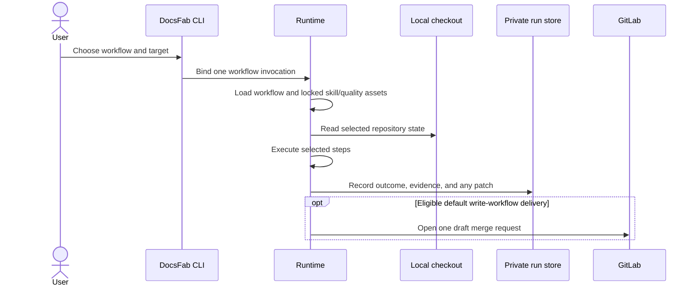

# Runtime contracts

This reference describes how the local CLI selects work, writes documentation,
and delivers a result. For installation, see the [installation reference](../get-started/installation-reference.md).

## One workflow per run

`docsfab run <workflow>` executes one named workflow. `docsfab do "<outcome>"`
classifies a request and admits it to at most one matching workflow. A workflow
records its selected steps and terminal outcome. A review such as
`review-documentation` is read-only. Use `docsfab list` to see the jobs in the
installed package and `docsfab plan <workflow>` to inspect a job without
calling a model.

The local `live-agent` is a persistent conversation around a local checkout.
It can answer repository questions, use installed skills, make documentation
edits, and invoke matching workflows. Documentation edits are enabled by
default; `--read-only` disables edits, workflow writes, and terminal commands.
Terminal commands require approval and are limited to documentation work.

## Local patches and GitLab delivery

Write workflows normally prepare a branch and open one GitLab draft merge
request. That path requires a GitLab remote, authenticated `glab`, and permission
to push and create the merge request. Use `--patch-only` to keep an unapplied
patch in DocsFab's private run data; this mode can run against a local checkout
without a remote or `glab`. Use `--dry-run` to preview workflow selection and
delivery without inspecting the target or calling a model.



The CLI accepts a local Git checkout through `--repo`; it does not clone a URL.
GitHub and other Git repositories can be used for local review and patch work.
`create-documentation` and `update-documentation` can bind a public GitHub pull
request as immutable change input with `--pr` or `--change`. The current draft
delivery path is GitLab-specific; the CLI does not create GitHub pull requests.

`bootstrap` is a local guidance-preparation workflow. It requires
`--allow-write` and produces a patch; it does not open a draft merge request.
The write grant authorizes its documentation edit, while `--patch-only` chooses
how to retain the result.

## Repository bootstrap

`docsfab run bootstrap --repo <path> --allow-write` runs the `repo-bootstrap`
step. It may change only `README.md` and `AGENTS.md` files in existing
repository scopes. It preserves useful nested guidance and cannot edit
application code, configuration, or arbitrary documentation paths.

The result binds the exact source revision. Its evidence cites tracked file
lines read before editing, and the host copies the cited source text into the
result. Credential-shaped files cannot be read for citations. The outcome is an
evidenced patch, an evidenced no-change, or unresolved questions. No-change
requires nonempty README and AGENTS guidance; successful execution alone does
not prove no change was needed. The source repository stays unchanged until a
separately authorized apply.

Hosted bootstrap uses the same domain checks, with a separate workflow write
grant naming the exact README and AGENTS paths. A Slack command cannot widen
that grant. Operators must install the workflow and register its approved
project canon before enabling member commands. Bootstrap grants no publication,
deployment, or merge authority. Readiness, release readiness, and structural
template audit are separate read-only workflows.

## Readiness assessments

`readiness` assesses whether a repository is a usable source for documentation
work. It combines deterministic artifact and inventory observations with model
judgments about source completeness and usability. Each judgment is bound to
the run, revision, search, and context; citations are checked against tracked
source lines and copied into the record from the source. A file with
credential-shaped content cannot be read for a citation. Missing or unsupported
evidence remains visible, and an observed required artifact meets only the
presence criterion. A `ready` result applies only to the declared scope and
grants no write, release, or publication authority.

`release-documentation-readiness` checks public release documentation against
its governed rubric. It requires a valid `.docsfab.json` tracked at the
assessed revision, whose declared default branch binds the assessment. The
record retains findings, limitations, unknown human decisions, and release
work-unit contracts. Successful execution does not itself mean the docs are
ready or that a person approved release. Hosted deployments must install the
workflow and model composition in dispatcher policy before authorized Slack
callers can invoke it; catalog presence alone does not activate a deployment.

## Hosted invoker boundary

The hosted invoker is an internal child-side execution seam, not another CLI or
workflow selector. The host supplies a closed request bound to the exact
repository state, workflow, context, model composition, tool policy, and claim.
Requests are read-only by default. A write step requires a host-minted
`writeAuthority` matching the installed reader and write policies. Review
workflows reject write steps. A documentation authoring request can use only
the steps and paths named by its authority.

The Linux child exposes only those grant-bound targets in its disposable
workspace. The source repository, release, no-grant workspaces, reviews, and
evidence replays remain read-only. The finite write ceiling may include
documentation directories and the exact files `fern/docs.yml` and
`fern/fern.config.json`; it cannot grant a wider Fern tree.

For original-source authority, the runtime preserves every admitted regular
tracked file, including binary assets and filenames with spaces. It compares,
sorts, and hashes member paths as exact strings, not as URLs, globs, citations,
or shell words. A path may use Git filename characters such as `+`, `@`, `!`,
`,`, `#`, `%`, `'`, `=`, `~`, and non-ASCII letters, up to
`sources.authorityMemberPathMaxChars` characters. Controls, invisible
format characters, line or paragraph separators, backslashes, colons, absolute
paths, a leading `~` or `-`, empty/traversal/edge-whitespace segments, braces
outside a whole `{name}` segment, non-NFC text, and credential-shaped paths are
refused. A path refusal names the path and rule. This membership rule does not
expand the separate citation-location grammar, so some admitted paths still
cannot be cited.

Before returning a patch, the runtime rechecks source freshness and binds the
patch evidence to the host request. The host verifies editorial evidence and
retains the artifact graph for replay. This can establish a retained hosted
patch; it does not establish live-provider execution, service activation,
deployment, or publication. Hosted `live-agent-turn` calls are individual
children: the host supplies prior conversation state and retains the answer and
next state for later turns.

## Workflow turn recovery

Pi workflow attempts can use the full admitted provider-turn envelope for
context compaction and repeated output-truncated tool-batch recovery. Each
attempt still obeys its admitted tool, token, and elapsed-time budgets. A
rejected batch consumes provider turns and tokens while executing no tools.
When a truncated batch cannot be retried within those bounds, the run stops
with `tool-arguments-truncated`.

The runtime can lower `governance.maxCompactions` with
`DOCSFAB_GOVERNANCE_MAX_COMPACTIONS`, including a value that disables
compaction, and lower `governance.maxConsecutiveLengthStoppedToolTurns` with
`DOCSFAB_GOVERNANCE_MAX_LENGTH_STOPPED_TOOL_TURNS`; its minimum supported value
disables reissue. These keys are part of the central limits configuration.
`governance.minRecentToolTurns` / `DOCSFAB_GOVERNANCE_MIN_RECENT_TOOL_TURNS`
preserves at least one recent complete tool group during compaction by default;
raising it reduces compaction freedom. These settings resolve inside the runtime
process, including an explicitly supplied harness limits configuration. A
hosted child has a clean environment; parent environment variables do not flow
into it, so hosts must pass lower values explicitly. Existing retry delays and
limit warning thresholds are unchanged.

These allowances do not promise a throughput level. Model latency, context
pressure, requested tool batches, and cumulative budgets can stop an attempt
earlier. Planner-summary sizing is a separate response and record-carrier
constraint.

## Closed-job pins

Every closed workflow invocation is bound to three inputs: **A**, the named
workflow in a validated manifest; **B**, the exact hashed skill bytes and
tools; and **C**, the selected quality-bar identifiers. The runtime manifest
selects A, canonical skill sources in `packages/skills/` produce B, and
canonical quality sources in `packages/quality/` produce C. Generated
`skill-crate/`, `quality/`, and `quality-pack/` are execution inputs, not authoring
locations. The quality-pack manifest binds the selected quality lock to the
exact skill lock; a skill never schedules another skill. Disk presence alone
does not activate a skill or create a workflow.

## Results and private state

Workflow runs produce inspectable records and may produce a patch. Successful
execution means the workflow completed its declared steps; it does not mean a
human approved the result or that documentation was published or merged.
Review the patch before applying or delivering it.

DocsFab stores configuration, conversations, run records, and retained patches
in user-private locations outside the target repository. `docsfab setup`
configures the model profile and stores the API key in the private
`secrets.env` file under the configuration root. SCM credentials stay in the
Git credential helper or `glab` login. Do not put credentials in prompts,
project files, or the target repository.

## Limits and configuration

Runtime limits are centrally configured and may be overridden by supported
host settings. The effective limits and remaining headroom are available from:

```bash
docsfab doctor --limits
```

The report shows effective values, supported overrides, and remaining headroom.
Limit diagnostics say whether the run stopped, a requested value was clamped,
or the operation continued with work clipped; they name the configured bound,
the observed, requested, or attempted value, and the remediation. Provider,
time, and validation constraints can also stop a workflow. Inspect the run
record and operator summary for completed steps, reported limitations, and any
clipped work.

## Runtime architecture

Workflows live in `workflows/`. The runtime executes them with installed skill
and quality artifacts, confines repository access to the selected checkout,
and records outcomes and evidence. The source code is grouped by entry point
and responsibility in the [runtime source map](../../src/README.md).

When developing DocsFab, change canonical skill and quality sources in
`packages/skills/` and `packages/quality/`. The runtime's `skill-crate/`,
`quality/`, and `quality-pack/` directories are generated staging.
