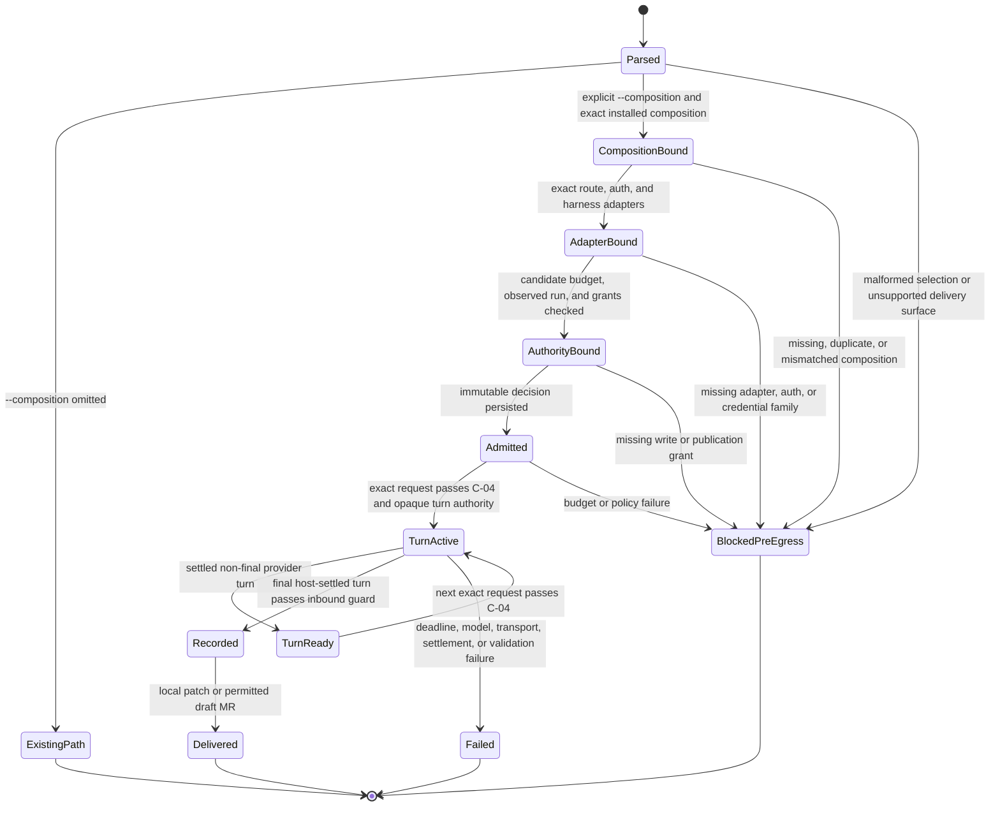

# Provider-neutral execution compositions and adapters

- **Status:** Accepted composition freeze after clean architecture, security, and API-fidelity review
- **Date:** 2026-08-22
- **Parents:** composition execution epic #335, provider-neutral composition epic #337
- **Investigations:** #336, #338
- **Simulation:** `experiments/provider-compositions/` in the source repository; it is not part of this package
- **Follow-on:** the execution-profile unification decision (#925 / #926) — ordinary model-profile execution binds this same installed composition.
- **Amended 2026-10-01:** execution tiers are deleted (#1722). `--composition <id>` alone selects the composition path; without it the model-profile path runs. The composition status `active` replaces the former tier word.

## Decision summary

DocsFab will select an exact **execution composition**, not a model name. The
installed composition template independently binds:

1. the requested model identity;
2. the serving route;
3. the authentication route;
4. the model interface; and
5. the execution harness and adapter version.

Each immutable step decision binds that infrastructure tuple to the run ID,
workflow, step ID and ordinal, step mode, role, repository/export identity,
frozen fixture, skill, quality pack, context, budget, and grants. This matches
the runtime's fresh Pi connection and session per workflow step. A host-owned
workflow manifest then aggregates the ordered step decision and result digests
for run-level evidence and the publication marker.

The composition selects its adapters and only then selects the credential
family those adapters declare. NVIDIA Inference Hub Metadata is evidence for
one NVIDIA serving-route approval adapter. It is not an inference credential,
not a universal model registry, and never a prerequisite for Codex, direct
OpenAI, Claude Code, direct Anthropic, or another route.

The first implementation adds an explicit composition lane. It permits useful,
bounded model runs without presenting a candidate as technically approved or
release-ready. Omitting `--composition` delegates to the existing path without making
any new production or release claim. Explicit-composition results permanently record
`technicalApproval: not-established` and
`releaseEligible: false`.

## Why composition and adapter are separate

The same nominal model can behave differently through different routes and
harnesses. Limits, aliases, system instructions, tools, authentication, data
handling, cost, and observable evidence can all change.

| Model | Serving and authentication route | Harness | Distinct composition |
| --- | --- | --- | --- |
| GPT-5.6 Sol | NVIDIA Inference API + NVIDIA inference credential | Pi | Yes |
| GPT-5.6 Sol | ChatGPT-managed Codex access | Codex CLI | Yes |
| GPT-5.6 Sol | OpenAI API + OpenAI API key | Pi | Yes |
| Claude Opus 4.7 | Claude.ai Enterprise OAuth | Claude Code | Yes |
| Claude Opus 4.7 | Anthropic API + Anthropic API key | Pi | Yes |
| Claude Opus 4.7 | Bedrock + AWS credential chain | Pi or Claude Code | Yes for each harness |

Evidence and qualification never transfer between these rows merely because
the marketing model family is the same.

## Two comparison tracks

DocsFab will support two explicitly labeled experiment families.

### Common-harness model and route comparison

Run multiple serving routes behind the same Pi harness, the same frozen task,
the same skill and quality pack, the same context, and equivalent operational
limits. This is the closest available comparison of model and serving-route
behavior.

Initial route adapters are NVIDIA's OpenAI-compatible API, direct OpenAI, and
direct Anthropic. Other OpenAI-compatible endpoints and local or hosted NIMs
can implement the same route contract.

### Native-harness system comparison

Run a native harness only when its adapter can establish the frozen execution
boundary. Codex 0.147 cannot disable its native tools. Claude Code can disable
tools but the current local host cannot prove descendant containment and
complete process-tree settlement. Both therefore have offline preflight
adapters only in the first slice and remain unsupported for live model-backed
comparison. A future contained native runner can join this track without
changing the experiment schema.

Native-harness evidence measures the complete model-plus-harness system. It is
useful product evidence, but it must not be described as a pure provider or
model comparison.

Every comparison record names its track. Cross-track leaderboards are
disallowed unless the report explicitly treats the harness as an independent
variable.

## Path selection

There are no execution tiers. A run takes one of two paths:

- `--composition <id>` selects the sealed-composition path. Prompt text and
  environment variables cannot select it.
- Omitting `--composition` takes the model-profile path. That path emits no
  release-eligibility or technical-approval claim from this design.
- The composition path refuses release-gate and existing-merge-request
  delivery by name (`composition-release-gate-unsupported`,
  `composition-existing-mr-unsupported`).
- There is no automatic fallback from one path to the other or from one
  composition to another.

The composition path is a learning authority, not a release authority. It does
not change the meaning or state of a candidate profile.

## Composition contract

The packaged composition registry is credential-free and digest-locked. A
record has this logical shape:

```ts
interface ExecutionCompositionV1 {
  schemaVersion: 1;
  compositionId: string;
  status: "active" | "planned";
  executionClass: "pi-provider" | "preflight-only";
  model: {
    vendor: "openai" | "anthropic" | "nvidia" | string;
    requestedId: string;
    resolvedId: string;
  };
  deployment: {
    routeId: string;
    provider: string;
    transport:
      | "openai-chat-completions"
      | "openai-responses"
      | "anthropic-messages"
      | "opaque-cli-managed";
    bindingKind: "exact-origin" | "opaque-cli-managed";
    identitySha256: string;
    region: string | null;
  };
  authentication: {
    route: string;
    credentialFamily: string;
    sourceNames: string[];
  };
  harness: {
    id: "pi" | "codex" | "claude-code" | string;
    policySha256: string;
  };
  adapters: {
    routeEvidence: { id: string; version: string };
    authentication: { id: string; version: string };
    providerConnection: { id: string; version: string };
    harness: { id: string; version: string };
  };
  compositionLimits: {
    contextWindow: number;
    maxInputTokens: number;
    maxOutputTokens: number;
    maxProviderTurns: number;
    timeoutMs: number;
    maxResponseBytes: number;
  };
  limitations: string[];
  compositionSha256: string;
}
```

The target repository cannot define or replace the installed registry. An
operator selects a `compositionId`; a model ID never infers a route. Registry
resolution requires exactly one host-installed, digest-valid `active` record with a
non-null resolved model identity. `planned` records are visible but cannot
execute. Alias resolution is a separate evidence operation; execution pins the
resolved identity.

## Adapter contracts

The registry uses a tagged contract for four adapter responsibilities and
versions each one independently. A harness entry binds only harness identity,
policy, and execution class; it is reusable across routes. Authentication binds
route, family, mechanism, executable policy, and environment policy. Route
evidence and provider connection bind the deployment dimensions they actually
observe or execute.

```ts
interface ServingRouteAdapter {
  readonly id: string;
  readonly version: string;
  inspect(candidate: RouteCandidate): Promise<CredentialFreeRouteObservation>;
}

interface AuthenticationAdapter {
  readonly id: string;
  readonly credentialFamily: string;
  preflight(candidate: AuthenticationCandidate): Promise<CredentialFreeAuthObservation>;
}

interface ProviderConnectionFactory {
  readonly routeId: string;
  readonly transport:
    | "openai-chat-completions"
    | "openai-responses"
    | "anthropic-messages";
  create(input: BoundProviderComposition): Promise<ModelConnection>;
}

interface HarnessAdapterFactory {
  readonly id: string;
  readonly version: string;
  create(input: BoundComposition): AgentHarness;
}

interface NativeComparisonAdapter {
  preflight(input: BoundComposition): Promise<CredentialFreeHarnessObservation>;
  runToolFree?(input: FrozenSerializedFixture): Promise<GuardedComparisonResult>;
}
```

The composition resolver produces a provider-neutral bound execution profile
containing model identity, deployment identity, effective budget, evidence
policy, and credential-free adapter references. Pi consumes that profile plus
the selected `ProviderConnectionFactory`; it no longer requires an
OpenAI-specific endpoint object for lease, evidence, or redaction policy.
Opaque native routes consume a `NativeComparisonAdapter`. Individual adapters must not choose another
provider, model, route, credential, transport, or harness as a fallback.

### Pi provider routes

Pi remains the common-harness adapter. Provider transports are selected by the
bound serving route, not by a provider-like model prefix.

- NVIDIA OpenAI-compatible inference uses its configured inference credential.
  Metadata credentials are not read during ordinary inference.
- Direct OpenAI uses an OpenAI credential and an OpenAI transport adapter.
- Direct Anthropic uses an Anthropic credential and the Messages transport.
- An endpoint adapter receives only its declared credential handle and exact
  origin. Redirect and outbound credential guards remain host-owned.

### Codex composition and preflight adapter

The Codex composition uses the authenticated Codex CLI, not an NVIDIA
endpoint. The initial adapter performs offline/no-inference inspection only:

- requires the installed CLI and an active `chatgpt` authentication mode;
- queries `codex debug models --bundled`, which explicitly skips catalog
  refresh, without starting app-server, a thread, or a turn;
- records requested model and catalog availability, not an observed model;
- treats `codex login status` as a bounded, version-pinned text observation
  because this installed CLI does not expose structured status; and
- rejects auth mismatch, executable drift, malformed output, unexpected
  environment authority, and model unavailability with content-free codes.

Codex 0.147 does not capability-disable native tools, does not attest an exact
serving origin, and its documented JSONL stream has no observed-model field.
The adapter therefore returns `unsupported-confinement` before `codex exec` or
any model request. It must not receive a target repository, prompt, provider
credential, or Inference Hub credential. A future live adapter requires
pre-inference tool denial or a host-mediated result loop plus real
containment; `read-only` sandboxing alone is insufficient.

### Claude Code composition preflight adapter

The Claude Code composition uses the authenticated Claude CLI. The initial
Claude.ai Enterprise preflight:

- requires `claude auth status --json` to report logged-in, first-party
  `claude.ai` authentication;
- verifies the installed executable/version and required flags without a model
  request;
- records the version-pinned, content-minimized `claude auth status --json`
  projection; and
- rejects conflicting API-key or cloud-route selectors before invocation.

The adapter is preflight-only and has no model-egress transition. A later
tool-free comparison still requires verified descendant containment and
complete process-tree settlement; an injected fake process is sufficient only
for provider-offline tests. Write-capable Claude Code additionally requires
mediated tool settlement.

Claude.ai OAuth is a local experimental route. A hosted product must use the
direct Anthropic API or another supported cloud route unless product and
security policy explicitly approve a subscription-auth composition.

## Composition admission

The earlier routing-guide experiment did not fail because a signed approval
bundle was missing. Its unknown profile was clamped to 8,192 context tokens,
while the first request needed roughly 49,447 input tokens plus reserve.

The composition path uses a separate non-authoritative operational cap. For the
first package version:

```text
context window: 65,536
max input:       65,536
max output:       8,192
reasoning:        off unless the adapter has an explicit bounded setting
input:            text
```

The effective limit is the minimum of host configured limits, the installed
candidate projection, the composition proposal, and the package composition
ceiling. Remaining context after input and reserve also caps output. These values are
experiment settings, not verified provider facts. Production keeps the
existing unknown/stale fallback unchanged.

Candidate definitions remain `not-approved` and `modelRequest: blocked`. A
candidate plus an explicit composition selection produces a one-run composition
decision; it never mutates the candidate or feeds profile approval.

## Composition execution decision

Before the first model request, the host resolves a package-lock-backed asset
authority that binds composition, candidate projection, adapter registry,
package ceiling, and the exact workflow catalog. The workflow catalog freezes
each required step ID, ordinal, mode, skill ID, and role. Target input cannot
supply or replace those assets.
DocsFab then freezes a closed
`docsfab-composition-execution-decision/v1` projection containing:

- requested and repository-minimum tiers plus the exact tracked policy digest;
- installed-manifest, composition, candidate, and experiment-manifest digests;
- model, route, authentication, transport, harness, adapter, workflow, role,
  repository revision, and track;
- configured, candidate, package, and effective limits;
- a one-use opaque host authentication authority with a safe, digest-bound
  observation tying the sole inspected source
  name to route, family, mechanism, executable, environment policy, and auth
  adapter, never the credential value;
- `technicalApproval: not-established`;
- role-qualification state;
- `releaseEligible: false`;
- the concrete observed step binding—run ID, repository and disposable-export
  identities, revision, workflow, step ID/ordinal/mode, role, fixture, skill,
  quality, context, and budget digests;
- a complete safe write-grant projection, including exact run-binding digest,
  issuance, and expiry, only when backed by opaque host authority;
- known limitations; and
- the complete decision digest.

The step decision is persisted before provider egress. Every provider turn and
step result binds its digest. After all steps settle, the host validates their
ordered subjects, consumes the recorded step states, and emits one run decision
manifest plus a one-use run-manifest authority. No individual step state can
authorize external delivery. Comparison results, local patches, draft-MR metadata, and the
permanent composition marker bind that run-level digest.

Aggregation resolves the installed workflow definition and requires every
required step exactly once. Caller-defined one-step or five-step versions of
`create-documentation` cannot mint run or delivery authority; the exact six
installed steps can.

Step write authority is catalog-bound: every installed `write` step must carry
valid write authority, and every installed `read-only` step must not.
Aggregation derives the write step from the installed definition rather than a
caller flag and checks this invariant before consuming any state.
The first slice does not add retry or resume authority. A host-owned, affine
opaque state capability moves from `admitted` through individually authorized
provider turns to `recorded`, then optional delivery. Authorizing a transition
reserves the predecessor; consuming it tombstones that predecessor. Parallel
or replayed authorities cannot fork execution history. Structured records and
self-hashes provide audit integrity; only the opaque host authority establishes
phase reachability. Deadline and grant decisions use an injected host clock,
never caller timestamps.

## Mutation, publication, and release

The composition path does not imply write permission. Direct provider/Pi execution
retains the existing host-mediated tools and controls:

- a write step requires `--allow-write`;
- a draft MR requires both `--allow-write` and `--draft-mr`;
- the runtime uses a disposable tracked export and captures a patch;
- explicit-composition MRs are visibly experimental and non-release evidence.

Native CLI adapters in this slice never receive write permission. Write and
write grants are bound to the exact run binding, workflow, repository revision,
composition, issuance, expiry, and authorization digests. Draft-publication
authority is minted only after the result and patch are frozen, and binds the
decision, run, result, patch, destination, issuance, and expiry. The
host derives the permanent composition marker from the execution decision; a
caller cannot omit or replace it.

Read-only results have a `record-only` delivery with no patch. `local-patch`
requires a still-current write authority. `draft-mr` requires still-current
write and publication authorities and the exact authorized destination. Every
grant is rechecked at the provider-turn and delivery boundaries.

The first slice rejects `--release-gate`, existing-MR comments, non-draft
publication, and every attempt to reinterpret an explicit-composition result as an
approval or release artifact.

## Comparable evaluation evidence

Every provider or harness comparison case binds the same:

- repository revision and disposable export identity;
- request and workflow;
- governed skill and quality-pack digests;
- context packet and source evidence;
- role, rubric, hard checks, and thresholds;
- comparable elapsed-time and output budgets plus separately named
  harness-specific turn, tool, and cost semantics; and
- independent-review policy.

Every Pi provider turn separately binds its exact serialized request and
pre-egress outbound guard. Settlement derives success or a terminal failure
from host facts: provider and host tool-batch settlement, installed response-
byte cap, stream completeness, output-schema validity, inbound credential
guard, no raw sink, observed model, session freshness/continuity, usage, and
turn-evidence digests. A failed or late settlement consumes the active state;
it cannot later be replaced by a successful observation.

Settlement is a closed union. `completed` requires bounded nonblank output,
complete stream, schema-valid credential-safe normalization, exact observed
model, and fresh-or-continuing session evidence. `failed` permits zero response
bytes and absent model/session evidence, requires a closed provider failure
category and complete bounded capture facts, and consumes the step to a
terminal failure. Malformed observations also terminalize rather than leaving
the active state reusable.

The normalized result records:

- task success and workflow outcome;
- rubric score and hard-gate results;
- documentation-quality layer vector;
- latency, token usage, cost when available, and retry count;
- tool calls and failure categories;
- model/route/harness identity and adapter version;
- reliability across repeated clean sessions; and
- approval, qualification, and release eligibility as separate fields.

Codex, Claude Code, and Pi do not expose equivalent meanings for “turn.” The
comparison records provider/model turns, process attempts, tool rounds, cost
ceilings, and deadlines as distinct dimensions and compares only like fields.

Missing cost or usage is `unknown`, not zero. A different fixture, skill,
rubric, context, or operational budget makes a result a different experiment,
not another row in the same leaderboard.

## State machine



No transition selects a different composition. No terminal state can be
promoted by later telemetry.

## Required failure injections

The deterministic simulation covers:

1. an omitted composition delegates without creating a release or approval claim;
2. prompt text cannot select the composition path;
3. a duplicate or malformed composition selection fails;
4. release-gate and existing-merge-request delivery refuse on the composition path;
5. retired and planned compositions are not selectable;
6. candidate without an explicit composition selection remains blocked;
7. missing, duplicate, target-supplied, or tampered composition fails;
8. concrete model, route, auth, transport, harness, adapter, version, candidate,
   experiment, or digest mismatch fails;
9. NVIDIA evidence cannot authorize Codex, OpenAI, Claude, or Anthropic;
10. missing adapters never fall back or trigger an unrelated credential lookup;
11. absent or ambiguous credential sources fail without values in diagnostics;
12. prompt or target files cannot override installed composition policy;
13. composition limits cannot exceed host, candidate, or package ceilings;
14. current-looking metadata cannot make an explicit-composition run release-eligible;
15. write, draft-MR, and release grants remain independent;
16. model-profile failures never fall back to the composition path;
17. a stale or forged state, turn, settlement, write, publication, or delivery
   authority fails;
18. delivery cannot strip the composition marker;
19. provider success cannot establish approval or another role's qualification;
20. provider failure cannot mutate candidate status;
21. malformed, oversized, credential-shaped, incompletely settled, or
   identity-conflicting adapter output fails before any sink;
22. comparison inputs with different bindings cannot share one experiment ID; and
23. native-harness evidence cannot be labeled a common-harness provider comparison.

## Implementation slice after model review

If this design survives review, the first MR is limited to:

- `experiments/provider-compositions/` for the retained state machine and
  failure injections;
- packaged, digest-locked composition records and their validator;
- a packaged installed-manifest trust root and opaque host authorities built
  with `contract-kit`;
- a composition resolver and adapter registry;
- explicit composition CLI selection and immutable run evidence;
- Pi provider-connection adapters for NVIDIA OpenAI-compatible, direct OpenAI,
  and direct Anthropic routes;
- offline Codex and Claude Code composition/preflight adapters that remain
  `unsupported-confinement` for model execution;
- normalized comparison contracts and a provider-offline fixture runner; and
- focused CLI, resolver, adapter, run-record, publication, and packed-install
  tests.

The base runtime configuration is loaded before any route-specific config.
Only after exact composition resolution may the selected adapter load its own
credential family. Ordinary tests accept only injected fake transports and
sentinel credential resolvers. A separate live command requires explicit
operator opt-in after the MR passes adversarial review. The MR remains
unmerged until the named approver confirms it.

## Ordinary model-profile path

Model-profile `do` / `run` / `live-agent` bind the same installed
composition as `--composition`. YAML
`DocsFabModelProfileV1` is a unique-match migration bridge onto this
object. There is still no automatic fallback from one composition to
another, no NemoClaw-style preload or gateway, and the composition path still
never implies technical approval or release eligibility. See the
execution-profile unification decision.

## Explicitly deferred

- Technical approval of any composition.
- Treating candidate limits as provider facts.
- Alpha, beta, or production admission for the new adapters.
- Live Codex model execution and write-capable native CLI execution.
- Live Claude Code model execution until containment is verified.
- Hosted use of subscription OAuth.
- Automatic best-model selection or silent fallback.
- Cross-track rankings that hide the harness variable.
- Merge or release automation from explicit-composition evidence.

## Amendment: GPT-5.6 retirement (2026-09-28, #1512)

The GPT-5.6 Sol rows above record the original composition freeze. On
2026-09-28 the product owner directed that "literally everything should switch to
gpt-6" (#1512). The installed records changed as follows:

- `openai-gpt-5.6-sol-codex-preflight` is retired as `provider-end-of-life`.
  NVIDIA disables GPT-5.6 Sol, Terra, and Luna in its Codex and ChatGPT Work
  environment effective September 30, 2026. Its successor is
  `openai-gpt-6-sol-codex-preflight`, on the same ChatGPT-managed Codex route
  and preflight-only boundary, requesting the Codex model slug `gpt-6-sol`. It
  does not share the retired record's harness policy or adapters: it binds new
  1.1.0 Codex adapter records and a new harness policy (below). The provider
  notice names GPT-6 Sol at Medium reasoning; the preflight record carries no
  reasoning setting.
- `openai-gpt-5.6-sol-pi` is retired as
  `superseded-by-operator-decision`. The provider notice does not cover the
  direct OpenAI API, so this retirement cites the decision record instead. Its
  successor is `nvidia-inference-gpt-6-sol-pi`.

Both retired records stay installed so completed run records keep rebinding
to them.

A live preflight on 2026-09-28 found the available, logged-in Codex at
`codex-cli 0.155.1`, whose catalog lists `gpt-6-sol` with default reasoning
`medium`. The successor record therefore pins 0.155.1 through its own
adapter records (`codex-chatgpt-auth` and `codex-preflight` at 1.1.0). Their
executable and harness policy digests are derived from checked-in policy
bodies that record the qualifying executable (sha256 `8eaf1ad1...`, identity
`da932e58...`). As with the 0.147.0 pin, preflight enforces the reported
version rather than the executable bytes. The retired GPT-5.6 record and the
frozen pilot keep the 1.0.0 adapter records and the 0.147.0 pin unchanged.
The preflight record carries no reasoning setting, because preflight makes no
model request; the catalog default is recorded as provenance.

**This reverses the provider-offline catalog choice above for the 0.155.1
pin.** The live preflight found the 0.155.1 bundled catalog stale: it does
not list `gpt-6-sol`. The account catalog (`codex debug models`, no
`--bundled`) does, and it is what NVIDIA's Codex environment serves. The
0.155.1 harness policy therefore reads the authenticated account catalog,
recorded as catalog source `codex-account`, and only after authentication is
`ready`. An unready login stops without falling back to the bundled catalog.
Codex makes that read against the provider with the operator's ChatGPT
session, so the successor preflight is not provider-offline. It stays
preflight-only: no model request, prompt, repository content, or credential is
sent to Codex, and the only provider contact is one authenticated catalog
read (645 KB, about 5 s, in the live run). That read makes Codex write
`models_cache.json` and `cloud-config-bundle-cache.json` in its own home
(`~/.codex/`); DocsFab writes nothing to its own state for it. The 0.147.0
pin keeps the bundled, provider-offline catalog.
