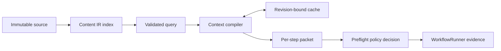

# Context compilation and preflight

This directory turns an immutable documentation structure into a bounded,
digest-bound context packet for one workflow step. It owns the query language,
compiler, cache identity, and preflight evidence. Start with the [runtime source
map](../README.md).

## Boundary

Context begins with a validated `ContentIndex` for one repository revision,
plus ontology, semantic artifacts, an optional active IA plan, a closed query,
a policy, and a budget. It returns document and section summaries, structural
edges and paths, semantic placement facts, provenance, measurements, and a
canonical packet digest.

Neighboring directories have different jobs:

- [`content-ir/`](../content-ir/) parses immutable source into documents,
  sections, links, navigation, and repository identity. This directory queries
  that index; it does not parse repository files itself.
- [`canon/`](../canon/) handles accepted canonical input and lineage. Canon
  can inform a job, but it is not the structural context packet.
- [`search/`](../search/) plans and records workflow discovery across the
  repository. Context answers bounded structural questions for a step.
- [`host-invoker/`](../host-invoker/README.md) adapts host-provided capsules and
  focused targets to this preflight interface.

A source path or packet digest identifies evidence. It does not authorize a
repository write, provider call, tool, publication, or host operation. Those
permissions remain with the workflow, harness, and host boundaries.

## Flow

`queries.ts` admits only `locate`, `get-neighborhood`, `find-home`,
`test-placement`, and `expand`. It rejects unknown fields, unsafe paths,
unnormalized text, invalid depths, and duplicate node IDs before canonicalizing
or hashing a query.

`compiler.ts` validates that the index and semantic artifacts bind to the same
repository, walks only known structural edges, applies the node, edge, path,
depth, byte, and token bounds of its budget, and validates its own result. A
packet digest covers the canonical packet without its `digest` field.

`budget.ts` sizes each packet's budget as a declared share of the model's
input window (`config/limits/context.yaml`). Only a window DocsFab admits
against counts, by `admittedInputWindowTokens`, the rule source reads use too:
an installed composition's, whatever its profile metadata says, or a profile's
with current metadata. Any other run, and any smaller window, uses the
declared fallback window. Node, edge, and path counts equal the token budget, so they never
bind first. The compiler ranks the walk: the requested targets first, in the
order the query names them, then each other node by its distance from them.
A packet over its budget is trimmed to the largest rank prefix that fits:
nodes first, then the edges among them, then their paths. Each element's
canonical size is measured once, so trimming a whole corpus does not
re-serialize the packet per probe. The trim's reasons carry the whole walk's
measured bytes and tokens or, when not even the first-ranked node fits, that
smallest packet's, which preflight records as the bound.

`ContextService` derives a cache key from all compilation inputs. A hit is
reused only when the cached result still matches that identity. Missing,
corrupt, unsafe, or mismatched entries compile at most once and leave explicit
cache evidence. File cache directories and entries use owner-only modes.
Degraded context is allowed only when the selected policy permits degraded
read access; it never becomes write-capable context.

`LocalContextPreflightService` builds the index and structural ontology, maps a
workflow step's context level and policy into a compile request, and records
ready, degraded, unnecessary, or failed evidence on that step. A named target
must remain present in the returned packet; it cannot silently widen to another
page or the whole corpus. A trimmed packet is `degraded` with reason
`preflight-budget-exceeded` and a `limit` naming the share, the token budget,
and the untrimmed tokens. When no packet fits at all, the step gets none and
the same record, with the smallest packet's tokens; the runner then lets a
read-only step continue and stops a write step, which needs a packet. A
requested page that a trim or the corpus leaves out of the packet is named in
`unboundTargets`, by its NFC path, or counted in `unboundTargetsOmitted` when
a record cannot hold its path. A requested path resolves the way the index
names files (NFC), so a page requested by a decomposed name binds; a
backslash stays part of the name, so it never binds a different page.

A preflight that cannot give a step a packet of its own for a coded cause
records it as `degraded` with a `cause` naming the raw code and the file:
`content-index-refused` for a `ContentIndexError` while building the index,
`content-index-unreadable` for a file-system error, `context-compile-failed`
for a compiler reason the preflight has no mapping for (`invalid-input`,
`repository-mismatch`) or any other throw, and `navigation-alias-refused` for
a selected symlink. The runner's existing rule then lets a read-only step
continue without a packet, before or after a write step, and stops a write
step, which needs one. Each code
has a situation catalog row with its class and next action, which `docsfab
why` reads. The content index reads every file by its on-disk name and leaves
out one whose name an index path cannot hold; the preflight hands those
names to the runner as `content-index-name-left-out` run warnings.

Hosted execution adds one narrow fallback in
[`host-invoker/context-preflight.ts`](../host-invoker/context-preflight.ts): a
compile failure, an index or compile cause above, or a 30-second wait timeout
uses the host capsule as degraded context, recording the compiler's coded
reason and cause. Only `target-not-applicable` and `navigation-alias-refused`
keep the compiler's verdict for a focused target. The timeout stops waiting,
not the underlying compiler. The [hosted invoker guide](../host-invoker/README.md)
explains the surrounding child contract.

`reader-context.ts` is a separate closed artifact for reader impact and source
provenance. It validates and digests supplied reader context; it is not the
Content IR packet compiler.

## File map

| File | Maintainer purpose |
| --- | --- |
| [`contracts.ts`](contracts.ts) | Query, budget, policy, packet, result, and preflight types. |
| [`budget.ts`](budget.ts) | Packet budgets as declared shares of the model input window. |
| [`queries.ts`](queries.ts) | Closed query validation and canonical query identity. |
| [`compiler.ts`](compiler.ts) | Structural traversal, placement, bounds, result validation, packet digest. |
| [`cache.ts`](cache.ts) | Exact cache identity and safe file-backed storage. |
| [`service.ts`](service.ts) | Cache-or-compile coordination and access enforcement. |
| [`preflight.ts`](preflight.ts) | Workflow-step adapter from repository target to recorded evidence. |
| [`diagnostic.ts`](diagnostic.ts) | Content-free, credential-safe failure diagnostics. |
| [`reader-context.ts`](reader-context.ts) | Reader-impact artifact contracts and provenance. |
| [`index.ts`](index.ts) | Public exports for this source boundary. |

## When to edit and verify

| Change | Focused evidence |
| --- | --- |
| Query shape or canonical identity | [`context-queries.test.ts`](../../test/context-queries.test.ts) |
| Packet construction or budgets | [`context-queries.test.ts`](../../test/context-queries.test.ts), [`context-packet-trim.test.ts`](../../test/context-packet-trim.test.ts), and [`context-packet-budget.test.ts`](../../test/context-packet-budget.test.ts) |
| Model input window reaching the budget | [`cli-run-context-window.test.ts`](../../test/cli-run-context-window.test.ts) and [`host-invoker-search-reuse.test.ts`](../../test/host-invoker-search-reuse.test.ts) |
| Cache identity, permissions, or corruption handling | [`context-cache.test.ts`](../../test/context-cache.test.ts) |
| Workflow admission from context status | [`context-runner.test.ts`](../../test/context-runner.test.ts) |
| Local or hosted preflight behavior | [`context-preflight.test.ts`](../../test/context-preflight.test.ts) and [`host-invoker-search-reuse.test.ts`](../../test/host-invoker-search-reuse.test.ts) |
| Reader-impact contracts | [`reader-context.test.ts`](../../test/reader-context.test.ts) |
