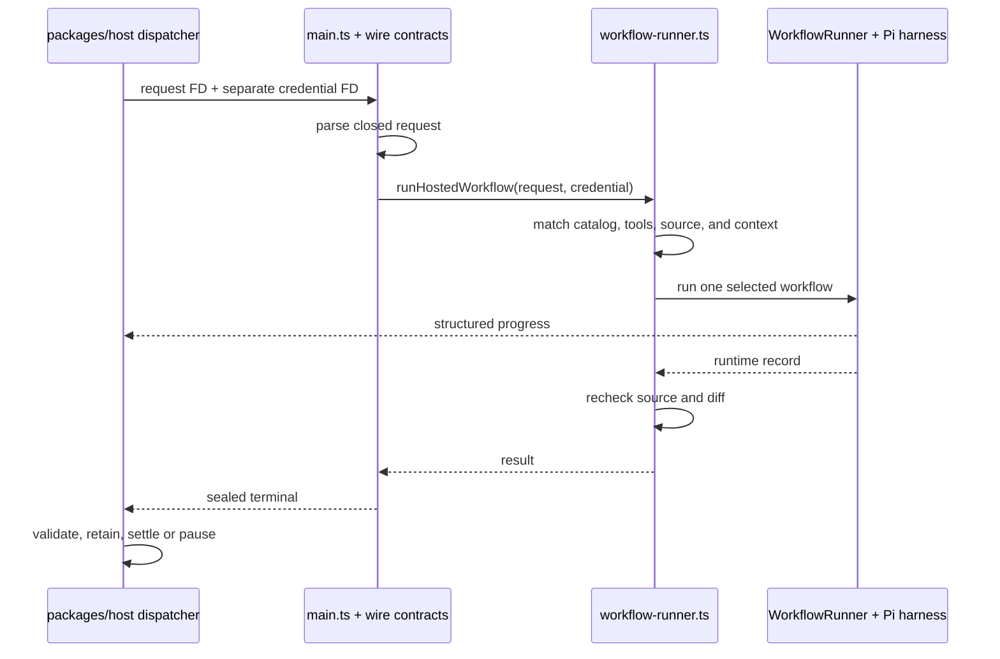

# Hosted invoker

The hosted invoker executes one host-dispatched request: a documentation
workflow or a `live-agent-turn` within an ongoing conversation. It accepts an
already selected workflow and exact source snapshot, runs it in the disposable
workspace prepared by `packages/host`, and returns structured progress followed
by one terminal envelope. The host retains conversation state between turns;
the child process handles one invocation.

Start with the [runtime source map](../README.md) and the [runtime package
overview](../../README.md); the host dispatcher lives in the sibling
`packages/host` package.
The public `docsfab run` path is separate. The hosted path currently constructs
`WorkflowRunner` directly instead of calling the [application helper](../application/README.md).

## One child invocation



For `live-agent-turn`, the request includes the question and verified prior
session state; the result includes the answer and next session state. A later
turn starts another invocation. The [live-agent guide](../live-agent/README.md)
compares this hosted state with the persistent local conversation started by
`docsfab live-agent`.

The child does not discover which job to run. The request names the workflow
and ordered step IDs. `workflow-runner.ts` loads that workflow from the
installed catalog and refuses a missing workflow, a step-order mismatch, a
declared-tool mismatch, or any write step without the matching host-minted
`writeAuthority`. No-grant requests and review workflows remain read-only. A
documentation authoring request may execute only the exact installed write
steps named by its sealed authority. The
[workflow execution guide](../workflow-execution/README.md) and [harness
guide](../harness/README.md) explain the scheduler and model adapter beneath
this seam.

Hosted `create-documentation` runs the canonical V3 authoring lifecycle in a
separate authenticated candidate workspace. Its search, Git evidence collector,
and native documentation checks see the actual candidate files; a separate
immutable workspace supplies original-source evidence. The runtime validates
the selected candidate record, reads its retained patch by digest, transfers
only that patch into the host checkout, and recomputes the final grant-bound
patch evidence. Native check results remain bound to the selected candidate; failed checks
retain failure evidence and missing check isolation remains unavailable
evidence. A completed authoring run
does not by itself establish document quality, publication, or release approval.
Installed nested callers may supply a host-derived instruction through the
in-process API; this does not change the selected workflow, tool ceiling, source
binding, or write grant and is not accepted as a new wire field.

`main.ts` reads and parses the request before entering the execution
`try`/`catch`. A malformed JSON document, invalid descriptor, oversized input,
or request-contract failure can therefore end the child without a terminal
envelope. After execution begins, an exception is converted to a closed failure
record and terminal envelope.

Failure terminals carry `failurePhase`: `workflow-execution` means the selected
workflow did not return a completed outcome; `terminal-sealing` means projection
or terminal sealing failed after an outcome returned. The accompanying `code` is
an exact member of that phase's closed vocabulary, or the fixed phase fallback
`execution-failed` / `terminal-sealing-failed`. A `reconcile-product-behavior`
reply that the proposal contract refuses as a whole is recorded as
`semantic-reply-<refusal>` (class `model-content`), for example
`semantic-reply-proposal-not-json`, so the run record and the host's dispatcher
failure line name the cause. The code never contains exception text, a cause,
stack, reply text, or rejected run record. Empty step, tool, and model arrays
in this synthetic fallback mean entries were not retained in that fallback; they
do not establish zero provider calls or usage.

## Host and child responsibilities

| Concern | Host responsibility | Child responsibility |
| --- | --- | --- |
| Job admission | Authorize the requester, select an installed workflow and composition, acquire the durable claim, and mint an exact documentation write authority when policy permits. | Match the installed workflow, ordered steps, tools, and composition; reject write steps unless they exactly match the sealed host authority. |
| Source workspace | Prepare the clean detached checkout and attempt directory; monitor the merge-request head where applicable. | Verify commit, tree, and cleanliness before and after execution using `/usr/bin/git`. |
| Inputs and context | Resolve frozen packet inputs, focused scope, and the context-manager receipt. | Check closed shapes, content digests, scope, capsule expiry, and read-only policy. |
| Process and credentials | Contain the process, supply a separate attempt credential, enforce deadlines and cancellation, and clean up. | Read bounded descriptors, handle abort signals, and confine model tools. |
| Results and settlement | Recheck claim and source, validate output, retain evidence, and settle or pause the durable job. | Emit request-bound progress and terminal evidence. |

Start host-side changes in `dispatcher/invoker.ts` in the sibling
`packages/host` package.
The child-side checks are in the kind-owned wire modules listed in the file
map, the [`contracts.ts`](contracts.ts) barrel, and
[`workflow-runner.ts`](workflow-runner.ts).

These digest checks establish consistency, not authority. In particular, an
invoker-validated composition digest, packet fingerprint, fence, or principal
does not prove that the request came from a current authorized host. The host
must establish those facts upstream and recheck them when admitting progress
and terminal output.

Useful terms:

- A **packet** is immutable job input: frozen content or a review event, plus
  optional focused review scope.
- A **capsule** is expiring selected context with its manager receipt.
- A **composition** binds a route, credential family, profile, tools, and digest.
- A **fence** is the durable claim generation. A later claimant receives a new
  fence so stale work cannot settle the current claim.

## Request fields by purpose

| Group | Fields | Why they travel together |
| --- | --- | --- |
| Deployment and claim | `deploymentId`, `projectId`, `deploymentEpoch`, `requestKey`, `origin`, `runId`, `fence` | Bind the attempt to one host-managed project, requester, and durable claim generation. |
| Exact source | `revision`, `sourceTreeObjectId`, `workspacePath`, `stateDirectory` | Name the immutable Git source and the child-only filesystem locations prepared by the host. |
| Selected job | `workflow`, `stepIds`, `toolPolicySha256` | Bind the named catalog workflow to its ordered steps and declared tools. |
| Frozen packet | `packetFingerprintSha256`, `inputManifest`, `canon`, `reviewEvent`, `reviewScope`, `readerTask` | Carry immutable request evidence, the host-resolved page set, and bounded reader intent when present. |
| Context capsule | `sha256`, `receiptSha256`, `expiresAt`, `selectedEvidence` | Carry bounded context bytes and their expiring receipt binding. |
| Model composition | `compositionId`, `route`, `credentialFamily`, `executionProfile`, `declaredTools`, `compositionSha256` | Select one installed provider setup without putting its credential in the request. |
| Write posture | `allowWrite`, optional `writeAuthority` | Derive `allowWrite` from the sealed authority; keep no-grant and reviewer requests read-only; admit only the authority's exact installed write steps. |

A granted terminal returns host-bound `patchEvidence`. For a successful
reader-task update, process-local replay must also establish canonical editorial
authority even when the optional `editorialOutcome` presentation is omitted or
unavailable. The Linux process makes only the grant-bound documentation targets
writable in the disposable author workspace; the source repository, release,
no-grant workspaces, reviews, and replay workspaces stay read-only. Its finite
path ceiling can include documentation directories and the exact files
`fern/docs.yml` and `fern/fern.config.json`, but no wider Fern tree. The write
grant conveys no publication authority, and this path alone does not establish
live-provider execution, service activation, or a deployed production run.

Filesystem-bearing deployment, project, epoch, and run IDs use safe path
segments. Paths in focused review scope must be normalized repository-relative
Markdown paths. The contracts reject unknown fields, malformed identifiers,
credential-shaped content, digest substitutions, expired capsules, duplicate
steps, and packet content beyond the declared byte limits.

## File-descriptor and credential boundary

`main.ts` reads `--request-fd` and optional `--credential-fd` descriptor
numbers from 3 through 16. The request uses the selected workflow's shared
`hostedRequestMaximumBytes` capacity. The credential is
capped at 16 KiB, read separately, trimmed, and its backing buffer is cleared
after conversion. Provider credential material must never appear in the request
packet, context, terminal record, patch, logs, fixtures, or retained receipts.

Regular-file reads use the caller's existing descriptor and current offset.
Cancellation waits for an in-flight read to finish; the caller retains the open
descriptor and its resulting offset. One-shot worker pipe/socket descriptors
transfer to the reader and close at EOF or abort.
Request, replay-record and credential reads all observe the worker's abort
signal, including when the host keeps a pipe's write end open. Cancellation adds
no independent input deadline or byte allowance.

`offline-fixture` requires no credential and rejects one if supplied. Executable
provider routes require their matching credential family and execution profile:
`openai-direct`, `anthropic-direct`, `nvidia-api-catalog`, or
`nvidia-inference-api`.

`native-codex` and `native-claude` are contract and preflight routes only.
Hosted execution raises `UnsupportedNativeCompositionError` until a contained
native runner is installed. They do not fall through to Pi or another route.

## Frozen input, context, and scope

An `input-manifest` or `canon` item contains canonical UTF-8 text and bindings
for its content digest, source-path digest, and Git blob object ID. A review job
can instead carry a canonical `review-event`. The host builds and verifies the
event against the selected review target; the runtime validates the closed
content-and-digest envelope it receives.

Focused `review-documentation` and `live-agent-turn` requests can carry a
host-resolved `reviewScope`. The runtime rechecks its digest and paths and
threads the same targets, deferred paths, reason, and corpus count into the run
record. The host can derive scope from operator-named pages or from pages
affected by a merge request and their relationships. Reference-model anchor
paths and optional coverage accounting travel with that scope; the terminal
must preserve them. `live-agent-turn` requires a non-empty focused scope. Other
workflows cannot accept scope they would ignore.

A Slack question that names no `target=` carries the scope reason
`documentation-index`, with the project's landing page as its one target. The
turn then indexes the project's documentation set in its exact export: every
tracked Markdown page except test data and benchmark inputs, each distinct text
once. It ranks the set against the question (scoring the thread's previous
question on the same scale at a lower weight, so a vague follow-up stays on
topic, and preferring pages under the project's declared `documentationRoots`
and the repository's top-level and forge README pages) and approves the best
matches, within `liveAgent.askIndexPages`; a page the question names by its
exact path is always approved first. Their text joins the turn's evidence, each page getting its
whole text or an equal share of `liveAgent.askIndexTextBytes` (at most
`liveAgent.askIndexPageTextBytes`), and the harness lists the approved pages in
place of the frozen target. The structural context packet describes the first
approved page when the content index reads it. The run record keeps the frozen
scope; the turn result records the selection, and the answer ends with the
pages DocsFab selected, naming any it passed only in part. Capsule context and
approved pages share one framing: repository evidence the model may rely on and
cite, fenced block by block, never instructions. The index is built per turn: a
hosted turn's only writable directory is its own attempt state, so nothing
outlives the turn to cache across turns.

An installed schema-v2 `update-documentation` request requires a sealed
`readerTask` and matching `readerEvidencePolicy`. Reader-policy V1 retains its
explicit path ceilings and supports the same 64 entries as the host policy.
Reader-policy V2 uses the explicit `readScope: "bound-tracked-repository"`
contract; it has no wildcard path or maintained root roster. V2 permits
nominations only within the selected project repository's tracked tree, while
retaining source-role and nomination-count checks. It does not authorize
untracked files, host paths, another project, or any write or publication. The task binds explicit reader
context, an exact base/head comparison, and bounded source nominations. Before
model execution, the host and runtime apply the installed source roles, path
ceiling, and nomination count to the complete derived source closure. A changed
or unreadable source, missing evidence, stale comparison, or policy violation
refuses the attempt instead of silently omitting evidence. The runtime uses the
same canonical reader-context admission, handoff, and editorial evidence
assembly as the CLI.

The hosted context preflight compiles structural context once per step because
the step ID contributes to packet provenance. An allowed compile result is used
directly, except one that left the step without a packet because the content
index could not be built or the compiler failed. Otherwise the service returns
the host capsule as `degraded` context and records the compiler's coded reason
and `cause`, such as `content-index-refused`. For a named target, only the
compiler's `target-not-applicable` and `navigation-alias-refused` results are
target refusals; a compiler failure or timeout falls back to the degraded
capsule so an indexer failure does not falsely claim that a present page is
absent. The 30-second budget limits how long the runner waits. It does not
cancel the underlying compiler, which can continue until the child exits.

The local workflow search coordinator makes `reuse` and `revalidate` affect
execution and evidence.

## Progress, terminal output, and durable state

Standard output is a newline-delimited structured channel. Progress envelopes
carry an increasing sequence, the request run ID, a run or step status, and a
declared step ID for step progress. The host validates each line against its
request. Operator diagnostics belong on standard error.

`needs-input` and `needs-human-decision` progress are observations only. They do
not pause the durable job by themselves, and the host keeps the packet in
`running`. A resumable state exists only after the child emits the matching
terminal outcome, the host validates and retains the run record and receipt,
and the journal appends a proof-bound `paused` event.

The terminal binding repeats the claim, exact source, packet inputs, capsule
and receipt, composition, and tool policy. Its evidence digests bind the full
runtime record and its steps, tools, models, optional security scan, and
editorial outcome when present. Successful terminal admission requires the
catalog step set, observed tools, provider and model, status, source, and
security evidence to agree with the request.

Cold wire imports keep the canonical workflow and authoring validator unloaded
until a terminal validation call needs them. A successful CREATE terminal still
passes the complete installed V3 validator with the caller's current decode
limits. Source releases use their own runtime TypeScript loader; compiled
packages load their native JavaScript directly. Missing validator support
refuses with `terminal-validation-unavailable`; restore the complete reviewed
runtime installation before retrying. No reduced validator or default manifest
is used when those dependencies are absent.

The child does not own durable retention. Before cleanup, the host asks the
installed runtime to replay a reader-task run against the exact request and
read-only attempt artifact store. A successful reader update requires that
canonical replay authority even when its optional outcome presentation is
absent. The host then stores the canonical run record, optional patch, receipt,
and complete editorial artifact inventory in its project-bound
content-addressed store. A separate cold-replay path verifies the retained
manifest and every object against independently trusted reader-task,
run-record, and revision bindings before restoring authority. Raw references or
a self-consistent unverified manifest are insufficient. The host also owns
pause replay, restart recovery, stale-head cancellation, process-group abort,
and verified removal of scratch and state directories.

`live-agent-turn` adds a bounded outbound projection. It cleans control
characters, normalizes and bounds the answer, restricts citations to approved
paths, screens the exact channel chunk plan for credentials, grant tokens, host
paths, patch text, and URLs, then appends the exchange. An empty or refused
answer advances no session state. The terminal record is the only child-to-host
path for the resulting answer and next session state.

## Semantic data codecs

[`semantic-comparison.ts`](semantic-comparison.ts) validates comparison chunks,
accepted-effect and corrective purposes, source citations, and gather or owner
information nominations. [`semantic-document-projection.ts`](semantic-document-projection.ts)
binds proposed placement to complete source bytes and protected document targets.
These data APIs are also exported by `contracts.ts`; workflow admission and
registration remain separate. Digests and parsed nominations confer no read,
owner-question, write, publication, or approval authority.

Ambiguous source fragments require the complete original bytes and an opaque
proof bound to that exact parsed object. Serialized copies require qualification
again; source exemptions do not apply to proposal metadata. Free text uses the
shared strict transport guard's UTF-16 string ceiling. A codec-valid proposal
does not imply that it fits a caller's serialized envelope: the dispatcher checks
its configured whole-line allowance, and retained objects have their own CAS
admission. Those consumers remain responsible for framing and capacity checks.

## File map

- [`main.ts`](main.ts) reads bounded FDs, handles signals, runs one request, and
  writes progress and terminal lines.
- [`contracts.ts`](contracts.ts) re-exports the hosted wire surface. Kind-owned
  modules parse the packets: [`request.ts`](request.ts), [`event.ts`](event.ts),
  [`terminal.ts`](terminal.ts), [`composition.ts`](composition.ts),
  [`write-authority.ts`](write-authority.ts), [`reader-task.ts`](reader-task.ts),
  [`patch-evidence.ts`](patch-evidence.ts), and
  [`candidate-review-evidence.ts`](candidate-review-evidence.ts).
- [`workflow-runner.ts`](workflow-runner.ts) matches the installed catalog,
  checks the workspace, creates `WorkflowRunner` and its Pi or offline harness,
  and returns the run result.
- [`context-preflight.ts`](context-preflight.ts) compiles per-step structural
  context with the bounded-wait, degraded-capsule fallback.
- [`live-agent-turn.ts`](live-agent-turn.ts) validates conversational input and
  session replay, builds the instruction, and safely projects the answer.
- [`live-agent-pages.ts`](live-agent-pages.ts) selects a no-`target=`
  question's pages from the documentation index
  ([`search/documentation-index.ts`](../search/documentation-index.ts)), and
  [`live-agent-evidence.ts`](live-agent-evidence.ts) fences the turn's evidence
  and names the selected pages after the answer.
- [`index.ts`](index.ts) exports internal entry points.

## Troubleshooting and focused verification

Run the focused runtime tests from `packages/runtime`:

```bash
npm test -- test/host-invoker.test.ts test/host-invoker-search-reuse.test.ts test/context-preflight.test.ts test/live-agent-turn.test.ts test/live-agent-documentation-index.test.ts
```

The source tests are [host invoker integration](../../test/host-invoker.test.ts), [search reuse](../../test/host-invoker-search-reuse.test.ts), [context
preflight](../../test/context-preflight.test.ts), and [live agent
turn](../../test/live-agent-turn.test.ts).

Common failure cues:

- No terminal line can mean pre-execution descriptor, byte-bound, JSON, or
  request-contract failure.
- `tool-policy-digest-mismatch`, catalog mismatch, or tool substitution means
  the host request and installed runtime release disagree.
- `target-not-applicable` means the named page was absent from the frozen
  structural index. Other context compilation failures should appear as
  degraded capsule context.
- `UnsupportedNativeCompositionError` means a preflight-only native route
  reached execution.
- A progress event requesting input is not evidence of a durable pause; inspect
  the retained terminal, receipt, and journal pause proof in the host.

For contained Linux evidence, use the host package's retained dispatcher
receipt and canonical reproduction recipe (`packages/host/test/fixtures/service-persistence/`)
instead of copying volatile values here. That receipt is historical proof for
an offline Linux/Bubblewrap path. It does not prove a live
provider call, native Codex or Claude execution, sealed context-provider execution, a
pilot deployment, or a running production service.

### Full reader request transport

A hosted reader task may include `requestText`, the complete submitted instruction.
Execution and editorial replay use it for `request:instruction` evidence; legacy
tasks fall back to `readerContextInput.reader_job`. Omitting this optional field
preserves the existing task digest. Conservative CLI and host inputs share one
default builder, retain their stated limitations, and remain ineligible for a
no-change conclusion. Metadata retains the existing per-input capacity. Full request text adds the
maximum JSON encoding of the configured Slack transport character capacity;
worker requests add the same measured framing growth to the existing request
capacity. Host and runtime share this derivation, while credential screening
and provider/context admission remain separate.

## Product behavior comparison

`reconcile-product-behavior` is an internal read-only hosted workflow. Its
canonical procedure is
[`packages/knowledge/skills/reconcile-product-behavior`](../../../knowledge/skills/reconcile-product-behavior/SKILL.md),
installed through the skill-crate generator. It does not acquire review delivery
or publication authority.

The frozen semantic chunk binds exact approved claim records, baseline generation
and approval receipt, source versions and byte spans. The harness uses the same
selected composition and credential path as other hosted jobs. The single step
returns a structured proposal. An assessment the contract refuses is dropped and
named in `missingEvidence` (`The comparison dropped an assessment of <evidenceId>
(<code>).`), and the rest of the reply stands; unassessed evidence is named the
same way. A gather request the contract refuses (an unbound, malformed, or
duplicate request) is dropped and named the same way (`The comparison dropped a
gather request for <evidenceId or "undeclared evidence"> (<code>).`), and every
other assessment and gather request in that reply still ships; the request's own
evidenceId is named only when it is itself a real assessment's evidenceId
elsewhere in the same reply, never echoed raw. Enumerated values are case-folded,
and a proposed claim scope written as the JSON text the chunk supplies is read as
that object; any other scope keeps the affected claim's approved scope, with a
note. Credential material in an admitted assessment, document projections, and a
chunk with a protected document-target policy still refuse the whole reply. The
host must combine all chunks and
recheck baseline currentness before declaring the comparison decision-ready; those
host aggregation and currentness operations are outside this runtime endpoint.
Issue and code text remain untrusted evidence, and source tests do not count as
successful test receipts.
