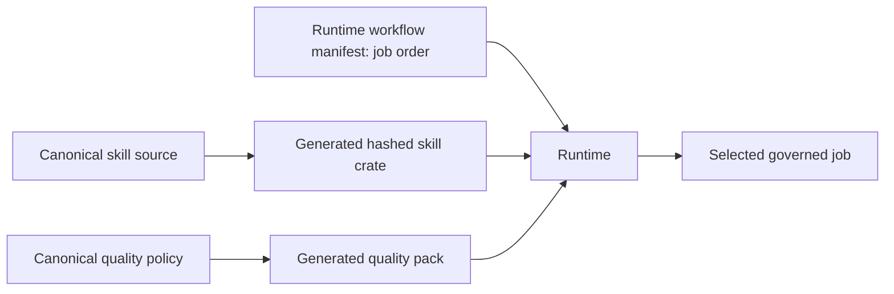
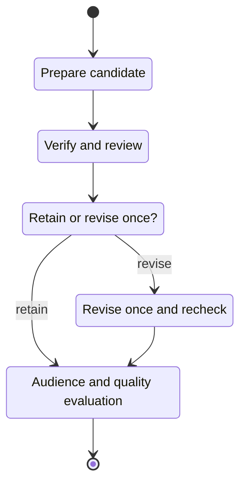

# Documentation skills

This directory is the canonical catalog of reusable DocsFab documentation
expertise. Skills define role methods and expected artifacts. Runtime controls
workflow order, tools, write authority, execution, and delivery. Product
evidence-gathering procedures live in [`../knowledge/skills/`](../knowledge/README.md).

Cursor skills under the repository's `.cursor/skills/` guide contributors;
they are not DocsFab product skills. From a target repository, start a governed
workflow with:

```sh
docsfab run review-documentation --context-path docs/get-started/quickstart.md
```

Use `--repo /absolute/path/to/target-repo` to select another repository. See
the [workflow guide](../../docs/workflows/run-a-documentation-workflow.md) for
inputs and write authorization.

## Relationship to the runtime



The closed-job contract has three pins: **A** identifies the job,
**B** binds skill bytes and tools, and **C** binds quality-bar IDs. Runtime
workflow manifests define A; this catalog supplies B; `packages/quality/`
supplies C. Runtime generates the hashed skill crate under
`packages/runtime/skill-crate/` and stages quality assets under
`packages/runtime/quality/`; `packages/runtime/quality-pack/manifest.json`
binds the quality lock to the skill lock. These runtime paths are generated
staging, not authoring roots. Runtime mounts the selected locked assets
read-only. A skill never schedules another skill, and files on disk alone do
not activate one. Change the canonical skill or quality sources, then
regenerate their runtime staging files as described below.

`docsfab run` accepts workflow IDs, not skill IDs. `live-agent` can select an
available locked skill, an ordered skill sequence, or a workflow; direct skill
use still needs its required inputs and host write authorization. Read the
[workflow guide](../../docs/workflows/run-a-documentation-workflow.md) and
[live-agent quickstart](../../docs/get-started/live-agent-quickstart.md) for
those entry points.

## Skill catalog

| Skill | Responsibility |
| --- | --- |
| [assess-documentation-readiness](assess-documentation-readiness/SKILL.md) | Assess agent input or explain governed release evidence without granting release authority. |
| [audit-documentation](audit-documentation/SKILL.md) | Set a focused or full scope, inventory coverage, and return evidence-backed findings. |
| [doc-context-analyzer](doc-context-analyzer/SKILL.md) | Compare repository foundations with registered evidence and report gaps or conflicts. |
| [tpl-design-ia](tpl-design-ia/SKILL.md) | Recommend a source-backed information architecture for a fixed task. |
| [template-scaffold-site](template-scaffold-site/SKILL.md) | Explain and verify prerequisites for an approved site scaffold. |
| [plan-documentation](plan-documentation/SKILL.md) | Gather sources, resolve the reader task, and bind the approved page set. |
| [write-documentation](write-documentation/SKILL.md) | Create or edit documentation within approved scope. |
| [lint-documentation](lint-documentation/SKILL.md) | Report repository-native deterministic checks and unavailable coverage. |
| [verify-technical-accuracy](verify-technical-accuracy/SKILL.md) | Inventory source facts and compare them with candidate passages. |
| [review-documentation](review-documentation/SKILL.md) | Independently assess clarity, audience fit, structure, and reader impact. |
| [test-audience-understanding](test-audience-understanding/SKILL.md) | Measure understanding with a frozen oracle and qualified participants. |
| [evaluate-document-quality](evaluate-document-quality/SKILL.md) | Reconcile evidence, applicable rubric scores, layered decisions, and gaps. |

## Workflow paths

Runtime manifests in `packages/runtime/workflows/` define the executable
sequences. The portable narratives in `workflows/` use the same workflow IDs;
they explain pinned stages and do not register jobs. Creation and update use
different branches: creation runs independent checks before a retain-or-revise
decision, while update chooses between authoring and an evidence-backed
no-change assessment. See the exact [create manifest](../runtime/workflows/create-documentation.json)
and [update manifest](../runtime/workflows/update-documentation.json).

<details>
<summary>Workflow steps and branch behavior</summary>



This is a conceptual map of the create-documentation candidate path, not the
executable step list. See the linked [create manifest](../runtime/workflows/create-documentation.json)
for the exact sequence and branch checks.

Creation and update intentionally use different manifests and decisions.
Creation begins by collecting related content or source code. It derives
source obligations in inventory-only mode, writes and lints, runs a provisional
technical comparison and independent review, then performs a fresh technical
verification before the revision decision. The retain path proceeds to
audience testing; revise performs one correction, then lint, provisional and
fresh technical checks, review, audience testing, and quality evaluation.
Update stays on schema version 2. Its author branch derives source obligations
after planning; it does not include create's provisional verification pair.
The no-change branch skips writing and linting and needs independent evidence.
An update preserves its bound operation even for a long or mixed-purpose page;
it does not silently become a restructure.

The `bootstrap` job uses `repo-bootstrap` for one governed write step, confined
to authorized `README.md` and `AGENTS.md` paths. Missing facts or unresolved
guidance conflicts return questions without edits. The workflow does not
grant publication or merge authority.

Other manifests compose these paths:

| Workflow | Ordered skills or outcome |
| --- | --- |
| `readiness` | `assess-documentation-readiness` with source-readiness evidence. |
| `release-documentation-readiness` | The readiness skill with the governed release rubric and host-projected disposition. |
| `review-documentation` | Audit, source-obligation inventory, lint, provisional and fresh technical verification, review, audience test, evaluation. |
| `restructure-documentation` | Audit, plan, source-obligation inventory, write, lint, technical verification, review, audience test, evaluation. |

Update uses a separate schema v2 branch after planning:

| Branch | Ordered work |
| --- | --- |
| `author` | Source-obligation inventory, write, lint, technical verification, review, audience test, evaluation. |
| `assess-no-change` | Technical verification, review, audience test, evaluation; no writing or linting. |

`write-documentation` supports authoring and focused polish. A direct editing
request uses the approved target and correction as its brief; workflow writing
keeps the supplied plan binding. Review remains independent and read-only. An
audience prerequisite check without a participant records an evidence gap, not
observed understanding or a quality pass.

</details>

<details>
<summary>Maintaining compact methods</summary>

## Maintaining and validating skills

Keep essential scope, authority, and evidence rules in each `SKILL.md`; put
conditional examples and methods in linked references. Skills remain
self-contained except for explicit shared quality assets. A reference adds
neither tool grants nor workflow steps. The
[distillation map](DISTILLATION.md) records methods retained, adapted, or
excluded for its covered skills. [`EXECUTION_CONTRACT.md`](EXECUTION_CONTRACT.md)
defines the portable governed HTML interface.

After changing canonical skill sources, regenerate the runtime skill crate and
comparison kit from `packages/runtime`:

```sh
npm run generate:pins
npm run generate:model-comparison-kit
npm run check:static
npm run check:pins
npm run check:kit
```

The skill crate is one release unit. For root quality checks, run:

```sh
make validate
make test
make smoke
```

</details>

## License

Skill instructions and documentation are licensed under CC-BY-4.0; scripts
and other source code are licensed under Apache License 2.0. See the
[`LICENSE`](LICENSE) in this directory for both license texts. Each `SKILL.md`
declares `Apache-2.0 AND CC-BY-4.0` in its frontmatter.
